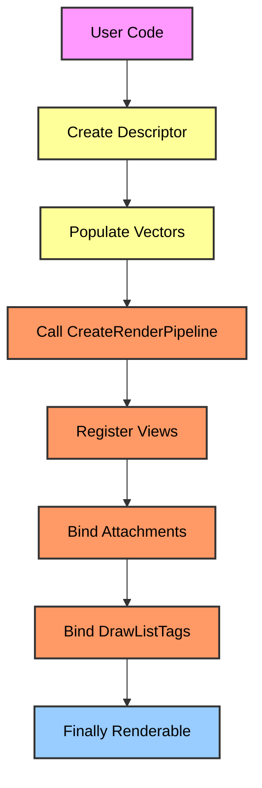
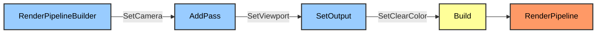
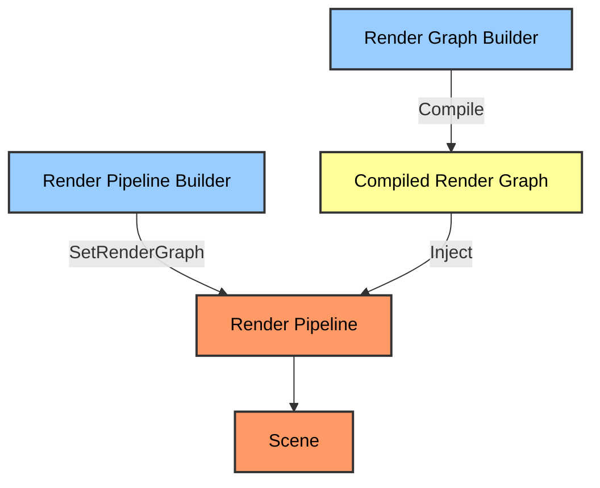

# Method 3: API Ergonomics (Fluent Interfaces & Builders)

### The Problem: API Friction and Boilerplate

Look at the current `RenderPipeline.h` and `Scene.h`. The API forces a multi-step, imperative initialization sequence. To create a render pipeline, you must:

1.  Instantiate a `RenderPipelineDescriptor`.
2.  Populate the descriptor's internal vectors and fields.
3.  Call `RenderPipeline::CreateRenderPipeline(desc)`.
4.  Manually register `PipelineViews` via `SetPersistentView` or `AddTransientView`.
5.  Manually bind `PassAttachmentBindings` and `DrawListTags`.

This is boilerplate. It forces the developer to understand the engine's internal data structures just to set up a basic rendering state. It is error-prone because the descriptor allows partially initialized states. If you forget a field, you get a runtime crash. If you pass the wrong `AZ::Name`, you get a silent rendering failure.

The API leaks implementation details. `RHI::DrawListTag`, `RHI::PipelineStateDescriptor`, and `AZ::RPI::PassAttachmentBinding` should not be exposed to the high-level user unless they are writing a custom RHI backend. The current API makes the user responsible for the engine's bookkeeping.



### The Solution: The Builder Pattern & Fluent Interfaces

We introduce a `RenderPipelineBuilder` that uses method chaining. The builder accumulates configuration state, validates it internally, and constructs the final object in a single `Build()` call. This eliminates partially initialized states and reduces the API surface to a handful of readable methods.



### Before vs. After: The Code Difference

**Current Atom API (Imperative, Leaky):**
```cpp
// 1. Create Descriptor
AZ::RPI::RenderPipelineDescriptor desc;
desc.m_name = AZ::Name("MainPipeline");
desc.m_rootPassTemplate = AZ::Name("MainPassTemplate");
desc.m_mainViewTagName = AZ::Name("MainCamera");

// 2. Create Pipeline
AZ::RPI::RenderPipelinePtr pipeline = AZ::RPI::RenderPipeline::CreateRenderPipeline(desc);

// 3. Create and Register View
AZ::RPI::ViewPtr view = AZ::RPI::View::CreateView(AZ::Name("MainCamera"), AZ::RPI::View::UsageCamera);
view->SetCameraTransform(cameraTransform);
pipeline->SetPersistentView(AZ::Name("MainCamera"), view);

// 4. Manually bind attachments to passes
AZ::RPI::Ptr<AZ::RPI::Pass> forwardPass = pipeline->FindFirstPass(AZ::Name("ForwardPass"));
if (forwardPass) {
    AZ::RPI::PassAttachmentBinding* binding = forwardPass->FindAttachmentBinding(AZ::Name("Output"));
    if (binding) {
        binding->m_unifiedScopeDesc.m_loadStoreAction.m_clearValue = clearColor;
    }
}

// 5. Add to Scene
scene->AddRenderPipeline(pipeline);
```

**Proposed Fluent API (Declarative, Safe):**
```cpp
// 1. Builder chaining (all in one expression)
Atom::RPI::RenderPipelineBuilder builder;

auto pipeline = builder.SetName("MainPipeline")
                       .SetRootPassTemplate("MainPassTemplate")
                       .SetCamera(view)
                       .SetViewport(0, 0, 1920, 1080)
                       .SetClearColor(Atom::Color(0.1f, 0.1f, 0.1f, 1.0f))
                       .AddPass<ForwardPass>("ForwardPass")
                       .AddPass<ToneMappingPass>("ToneMappingPass")
                       .Build();

// 2. Add to Scene (Pipeline handles internal attachment binding automatically)
scene->AddRenderPipeline(pipeline);
```

### Internals: How the Builder Works

The builder is not just syntactic sugar. It is a state machine that validates inputs before construction.

```cpp
namespace Atom::RPI {

class RenderPipelineBuilder {
public:
    RenderPipelineBuilder& SetName(const AZ::Name& name) {
        m_name = name;
        return *this;
    }

    RenderPipelineBuilder& SetCamera(ViewPtr camera) {
        m_camera = camera;
        return *this;
    }

    RenderPipelineBuilder& SetClearColor(const AZ::Color& color) {
        m_clearColor = color;
        return *this;
    }

    template<typename PassType>
    RenderPipelineBuilder& AddPass(const AZ::Name& passName) {
        m_pendingPasses.push_back({ passName, typeid(PassType) });
        return *this;
    }

    AZ::RPI::RenderPipelinePtr Build() {
        // 1. Validate required fields
        if (m_name.IsEmpty()) {
            AZ_Error("RenderPipelineBuilder", false, "Pipeline name is required.");
            return nullptr;
        }
        if (!m_camera) {
            AZ_Error("RenderPipelineBuilder", false, "Camera is required.");
            return nullptr;
        }

        // 2. Create the descriptor internally
        AZ::RPI::RenderPipelineDescriptor desc;
        desc.m_name = m_name;
        desc.m_mainViewTagName = AZ::Name("MainCamera");
        
        // 3. Create the pipeline
        AZ::RPI::RenderPipelinePtr pipeline = AZ::RPI::RenderPipeline::CreateRenderPipeline(desc);

        // 4. Bind the camera view
        pipeline->SetPersistentView(desc.m_mainViewTagName, m_camera);

        // 5. Create and inject passes
        for (auto& [passName, passType] : m_pendingPasses) {
            // Use the PassFactory to instantiate the pass dynamically
            auto pass = PassFactory::CreatePass(passType, passName);
            pipeline->GetRootPass()->InsertChild(pass, nullptr); // Append to end
        }

        // 6. Configure clear color on the first pass that writes to the backbuffer
        auto firstPass = pipeline->FindFirstPass(m_pendingPasses.front().first);
        if (firstPass) {
            auto* binding = firstPass->FindAttachmentBinding(AZ::Name("Output"));
            if (binding) {
                binding->m_unifiedScopeDesc.m_loadStoreAction.m_clearValue = m_clearColor;
            }
        }

        return pipeline;
    }

private:
    AZ::Name m_name;
    ViewPtr m_camera;
    AZ::Color m_clearColor;
    AZStd::vector<AZStd::pair<AZ::Name, std::type_index>> m_pendingPasses;
};

} // namespace Atom::RPI
```

### Strong Typing and Compile-Time Safety

The current API relies heavily on `AZ::Name` (string lookups) for things like `PipelineViewTag`, `PassName`, and `AttachmentName`. This is a runtime disaster waiting to happen. A typo in a string results in a silent failure or a crash deep in the render graph.

Method 3 introduces **Strong Types** (Wrapper types around IDs or strings) that are validated at compile time or during graph construction.

```cpp
// Current (Runtime string lookup)
pipeline->SetPersistentView(AZ::Name("MainCamera"), view); // Typo: "MainCamrea" -> silent fail

// Proposed (Compile-time type safety)
struct PipelineViewTag {
    static constexpr AZ::Name MainCamera = AZ::Name("MainCamera");
    static constexpr AZ::Name ShadowMap = AZ::Name("ShadowMap");
};

pipeline->SetPersistentView(PipelineViewTag::MainCamera, view); // Typo impossible
```

### RAII and Automatic Resource Management

The builder pattern must also handle resource lifetimes. Instead of returning raw pointers (`AZ::RPI::Ptr<T>`), the builder returns smart pointers that automatically clean up transient resources when the pipeline is destroyed or rebuilt.

```cpp
// Current: Manual cleanup required
AZ::RPI::PassAttachmentBinding* binding = forwardPass->FindAttachmentBinding(AZ::Name("Output"));
// Who frees the transient texture attached here? The user has to track it.

// Proposed: RAII wrapper
class ScopedTransientTexture {
public:
    ScopedTransientTexture(RHI::TextureHandle handle, RHI::Heap* heap) 
        : m_handle(handle), m_heap(heap) {}
    
    ~ScopedTransientTexture() {
        m_heap->Free(m_handle); // Automatically freed when scope ends
    }
private:
    RHI::TextureHandle m_handle;
    RHI::Heap* m_heap;
};
```

### Integration with Method 2 (Render Graph)

The Fluent Builder API is the perfect companion to the Render Graph (Method 2). The `RenderGraphBuilder` from Method 2 is already a fluent interface. Method 3 extends that philosophy to the entire engine architecture.

Instead of building a `RenderPipeline` with a `PassTree`, the pipeline builder can directly accept a `CompiledRenderGraph`.

```cpp
// Combining Method 2 and Method 3
auto compiledGraph = renderGraphBuilder.Compile();

auto pipeline = RenderPipelineBuilder()
                    .SetName("MainPipeline")
                    .SetCamera(mainCamera)
                    .SetRenderGraph(compiledGraph) // Inject the Render Graph
                    .SetClearColor(Atom::Color::Black)
                    .Build();
```



### Migration Strategy

We cannot break the existing API overnight. O3DE's Editor and built-in Gems rely on `RenderPipeline::CreateRenderPipeline(desc)`.

**Phase 1: The Builder Wrapper (C++)**
Implement `RenderPipelineBuilder` in `Atom/RPI`. It internally calls the existing `CreateRenderPipeline` and `SetPersistentView` methods. This is purely additive. No existing code breaks.

**Phase 2: Strong Types (C++)**
Introduce `PipelineViewTag`, `PassName`, and `AttachmentName` strong types. Provide implicit conversion operators to `AZ::Name` so the old API still works, but encourage the new API to use the strong types.

**Phase 3: Deprecation Warnings**
Mark the old `RenderPipelineDescriptor` and `CreateRenderPipeline` functions with `[[deprecated("Use RenderPipelineBuilder instead.")]]`. This forces internal O3DE developers to migrate their code.

**Phase 4: Internal Rewrite (O3DE Gems)**
Rewrite O3DE's built-in rendering Gems (Atom_Feature_Common, Atom_Bootstrap) to use `RenderPipelineBuilder`. This validates the API in a production environment.

**Phase 5: Removal**
Once all internal and external dependencies have migrated, remove the deprecated `RenderPipelineDescriptor` and `CreateRenderPipeline` functions entirely.