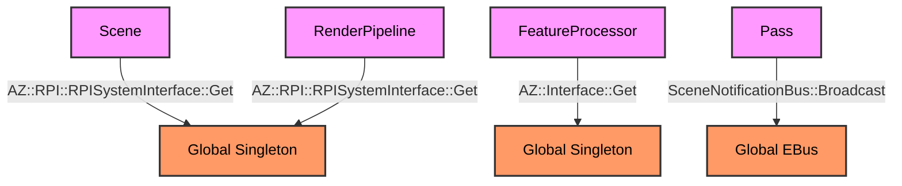
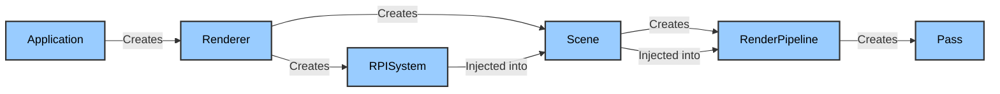
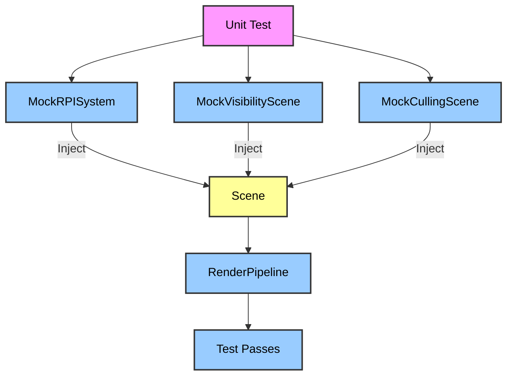

### The Problem: Global State and Hidden Dependencies

Look at the current Atom codebase. It is a spiderweb of global singletons and `EBus` (Event Bus) broadcasts. 

In `Scene.h`, the `Scene` class reaches out to `AZ::RPI::RPISystemInterface::Get()`. In `main.cpp`, the user grabs the `RPISystemInterface` via a global call. The `RenderPipeline` connects to the `SceneNotificationBus`. The `FeatureProcessors` use `AZ::Interface<T>::Get()` to find each other.

This is a service locator anti-pattern. The code hides its dependencies. When you instantiate a `Scene`, you have no idea from the header what external systems it requires. It might need the RPI System, the Settings Registry, the Asset Manager, or the Console. You won't find out until you hit a null pointer dereference at runtime. 

It also makes unit testing impossible. You cannot instantiate a `Scene` in a test without booting up the entire `ComponentApplication`, the `SettingsRegistry`, and the global `AZ::Interface` system. The global state leaks everywhere. Multi-threaded rendering becomes a nightmare because every thread is competing for the same global `RPISystemInterface`.



### The Solution: Explicit Ownership via DI

Dependency Injection (DI) means passing dependencies explicitly through constructors or initialization methods. Instead of `Scene` asking the world for an `RPISystem`, the `Application` creates the `RPISystem` and passes it directly to the `Scene`.

This makes ownership explicit. The `Application` owns the `RPISystem`. The `Application` owns the `Scene`. The `Scene` owns the `RenderPipeline`. The `RenderPipeline` owns the `Pass`. If a class needs access to a system, it receives a reference or pointer to it.



### Technical Implementation: The Code Shift

We start by changing the constructors. No more default constructors that secretly grab globals.

**Current `Scene` Initialization (Global State):**
```cpp
// Inside Scene.cpp
Scene::Scene() {
    // Where did this come from? Who owns it?
    m_rpiSystem = AZ::RPI::RPISystemInterface::Get(); 
    m_dynamicDrawSystem = m_rpiSystem->GetDynamicDrawSystem();
    m_visibilityScene = aznew AzFramework::VisibilityScene();
    m_cullingScene = aznew AZ::RPI::CullingScene();
}
```

**Proposed `Scene` Initialization (Dependency Injection):**
```cpp
// Inside Scene.h
class Scene {
public:
    // Explicit dependencies required in the constructor
    Scene(RPISystem* rpiSystem, AzFramework::VisibilityScene* visibilityScene, CullingScene* cullingScene);
    
private:
    RPISystem* m_rpiSystem = nullptr; // Raw pointer, not owning
    AzFramework::VisibilityScene* m_visibilityScene = nullptr;
    CullingScene* m_cullingScene = nullptr;
};

// Inside Scene.cpp
Scene::Scene(RPISystem* rpiSystem, AzFramework::VisibilityScene* visibilityScene, CullingScene* cullingScene)
    : m_rpiSystem(rpiSystem)
    , m_visibilityScene(visibilityScene)
    , m_cullingScene(cullingScene) 
{
    AZ_Assert(m_rpiSystem, "RPISystem cannot be null.");
    m_dynamicDrawSystem = m_rpiSystem->GetDynamicDrawSystem();
}
```

**The Application/Renderer takes control:**
```cpp
// Inside the new Atom::Renderer class
class Renderer {
public:
    void Initialize() {
        m_rpiSystem = AZStd::make_unique<RPISystem>();
        m_visibilityScene = AZStd::make_unique<AzFramework::VisibilityScene>();
        m_cullingScene = AZStd::make_unique<AZ::RPI::CullingScene>();
        
        m_scene = AZStd::make_unique<Scene>(m_rpiSystem.get(), m_visibilityScene.get(), m_cullingScene.get());
    }
};
```

### Removing `EBus` for Point-to-Point Communication

`EBus` (Event Bus) is a broadcast system. It is useful when a publisher has no idea who the subscribers are, and there are multiple subscribers. But in the rendering pipeline, the dependencies are rigid. A `RenderPipeline` knows exactly which `Scene` it belongs to. A `Pass` knows exactly which `RenderPipeline` it belongs to. 

Using `EBus` for these point-to-point relationships hides the dependency. The `SceneNotificationBus` is a prime example. A `RenderPipeline` connects to the `Scene`'s notification bus. If you remove the `Scene` from the equation, the `RenderPipeline` silently fails to connect, and nothing renders. There is no compile-time error.

We replace `EBus` with `AZ::Event` (a lightweight multicast delegate) or standard C++ callbacks.

**Current `EBus` Approach (Hidden Coupling):**
```cpp
// In RenderPipeline.h
class RenderPipeline : public SceneNotificationBus::Handler {
    // Connects via BusConnect(scene->GetId()) internally
    void OnRenderPipelineChanged(...) override;
};

// In Scene.cpp
void Scene::AddRenderPipeline(RenderPipelinePtr pipeline) {
    m_pipelines.push_back(pipeline);
    // The pipeline silently connects to the EBus here
    pipeline->OnAddedToScene(this); 
}
```

**Proposed `AZ::Event` Approach (Explicit Coupling):**
```cpp
// In Scene.h
class Scene {
public:
    // Expose an explicit event handler
    AZ::Event<RenderPipeline*, RenderPipelineChangeType>::Handler m_pipelineChangedEvent;
};

// In RenderPipeline.h
class RenderPipeline {
public:
    // The Scene passes its event handler directly to the pipeline
    RenderPipeline(Scene* scene) {
        m_scene = scene;
        // Explicitly connect to the Scene's event
        m_scene->m_pipelineChangedEvent.Connect(m_pipelineChangedHandler);
    }
private:
    AZ::Event<RenderPipeline*, RenderPipelineChangeType>::Handler m_pipelineChangedHandler;
    void OnPipelineChanged(RenderPipeline* pipeline, RenderPipelineChangeType changeType);
};
```

### The Service Locator Fallback

True Dependency Injection is the goal. However, rewriting every single `AZ::Interface<T>::Get()` call across the entire engine at once is impossible. We introduce a **Scoped Service Locator** for the transitional period. 

Instead of a global static `RPISystemInterface::Get()`, we create a `RendererContext` struct that is passed down.

```cpp
struct RendererContext {
    RPISystem* m_rpiSystem;
    RHI::Device* m_rhiDevice;
    AssetManager* m_assetManager;
    IConsole* m_console;
};

// The Scene receives the context, not the individual globals
Scene::Scene(const RendererContext& context) 
    : m_context(context) 
{
    m_rpiSystem = m_context.m_rpiSystem;
}

// The RenderPipeline receives the context from the Scene
RenderPipeline::RenderPipeline(Scene* scene, const RendererContext& context) 
    : m_scene(scene), m_context(context) 
{
    // Use m_context.m_rhiDevice directly, no global lookup needed
}
```

### Unit Testing: The Ultimate Validation

The true test of this architecture is unit testing. With DI, we can instantiate a `Scene` in a test without booting the `ComponentApplication`.

```cpp
// Unit Test
TEST(SceneTest, AddRenderPipeline) {
    // 1. Create mock dependencies
    MockRPISystem mockRpiSystem;
    MockVisibilityScene mockVisibilityScene;
    MockCullingScene mockCullingScene;
    
    // 2. Inject them into the Scene
    Scene scene(&mockRpiSystem, &mockVisibilityScene, &mockCullingScene);
    
    // 3. Create a pipeline (injecting the scene)
    RenderPipeline pipeline(&scene);
    
    // 4. Test the behavior
    scene.AddRenderPipeline(&pipeline);
    
    EXPECT_EQ(scene.GetRenderPipelines().size(), 1);
    
    // 5. Verify the mock was called correctly
    EXPECT_CALL(mockRpiSystem, GetDynamicDrawSystem()).Times(1);
}
```

This is impossible with the current global singleton architecture. The global `RPISystemInterface::Get()` would return a real `RPISystem` (or null if the engine isn't booted), crashing the test.



### Migration Strategy

We cannot rip out every global singleton overnight. We use the **Strangler Fig** pattern.

**Phase 1: Dual Constructors**
Add a new constructor to `Scene`, `RenderPipeline`, and `Pass` that accepts injected dependencies. Keep the old default constructor that uses `AZ::Interface<T>::Get()` for backward compatibility. The old constructor delegates to the new one by grabbing the globals and passing them in.

```cpp
// Old Constructor (Deprecated)
Scene::Scene() : Scene(AZ::RPI::RPISystemInterface::Get(), 
                       AZ::Interface<AzFramework::IVisibilityScene>::Get(), 
                       AZ::Interface<AZ::RPI::CullingScene>::Get()) {}
```

**Phase 2: Migrate Internal O3DE Code**
Rewrite O3DE's built-in Gems (`Atom_Feature_Common`, `Atom_Bootstrap`) to use the new constructors. Pass the dependencies down from the `RPISystem` explicitly.

**Phase 3: Deprecate and Remove**
Mark `AZ::RPI::RPISystemInterface::Get()` with `[[deprecated("Use Dependency Injection instead.")]]`. Once all internal and external code has migrated, remove the global singleton entirely.

**Phase 4: Thread Safety**
With DI, we can create multiple `Scene` instances on different threads, each with their own `RPISystem` and `RendererContext`. This unlocks multi-threaded rendering and parallel scene updates without mutex contention on global singletons.