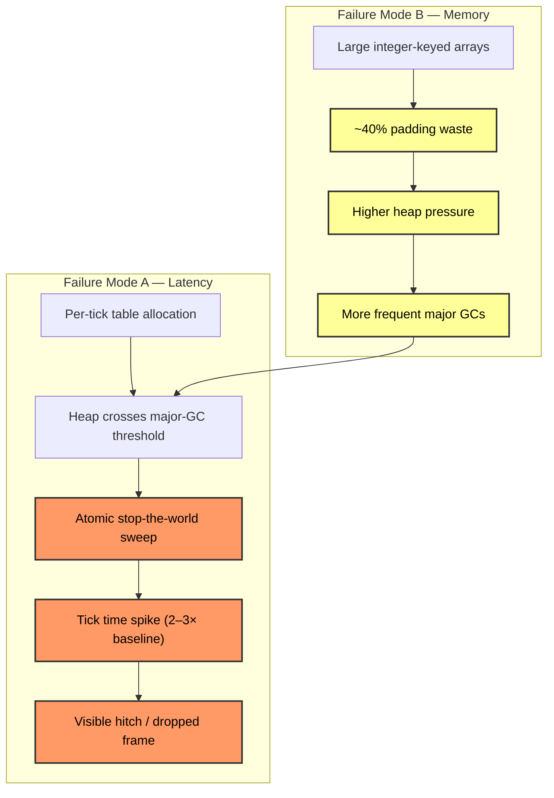
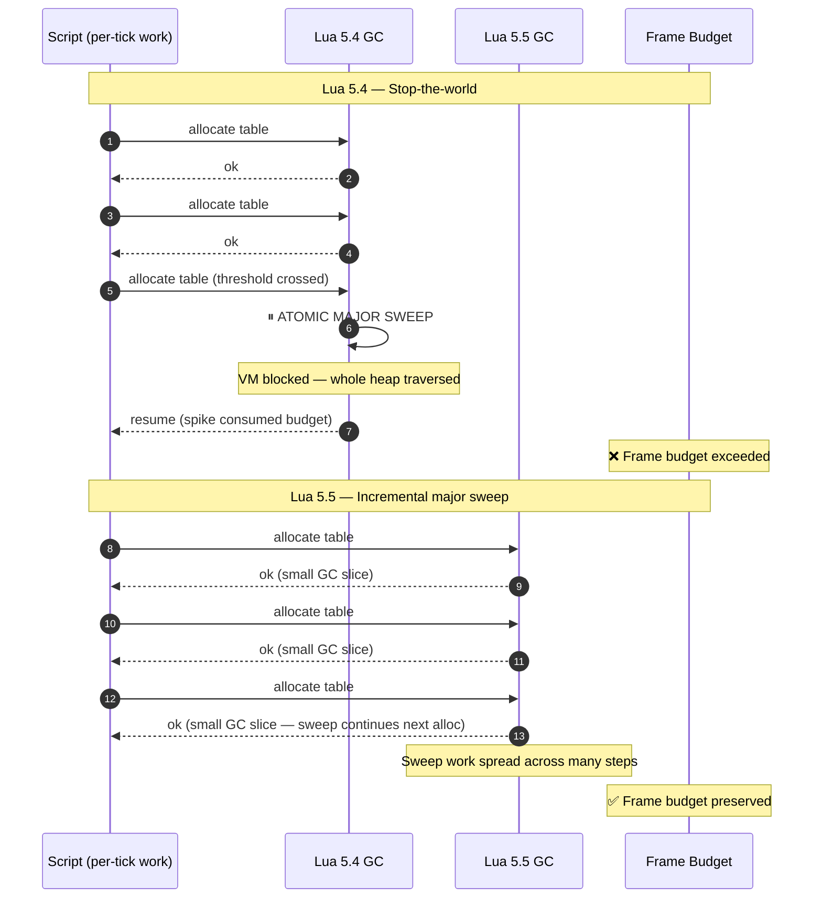
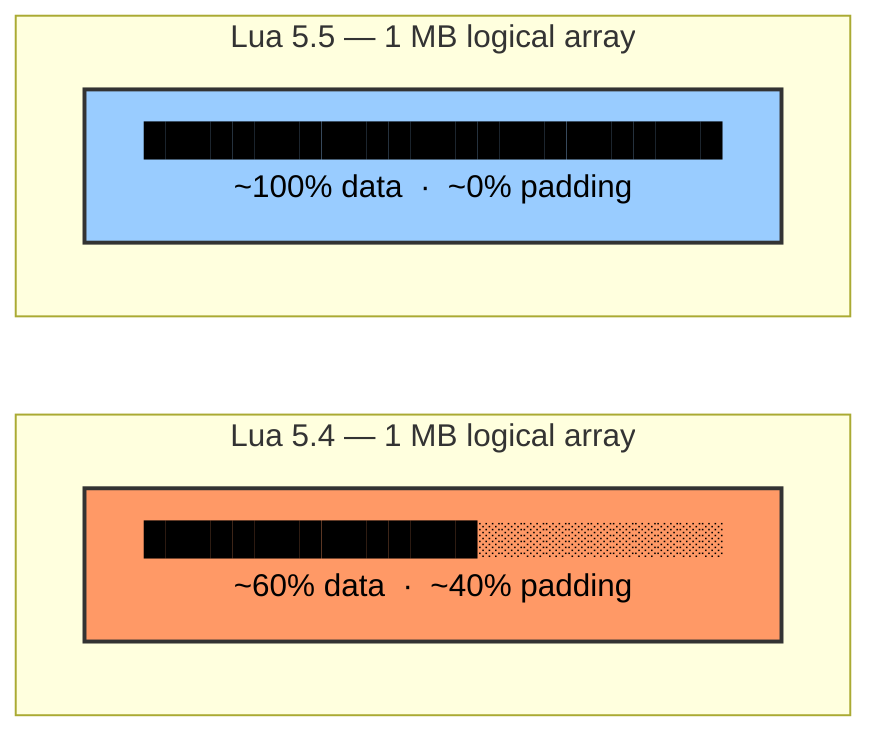
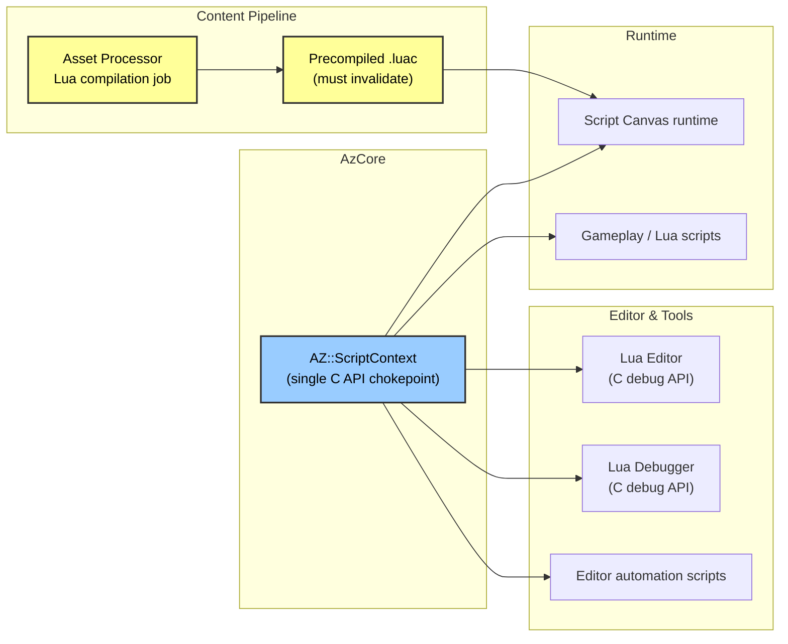
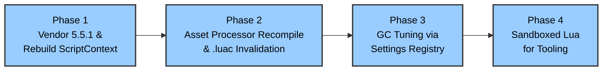
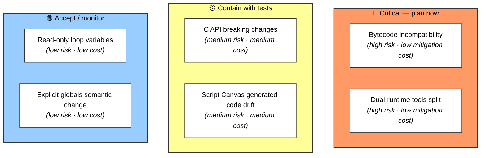

# Method 8: Lua 5.5.1 — Deterministic GC & Modernized Scripting

---


## Executive Summary

O3DE ships Lua 5.4.4. Its garbage collector pauses the whole VM during major collections, and its large-array representation wastes ~40% of memory on padding. Both effects surface as **unpredictable tick-time spikes** in Script Canvas and Lua tooling, and both are fixed structurally in **Lua 5.5.1**. This method is not a language-feature upgrade — it is a **real-time determinism and scripting-usability upgrade**, and it is the cheapest high-leverage item in the optimization pass.

| Attribute | Detail |
|---|---|
| **Current runtime** | Lua 5.4.4 (vendored in AzCore) |
| **Target runtime** | Lua 5.5.1 (released 03 Aug 2026) |
| **Primary wins** | Deterministic tick time · ~60% smaller large arrays |
| **Secondary wins** | Sandboxing · better tooling · clearer script semantics |
| **Effort** | Medium — bounded by `AZ::ScriptContext` chokepoint |
| **Risk** | Low–Medium — bytecode invalidation, C API audit |

---

## 1. The Problem: Two Failure Modes, One Symptom

Lua 5.4's collector is not "slow" in aggregate — its *throughput* is fine. The problem is **when** it does the work: in indivisible chunks that block the VM. The two failure modes below are independent, but they compound: memory bloat triggers more collections, and each collection is an atomic pause.



### 1.1 Failure Mode A — Atomic Major Collections

Lua 5.4 uses a generational collector with two tunables: a **pause** parameter (default 200) that controls how long the collector waits before starting a new cycle, and a **step multiplier** that governs work-per-allocation. Minor collections traverse only young objects — frequent but cheap. **Major collections sweep the entire heap in one atomic operation.** There is no way to slice a major collection across ticks without patching the VM.

For Script Canvas, which allocates tables for variable maps, event payloads, and per-tick state, the heap crosses major-collection thresholds at irregular intervals that have **no correlation with rendering load**. The result is a frame-time histogram with a fat tail: most ticks are fast, and a small number are catastrophic.

### 1.2 Failure Mode B — Array Padding Waste

Lua 5.4 stores array parts with alignment padding. Sequential integer-keyed tables — the natural shape for entity ID lists, variable arrays, and per-tick data — carry **>40% memory overhead**. On a constrained budget (e.g. 256 KB for a scripting context), this is the difference between fitting 2.5× more data and thrashing the collector.

### 1.3 Why This Is an Engine Problem, Not a Scripting Problem

`AZ::ScriptContext` is the single Lua state shared by Script Canvas, the Lua Editor, gameplay systems, Asset Processor automation, and Editor tooling. There is no per-subsystem isolation. A GC pause triggered by an Editor automation script can stall a gameplay tick. **Lua's GC behaviour is therefore an engine-wide performance characteristic**, and it must be addressed at the runtime level — not patched per-caller.

---

## 2. The Solution: What Lua 5.5.1 Changes



### 2.1 Incremental Major Collections

Lua 5.5 spreads major-collection work across multiple VM steps instead of pausing. **Pause time becomes bounded and decoupled from heap size** — the property that makes Lua viable for latency-sensitive scripting.

### 2.2 Compact Arrays

Lua 5.5 stores large sequential integer-keyed arrays with roughly **60% less memory** for large arrays. The comparison below uses the same logical payload — the visual bar shows how much of the heap is *useful data* versus *padding waste*.



| | Lua 5.4 | Lua 5.5 | Change |
|---|---|---|---|
| Array payload | 1 MB logical | 1 MB logical | — |
| Heap footprint | ~1.67 MB | ~1.00 MB | **−40%** |
| Large-array waste | ~40% | ~0% | eliminated |

Lower heap pressure → fewer GC cycles → fewer opportunities for any pause at all. It is a compounding win.

### 2.3 Secondary Wins

| Change | Benefit |
|---|---|
| `table.create` | Pre-size arrays; avoid reallocation churn during per-tick table building |
| `luaL_openselectedlibs` | Whitelisted standard libraries — sandboxable script states |
| Read-only `for`-loop variables | Prevents accidental mutation of loop indices; static-analysis friendly |
| Explicit global declarations | Opt-in strict mode; clearer intent; better tooling |
| Debug-interface updates | New debugger surface — see §4 |

---

## 3. Integration Map: Where Lua 5.5 Touches O3DE



| Surface | Change required |
|---|---|
| `AZ::ScriptContext` | Rebuild against 5.5 headers; single audit point |
| Script Canvas runtime | Regenerate Lua code; precompile with 5.5 |
| Asset Processor Lua job | Emit 5.5 bytecode; invalidate `.luac` cache on first boot |
| Lua Editor / Debugger | Rebuild against 5.5 C debug API; add loop-variable mutation warnings |
| Editor automation | Same vendored runtime — no dual-runtime splits |

---

## 4. Usability & Associability Wins

The upgrade is not only a performance fix. **The new runtime semantics are a catalyst for making O3DE scripting more discoverable, safer, and less surprising** — a core goal of the broader optimization pass.

```mermaid
graph TD
    L55[Lua 5.5.1 Runtime] --> P[Performance]
    L55 --> U[Usability]
    L55 --> A[Associability]
    
    P --> P1[Deterministic tick time]
    P --> P2[Predictable memory budget]
    
    U --> U1[No GC hitch during debugging]
    U --> U2[Read-only loop vars → fewer silent bugs]
    U --> U3[table.create → clearer performance patterns]
    U --> U4[Explicit globals → intent visible in source]
    
    A --> A1["Error messages point to correct scope"]
    A --> A2["New scripters see less 'magic' behaviour"]
    A --> A3[luaL_openselectedlibs → sandboxed Editor scripting]
    
    style L55 fill:#9cf,stroke:#333,stroke-width:2px,color:#000
    style P1 fill:#9cf,stroke:#333,stroke-width:2px,color:#000
    style P2 fill:#9cf,stroke:#333,stroke-width:2px,color:#000
    style U1 fill:#9cf,stroke:#333,stroke-width:2px,color:#000
    style U2 fill:#9cf,stroke:#333,stroke-width:2px,color:#000
    style U3 fill:#9cf,stroke:#333,stroke-width:2px,color:#000
    style U4 fill:#9cf,stroke:#333,stroke-width:2px,color:#000
    style A1 fill:#9cf,stroke:#333,stroke-width:2px,color:#000
    style A2 fill:#9cf,stroke:#333,stroke-width:2px,color:#000
    style A3 fill:#9cf,stroke:#333,stroke-width:2px,color:#000
```



### 4.1 Usability Improvements

- **Debugger fidelity.** GC pauses in 5.4 masquerade as "the debugger is slow" or "stepping is stuck". With 5.5, step timing reflects script logic, not collector behaviour — a concrete relief for new scripters.
- **Fewer silent bugs.** Read-only loop variables eliminate a classic class of bug (accidental `i = i + 1` inside a `for` body) that currently produces wrong results with no warning.
- **Explicit globals.** Opt-in strict mode surfaces typos as errors rather than as silently `nil` variables — directly addressing one of the most common first-time-scripter failure modes.
- **`table.create` as a documented pattern.** Gives scripters a clear, engine-recommended way to allocate per-tick arrays without churn, with measurable benefit.

### 4.2 Associability Improvements

- **Sandboxed Editor scripting.** `luaL_openselectedlibs` enables a restricted Lua state for Editor automation with no `io`, no `os`, no `debug` — only `math`, `table`, and engine bindings. Fewer footguns, smaller blast radius, clearer failure modes.
- **Predictable memory budget.** Compact arrays make it possible to publish a per-script memory budget (`ScriptContext::GetMemoryUsage()` becomes a meaningful, stable number) — associable by tooling, dashboards, and CI gates.
- **Clearer boundaries.** With explicit globals and read-only loop variables, the *shape* of a script's state is legible from its source — both to humans and to static analysis.

---

## 5. Profiling Methodology (How to Validate the Problem Today)

Before committing to Phase 1, the claim should be reproducible.

**Instrument:**

```cpp
// Pseudocode — instrumentation hook
void OnTick(float dt) {
    size_t heapBefore = lua_gc(L, LUA_GCCOUNT, 0);
    auto t0 = Time::Now();
    scriptContext->ExecuteTick(dt);
    auto t1 = Time::Now();
    size_t heapAfter = lua_gc(L, LUA_GCCOUNT, 0);
    Profiler::Emit({ t0, t1, heapBefore, heapAfter });
}
```

**Correlate:** plot heap growth vs per-tick time. Major-GC events should appear as clusters of high-latency ticks immediately following heap-growth thresholds — the signature of atomic sweeps. Use the standard Script Canvas stress scene as the baseline workload.

**Post-upgrade gate:** the same histogram, re-run on 5.5.1, should show **no ticks above the 99th-percentile budget** attributable to GC. This becomes the acceptance criterion for Phase 1 sign-off.

---

## 6. Migration Strategy



### Phase 1 — Vendor & Rebuild *(Immediate)*
Replace vendored 5.4.4 sources in AzCore with 5.5.1. Rebuild `AZ::ScriptContext` and every C++ binding against the new headers. Run Script Canvas and Lua test suites. **No user-facing features — clean compile baseline.** Acceptance gate: 99th-percentile GC pause < 1 ms in the standard stress scene.

### Phase 2 — Asset Processor Recompile & Cache Invalidation *(Short-Term)*
Emit 5.5 bytecode; invalidate `.luac` on first boot (loading 5.4 bytecode into a 5.5 VM is undefined behaviour). Ship `.lua` source fallback for projects that disable precompilation.

### Phase 3 — GC Tuning *(Medium-Term)*
Expose incremental-GC parameters via the Settings Registry. Allow performance-sensitive contexts (Script Canvas runtime, Editor automation) to run with tighter step budgets — or disable automatic GC for short-lived tooling.

### Phase 4 — Sandboxed Lua *(Long-Term)*
Adopt `luaL_openselectedlibs` for Editor automation and pipeline scripts. Register only `AZ::BehaviorContext` types plus a minimal standard library.

---

## 7. Risk Register



| Risk | Severity | Mitigation |
|---|---|---|
| **5.4 bytecode incompatible with 5.5 VM** | 🔴 High | Asset Processor invalidates `.luac` cache; `.lua` source always recompiled |
| **Dual Lua runtimes in tools** | 🔴 High | Audit every target linking Lua; vendored 5.5.1 is the single source for AzCore, Asset Processor, Editor |
| **C API breaking changes** | 🟡 Medium | Phase 1 surfaces at compile time; `ScriptContext` is the single chokepoint |
| **Script Canvas generated code relies on 5.4 semantics** | 🟡 Medium | Regenerate with 5.5 compiler; generated code is machine-emitted and auditable |
| **`for` loop variables become read-only** | 🟢 Low | Lua Editor static analysis flags assignments to loop variables |
| **Explicit global declarations** | 🟢 Low | Compatibility mode preserves existing scripts; new scripts may opt into strict |

---

## 8. Why This Belongs in the Optimization Pass

Every optimization in this pass assumes a scripting layer that does not sabotage tick-time determinism. Lua 5.4 is that saboteur: its atomic major GC and array memory bloat introduce **latency spikes from outside the C++ hot path**, which no amount of engine-side optimization can eliminate. Lua 5.5 removes those spikes structurally — incremental major collections bound pause time, and compact arrays reduce the heap growth that triggers collection at all.

Crucially, the upgrade is **also a usability milestone**. Read-only loop variables, explicit globals, `table.create`, and `luaL_openselectedlibs` are not performance features — they are concrete improvements to how scripters *see and shape* their code. They give us a defensible story for the TSC/TAC: **this is how we make O3DE scripting both faster and easier to reason about at the same time.**

The upgrade is additive, bounded, and low-risk relative to the architectural rewrites in the rest of the pass. It changes no C++ rendering path. It preserves Script Canvas graph semantics. And it makes every other scripting-adjacent optimization in this pass observable in frame-time histograms.

> **Lua 5.5.1 is not a language feature upgrade. It is a real-time determinism and scripting-usability upgrade.**