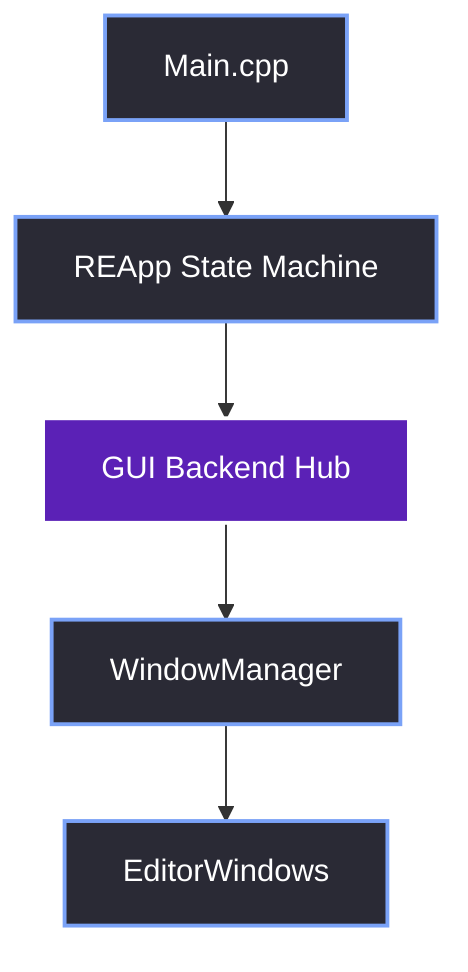

# Dear ImGui Editor Architecture
### A Chogan Studios Technical Notes on ImGui in Vulkan and GLFW

> [!info] Welcome
> I am Astin. This vault is the definitive technical reference for how we built the Red Editor interface from the ground up. 
> 
> The Red Editor is the standalone editor application for the Red Reality Engine (RR). We built its UI using Dear ImGui, Vulkan, GLFW, and Win32. Along the way, we hit severe architectural bottlenecks, threading deadlocks, and OS-level windowing bugs. This document is the collection of everything we learned. I wrote this to serve as both a reference manual for our team and a personal engineering blog of the war stories behind the code.

---

### Metadata

| Field | Value |
| :--- | :--- |
| **Author** | Astin |
| **Publisher** | Chogan Studios |
| **Application** | Red Editor |
| **Engine** | Red Reality Engine (RR) |
| **Tech Stack** | C++20 · Dear ImGui 1.93.0 (docking) · Vulkan · GLFW · Win32 API |
| **Platform** | Windows 10 / 11 |
| **License** | Chogan Studios Internal Technical Documentation |

---

### The Big Picture

We designed the Red Editor in five distinct layers. Data flows downward (input/events), and ownership flows upward.

---

### 01. Getting Started
- [[01.01 Introduction]]
- [[01.02 Prerequisites]]
- [[01.03 Tech Stack Overview]]
- [[01.04 Minimal Working Example]]

### 02. Architecture
- [[02.01 High-Level Architecture]]
- [[02.02 Layered Design]]
- [[02.03 Application State Machine]]
- [[02.04 Main Loop & Frame Lifecycle]]

### 03. Backend (GUI Infra)
- [[03.01 GUI Class as Infrastructure Hub]]
- [[03.02 Vulkan & ImGui Initialization]]
- [[03.03 Swapchain & Resize Handling]]
- [[03.04 Multi-Viewport Setup]]
- [[03.05 Texture Loading (ImGui 1.93+)]]
- [[03.06 Descriptor Pool Configuration]]
- [[03.07 Vulkan Validation Layers]]
- [[03.08 GPU Selection]]

### 04. Windowing & Custom Frame
- [[04.01 GLFW Window Creation]]
- [[04.02 Borderless Window & Win32 Hooks]]
- [[04.03 Custom ImGui Title Bar]]
- [[04.04 Dragging, Resizing, Aero Snap]]
- [[04.05 Handling Minimize & Maximize]]
- [[04.06 Per-Monitor DPI Awareness]]
- [[04.07 Window Icon & Taskbar]]

### 05. Modular Window System
- [[05.01 EditorWindow Base Class]]
- [[05.02 WindowManager & Docking]]
- [[05.03 Adding a New Editor Window]]
- [[05.04 Pinning & Context Menus]]
- [[05.05 Dock Layout Persistence]]
- [[05.06 Drag-and-Drop Between Windows]]

### 06. Theming & Fonts
- [[06.01 Theme Registry & Switching]]
- [[06.02 ImGui Style Customization]]
- [[06.03 FreeType Font Integration]]
- [[06.04 Runtime Theme Switching]]

### 07. Asynchronous UI
- [[07.01 ThreadPool]]
- [[07.02 UIEventQueue]]
- [[07.03 Splash Screen Example]]
- [[07.04 Avoiding ImGui Thread-Safety Issues]]
- [[07.05 Cancellable Tasks]]

### 08. Editor Windows Deep Dive
- [[08.01 Launcher UI (Dynamic Layout)]]
- [[08.02 Console Window (Rich Text Logging)]]
- [[08.03 Asset Browser (List, Grid, Menus)]]
- [[08.04 Inspector (Dynamic Data Binding)]]
- [[08.05 Hierarchy & Outliner]]
- [[08.06 Performance Overlay (Live Metrics)]]
- [[08.07 Settings Window]]
- [[08.08 About Dialog & Splash Sequence]]

### 09. Console & Command Systems
- [[09.01 Command Registry Pattern]]
- [[09.02 Tab-Autocompletion (LCP)]]
- [[09.03 Command History Navigation]]
- [[09.04 Variable Introspection (EVal)]]
- [[09.05 Thread-Safe Logging for Console]]
- [[09.06 Console Filtering & Search]]

### 10. Input & Interaction
- [[10.01 Keyboard Shortcut System]]
- [[10.02 Mouse Routing & Focus Management]]
- [[10.03 Clipboard Integration]]
- [[10.04 Drag-and-Drop Payloads]]
- [[10.05 Command Palette (Ctrl+Shift+P)]]

### 11. Platform & Diagnostics
- [[11.01 Per-Monitor DPI & Layout]]
- [[11.02 Error Dialogs & Crash Reporting]]
- [[11.03 Vulkan Validation in Dev]]
- [[11.04 Editor Settings Persistence]]
- [[11.05 Hot Reload & State Preservation]]

### 12. Menu, Toolbar & Notifications
- [[12.01 Menu Bar Internals]]
- [[12.02 Callback Wiring Pattern]]
- [[12.03 Undo-Redo in the Menu Bar]]
- [[12.04 Toolbar Design]]
- [[12.05 Toasts & Notifications]]

### 13. Advanced Topics
- [[13.01 Focus-Based Frame Throttling]]
- [[13.02 Lua Scripting Extensibility]]
- [[13.03 EditorWindow Hosting for Plugins]]
- [[13.04 Multi-Threaded Asset Loading]]

### 14. Troubleshooting & Pitfalls
- [[14.01 Multi-Viewport Flickering]]
- [[14.02 Texture Breaking Changes (1.93)]]
- [[14.03 Heap Corruption (Descriptor Types)]]
- [[14.04 VK_ERROR_DEVICE_LOST]]
- [[14.05 Deadlock in Logging Callbacks]]
- [[14.06 Minimize Crash (g.WithinFrameScope)]]
- [[14.07 Launcher Layout & Scaling]]
- [[14.08 DPI Scaling Artifacts]]
- [[14.09 Dock Layout Corruption]]
- [[14.10 ImGui ID Collisions]]

### 15. Appendices
- [[15.01 Glossary]]
- [[15.02 Code Snippets]]
- [[15.03 Further Reading]]
- [[15.04 Migration Notes (ImGui 1.93)]]

