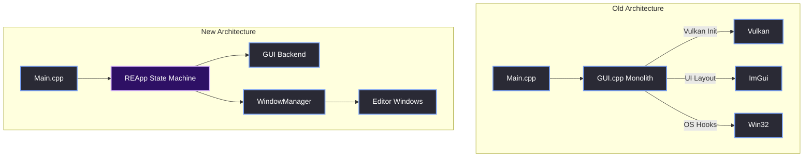
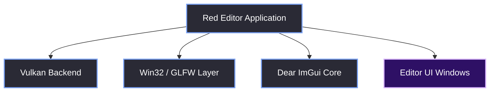

# Introduction

> [!abstract] TL;DR
> This document is the complete engineering reference for how we built the Red Editor, the standalone UI for the Red Reality Engine (RR). We used Dear ImGui, Vulkan, GLFW, and the Win32 API to build a professional, multi-window, highly responsive editor from scratch. This is our story, our architecture, and our war stories.

## 1. Context and The Vision
I am Astin. We started building the Red Reality Engine (RR) in 2024. From the very beginning, we knew that an engine is only as good as its tooling. If developers cannot iterate quickly, debug easily, and visualize their data, the underlying engine is useless. 

We didn't want to rely on standard OS windowing (which limits customizability), nor did we want to build a custom UI framework from scratch (which takes years). We chose **Dear ImGui** for its immediate-mode paradigm and **Vulkan** for its modern, low-level rendering capabilities. 

The goal was simple: build a modular, highly extensible editor that feels like a native desktop application while remaining entirely under our control.

## 2. The Problem We Faced (The Monolithic Trap)
There is a severe lack of comprehensive, production-level documentation for combining Dear ImGui, Vulkan, and GLFW into a cohesive application. Most tutorials show you how to draw a single window. They don't show you how to handle the real-world problems:

- **The 1x1 Window Hack:** Many tutorials tell you to create a 1x1 GLFW window and draw a massive 1920x1080 ImGui window on top of it. This completely breaks OS-level window management, Aero Snap, and multi-monitor dragging.
- **Native OS Integration:** Custom title bars, borderless windows, and Win32 message hooks for resizing.
- **Multi-threading:** Preventing the UI thread from freezing during heavy asset loads.
- **State Management:** Decoupling the Vulkan backend from the UI frontend so adding a new tool doesn't require rewriting core code.

## 3. Our Solution: The Layered Architecture
To solve this, we built the Red Editor using a strict layered architecture. The backend (Vulkan/ImGui) is completely decoupled from the frontend (the tool windows). 

If we want to add a new window (like a Physics Debugger or Animation Timeline), we simply subclass `EditorWindow` and register it. We never touch the Vulkan initialization or the Win32 message loop.

## 4. What You Will Learn
By reading this vault, you will learn how to architect a robust editor from the ground up. We cover everything from the initial `glfwCreateWindow` call to complex asynchronous logging, custom docking algorithms, and ImGui texture management.

> [!tip] What I'd Do Differently
> If I were to start this project over, I would set up the custom Win32 message hooks for the window title bar *before* writing a single line of ImGui code. Fighting the OS defaults later in development cost us weeks of refactoring.
> 
> **Platform Agnostic Note:** If you plan to port your editor to Linux or macOS, isolate all native OS calls (like `<Windows.h>`) from day one. Wrap them in `#ifdef _WIN32` blocks. For more details on what you'll need to swap out, check out [[01.05 Platform Agnosticism]].

> [!summary] What We Took Away
> - Dear ImGui is incredibly powerful, but it requires significant boilerplate to integrate natively with an OS.
> - A clean separation between the Vulkan backend and the UI frontend is non-negotiable for a scalable editor.
> - Never use the 1x1 window hack; always create a properly sized OS window and let ImGui dock inside it.