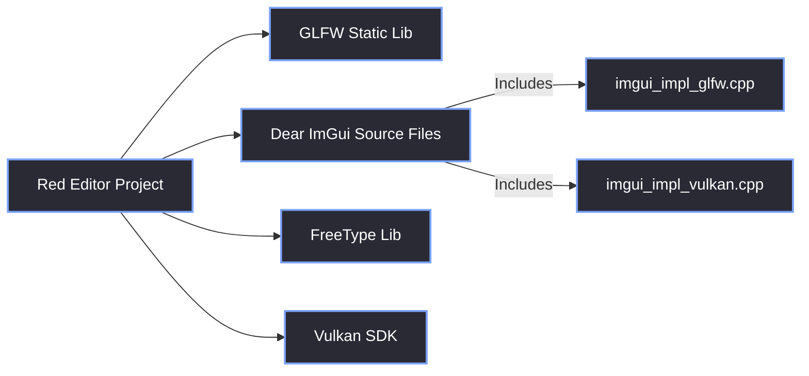

# Prerequisites

> [!abstract] TL;DR
> Before you can build an editor like the Red Editor, you need a properly configured Windows development environment. This note details the required SDKs, the exact dependencies, and how we set up our Visual Studio projects without CMake.

## 1. Environment Requirements
We develop the Red Editor entirely on **Windows 10 and 11**. While GLFW and ImGui are cross-platform, the native windowing features we implement (like Aero Snap and custom title bars) rely heavily on the Win32 API.

### Required Software
- **Visual Studio 2022** (or newer) with the "Desktop development with C++" workload.
- **C++20** compliant compiler. We heavily utilize `<format>`, `<filesystem>`, and concepts.
- **Vulkan SDK** (Latest version from LunarG). This provides `vulkan-1.lib` and the headers.
- **Git** (To clone the dependencies).

> [!warning] No CMake
> The Red Reality Engine and Red Editor **do not use CMake**. We rely entirely on Visual Studio's native build system (`.sln` and `.vcxproj`). If you are porting this to Linux or Mac, you will need to create your own build scripts. 

## 2. Dependency Setup
We keep our dependency tree small. Here is how we set them up in our workspace:

1.  **GLFW:** We pull the pre-compiled binaries for Windows (x64) and include the `include` folder and `lib-vc2022` folder.
2.  **Dear ImGui:** We clone the repository and checkout the **docking** branch (`git checkout docking`). We compile `imgui.cpp`, `imgui_draw.cpp`, `imgui_tables.cpp`, `imgui_widgets.cpp`, `imgui_demo.cpp`, `imgui_impl_glfw.cpp`, and `imgui_impl_vulkan.cpp` directly into our project.
3.  **FreeType:** We use the pre-compiled binaries or build it from source to link with `imgui_freetype.cpp`.
4.  **Vulkan:** Handled entirely by the Vulkan SDK installer and environment variables.



## 3. Visual Studio Configuration (The VCXPROJ)
Because we don't use CMake, we manually configure the `.vcxproj` file. Here are the crucial settings:

- **C++ Language Standard:** `ISO C++20 Standard (/std:c++20)`
- **Additional Include Directories:** 
  - `$(VULKAN_SDK)\Include`
  - `path\to\glfw\include`
  - `path\to\imgui`
  - `path\to\imgui\backends`
- **Additional Library Directories:**
  - `$(VULKAN_SDK)\Lib`
  - `path\to\glfw\lib-vc2022`
  - `path\to\freetype\lib`

## 4. Compiler & Linker Directives
Instead of relying entirely on the Visual Studio property pages for linking (which can be hidden and hard to track), we link most Windows libraries directly in the code using `#pragma comment`. 

This makes the code self-documenting. For example, in `Win32Hooks.cpp`, we have:

```cpp
#pragma comment(lib, "Comctl32.lib") // For SetWindowSubclass
#pragma comment(lib, "Shell32.lib")  // For opening file explorers
#pragma comment(lib, "Pdh.lib")      // For performance metrics
```

> [!tip] What I'd Do Differently
> If you are targeting multiple platforms, remember that libraries like `Comctl32.lib` do not exist on macOS or Linux. You will need to wrap these `#pragma comment` lines in `#ifdef _WIN32` blocks. We detail the cross-platform dependencies later in [[01.05 Platform Agnosticism]].

> [!bug] I Hit This Issue
> I once spent hours chasing a `LNK2019: unresolved external symbol` for `bool IsMaximized()`. 
> 
> The compiler didn't crash, but it didn't generate the object code for the function either. It turns out that `<windowsx.h>` defines a preprocessor macro called `IsMaximized(hwnd)`. When the compiler hit our definition `bool IsMaximized()`, the preprocessor tried to expand the macro, blew up with a `C4003` warning (not a hard error), and skipped compiling the function. 
> 
> Because `Win32Hooks.obj` didn't contain the symbol, linking failed. `CustomFrame.cpp` didn't include `<windowsx.h>`, so its call resolved correctly to the intended symbol — hence the mismatch.
> 
> The fix was embarrassingly simple: rename the function so it doesn't collide with the Windows macro.
> ```diff
> - bool IsMaximized();
> + bool IsWindowMaximized();
> ```

> [!summary] What We Took Away
> - Stick to C++20; `<format>` makes logging significantly cleaner.
> - The docking branch of ImGui is mandatory for a professional layout.
> - Watch out for `<windowsx.h>` and `<minwindef.h>` macros silently destroying your function signatures.

