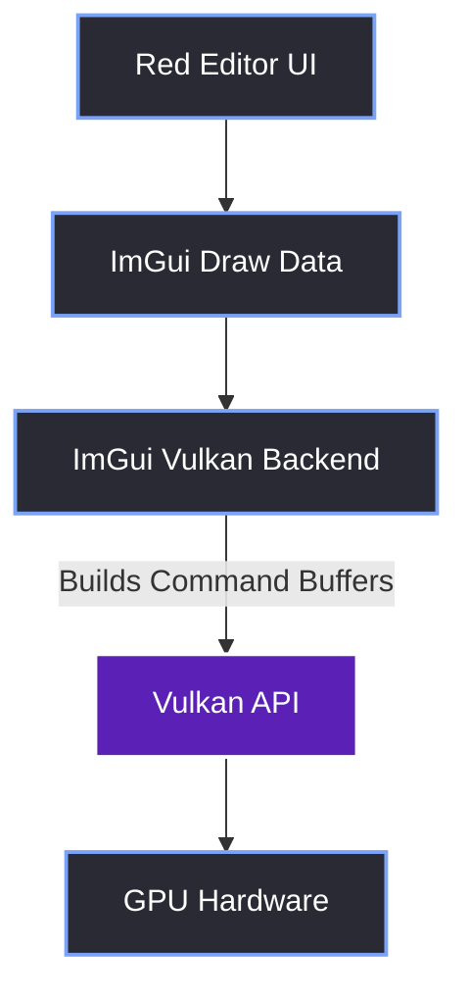
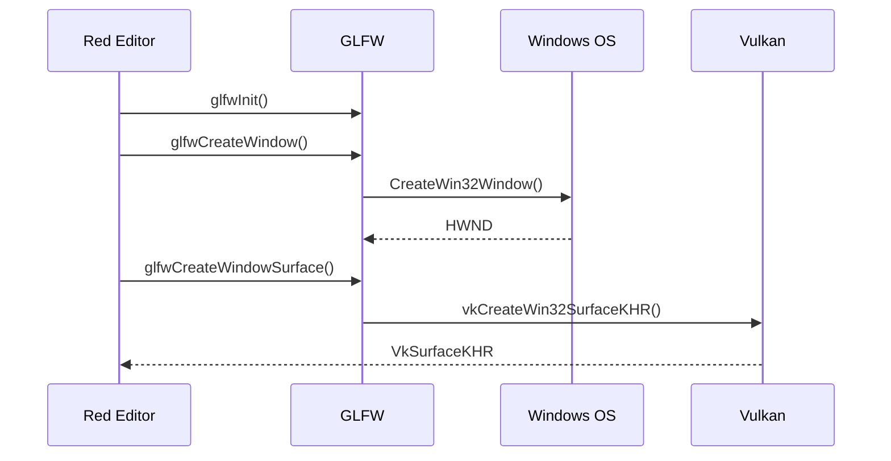
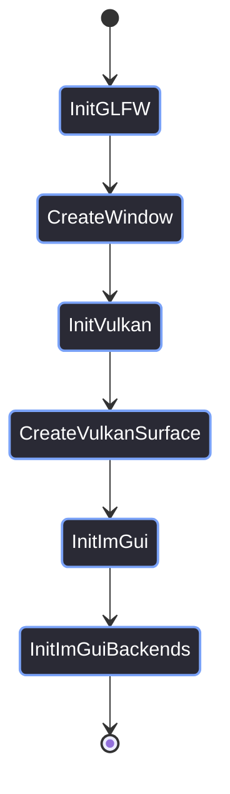

# Tech Stack Overview

> [!abstract] TL;DR
> The Red Editor is built on three core pillars: **Vulkan** for explicit GPU control, **GLFW** for cross-platform OS window management and input, and **Dear ImGui** for rapid, stateless UI development. Here is a deep dive into why we chose them, the alternatives we rejected, and how they bridge together.

## 1. Why Vulkan? (The Graphics API)
When we started the Red Reality Engine (RR) in 2024, the choice was between DirectX 12 and Vulkan. To be completely honest, OpenGL wasn't even a consideration. I hate OpenGL because it's a nightmare to debug; when things go wrong, you often get a black screen and no clear reason why. Vulkan's explicit control and robust validation layers make debugging far more sane.

We chose Vulkan for three main reasons:
1. **Debuggability & Control:** We manage our own memory, descriptor pools, and synchronization. If we crash, the Vulkan validation layers tell us exactly which line of code caused the error.
2. **Multi-Viewport Support:** Dear ImGui's Vulkan backend handles OS-level viewports (dragging a tool window outside the main app) flawlessly, provided you set up the swapchains correctly.
3. **Cross-Platform Targets:** We have zero interest in targeting Apple systems. Our porting roadmap is strictly **Windows, Linux, Consoles, and maybe FreeBSD**. Vulkan is the only modern API that universally supports all of these.



## 2. Why GLFW? (The Window Manager)
GLFW acts as our bridge to the operating system. It handles the creation of the raw OS window, keyboard/mouse input, and the platform-specific surface creation for Vulkan.

We chose GLFW over SDL or raw Win32 because it provides a **native access API**. This means we can let GLFW manage the window creation, but we can reach in and grab the raw Win32 `HWND` handle when we need to do advanced OS-level things (like our custom borderless window hooks).



> [!tip] What I'd Do Differently
> The sequence above shows `vkCreateWin32SurfaceKHR`. If you want to build a truly cross-platform editor for our roadmap, you shouldn't call that function directly. Instead, use `glfwCreateWindowSurface()`, which GLFW implements for Win32, X11, Wayland, and FreeBSD under the hood. Read more in [[01.05 Platform Agnosticism]].

## 3. Why Dear ImGui? (The UI Paradigm)
Immediate Mode GUIs (IMGUI) are perfect for game engine editors. 

In a traditional Retained Mode GUI (like Qt or WPF), you build a tree of widgets, and the OS manages their state. This requires complex data binding, event listeners, and state synchronization. 

In ImGui, you declare the UI from scratch every single frame based on the engine's current state. It is stateless and highly reactive. If the engine data changes, the UI updates automatically on the next frame without you writing a single event handler.

```cpp
// Because ImGui is immediate mode, we just check the ECS state and draw.
// No event listeners. No data binding. Just direct access.
if (entity.HasComponent<Transform>()) {
    auto& transform = entity.GetComponent<Transform>();
    ImGui::DragFloat3("Position", &transform.Position.x);
}
```

## 4. The Integration Flow
Getting these three technologies to talk to each other requires a specific initialization order. If you initialize ImGui before Vulkan is ready, it will crash. 



> [!bug] Why I Took Over the UI
> I am the lead dev, designer, and director for Red Reality. To be blunt: I abhor UI development. I tried to avoid it for as long as possible and left the editor architecture to the engine team.
> 
> But after 8 months of development hell—dealing with a UI system that was fundamentally broken, blocking the main thread, and impossible to maintain—I finally snapped. I picked it up myself to fix it. This vault is the documentation of that deep dive. I had to learn the hard way exactly how ImGui, Vulkan, and Win32 actually talk to each other to make an editor that feels professional and doesn't freeze every five seconds.

> [!summary] What We Took Away
> - Vulkan is hard, but ImGui's backend abstracts 90% of the rendering boilerplate.
> - GLFW's native access (`glfwGetWin32Window`) is the secret weapon for customizing the window frame.
> - ImGui's immediate mode is a perfect match for an Entity Component System (ECS).
> - We don't touch Apple systems; our sights are set on Linux, Consoles, and FreeBSD.

