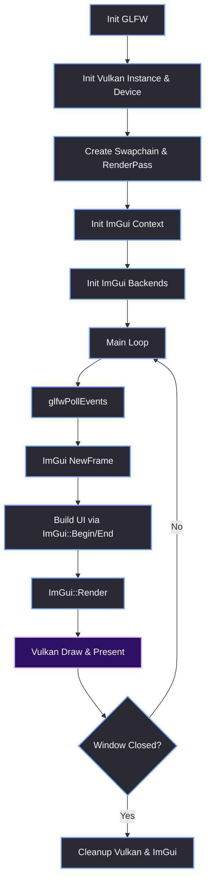
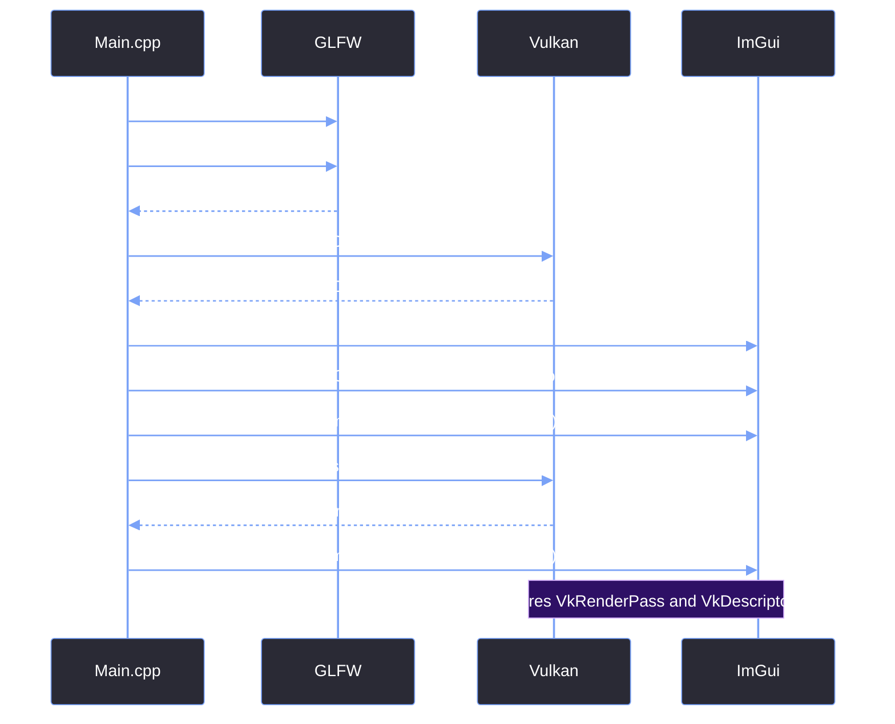
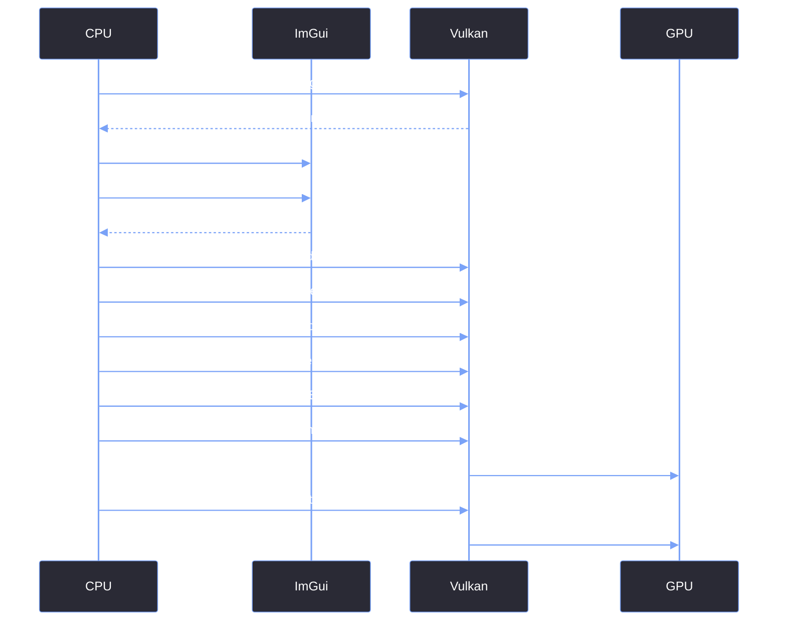
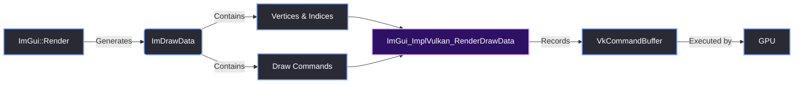

# Minimal Working Example

> [!abstract] TL;DR
> Before we build the complex, multi-window Red Editor, we need a single, blank window running Vulkan and Dear ImGui. This note provides the absolute minimum amount of code required to initialize the context, create a Vulkan swapchain, build a descriptor pool, and get a frame on the screen without crashing.

## 1. The Core Architecture
Every ImGui + Vulkan application follows the exact same synchronous loop. The CPU builds the UI, records the command buffers, and submits them to the GPU. The GPU renders the frame, and the CPU waits for it to present before starting the next frame.



## 2. The Initialization Sequence
The order in which you initialize these systems matters. If ImGui tries to initialize before Vulkan has created a `VkRenderPass` and a `VkDescriptorPool`, it will crash.



## 3. Initialization Code
We start by creating a window without an OpenGL context. Then, we set up the Vulkan boilerplate and pass those handles to ImGui.

```cpp
// 1. Initialize GLFW
glfwInit();
glfwWindowHint(GLFW_CLIENT_API, GLFW_NO_API); // Vulkan, not OpenGL!
glfwWindowHint(GLFW_DECORATED, GLFW_FALSE);  // We handle the window frame ourselves later
GLFWwindow* window = glfwCreateWindow(1280, 720, "Red Editor", nullptr, nullptr);

// 2. Initialize Vulkan (Standard Vulkan tutorial boilerplate)
// You must create the Instance, Physical Device, Logical Device, Swapchain, and RenderPass here.

// 3. Initialize ImGui Context
IMGUI_CHECKVERSION();
ImGui::CreateContext();
ImGuiIO& io = ImGui::GetIO();

// CRITICAL: Enable Docking and Multi-Viewport
io.ConfigFlags |= ImGuiConfigFlags_DockingEnable; 
io.ConfigFlags |= ImGuiConfigFlags_ViewportsEnable; 

// 4. Initialize the ImGui Backends
ImGui_ImplGlfw_InitForVulkan(window, true);

ImGui_ImplVulkan_InitInfo init_info = {};
init_info.Instance = vkInstance;
init_info.PhysicalDevice = vkPhysicalDevice;
init_info.Device = vkDevice;
init_info.QueueFamily = vkQueueFamily;
init_info.Queue = vkQueue;
init_info.PipelineCache = vkPipelineCache;
init_info.DescriptorPool = vkDescriptorPool; // See Pitfall below
init_info.MinImageCount = 2;
init_info.ImageCount = swapchainImageCount;
init_info.MSAASamples = VK_SAMPLE_COUNT_1_BIT;
init_info.RenderPass = vkRenderPass; // Must be compatible with your swapchain images

ImGui_ImplVulkan_Init(&init_info);
```

> [!warning] Watch Out: The Descriptor Pool
> ImGui requires a `VkDescriptorPool` to handle textures and fonts. If you don't provide one with the correct descriptor types (specifically `VK_DESCRIPTOR_TYPE_SAMPLER` and `VK_DESCRIPTOR_TYPE_SAMPLED_IMAGE`), ImGui will silently corrupt the heap when it tries to load the default font atlas. We cover the exact pool configuration in [[03.06 Descriptor Pool Configuration]].

## 4. The Render Loop (CPU/GPU Sync)
In Vulkan, you cannot just draw to the screen. You have to ask the swapchain for an image, record your commands into a buffer, submit that buffer to the GPU queue, and then tell the swapchain to present that image to the OS.



## 5. The Render Loop Code
The main loop is where the magic happens. We start an ImGui frame, draw our UI, and then manually instruct Vulkan to render it.

```cpp
while (!glfwWindowShouldClose(window)) {
    glfwPollEvents();

    // Handle window minimize (Important for Vulkan)
    int fb_width, fb_height;
    glfwGetFramebufferSize(window, &fb_width, &fb_height);
    if (fb_width == 0 || fb_height == 0) {
        // Vulkan will crash if we try to present a 0x0 swapchain
        std::this_thread::sleep_for(std::chrono::milliseconds(16));
        continue; 
    }

    // Start the frame
    ImGui_ImplVulkan_NewFrame();
    ImGui_ImplGlfw_NewFrame();
    ImGui::NewFrame();

    // Build the UI
    ImGui::Begin("Hello, Red Editor");
    ImGui::Text("This is our first window.");
    ImGui::End();

    // End the frame (Generates DrawData)
    ImGui::Render();
    ImDrawData* draw_data = ImGui::GetDrawData();
    
    // --- VULKAN RENDERING ---
    // 1. vkWaitForFences()
    // 2. vkAcquireNextImageKHR()
    // 3. vkResetCommandBuffer()
    // 4. vkBeginCommandBuffer()
    // 5. vkCmdBeginRenderPass()
    
    // 6. Draw ImGui
    ImGui_ImplVulkan_RenderDrawData(draw_data, commandBuffer);
    
    // 7. vkCmdEndRenderPass()
    // 8. vkEndCommandBuffer()
    // 9. vkQueueSubmit()
    
    // --- MULTI-VIEWPORT HANDLING ---
    if (io.ConfigFlags & ImGuiConfigFlags_ViewportsEnable) {
        ImGui::UpdatePlatformWindows();
        ImGui::RenderPlatformWindowsDefault();
    }
    
    // 10. vkQueuePresentKHR()
}
```

## 6. Data Flow: ImGui to GPU
When you call `ImGui::Render()`, ImGui doesn't touch the GPU. It simply flattens your UI into a series of draw commands and vertex/index buffers. The Vulkan backend then translates this data into Vulkan commands.



## 7. Cleanup
Vulkan and ImGui do not clean themselves up. If you close the window without waiting for the GPU to finish, you will get a crash or validation layer errors.

```cpp
// Wait for the GPU to finish all pending operations
vkDeviceWaitIdle(vkDevice);

// Shutdown ImGui backends
ImGui_ImplVulkan_Shutdown();
ImGui_ImplGlfw_Shutdown();
ImGui::DestroyContext();

// Destroy Vulkan resources (Swapchain, Device, Instance)
// Destroy GLFW window
glfwDestroyWindow(window);
glfwTerminate();
```

> [!bug] The 2.5-Day Rewrite Sprint
> This minimal working example is the foundation of the rewrite. When I finally decided to take over the UI from the engine team after 8 months of development hell, I stripped everything down to this exact boilerplate.
> 
> I wrote this foundational backend in exactly **2.5 days**. By deleting their over-engineered, monolithic abstraction layers and starting from this raw ImGui + Vulkan setup, I was able to stop the main thread from blocking and finally get a responsive window on the screen.

> [!summary] What We Took Away
> - The `ImGui_ImplGlfw_InitForVulkan` call must be passed `true` to install the GLFW input callbacks.
> - Vulkan requires significant boilerplate (fences, semaphores, command buffers) that ImGui *doesn't* do for you.
> - You must handle the `fb_width == 0` case (minimized window) to prevent `VK_ERROR_DEVICE_LOST`.
> - `ImGui::UpdatePlatformWindows()` must be called *after* rendering the main window if multi-viewport is enabled.

