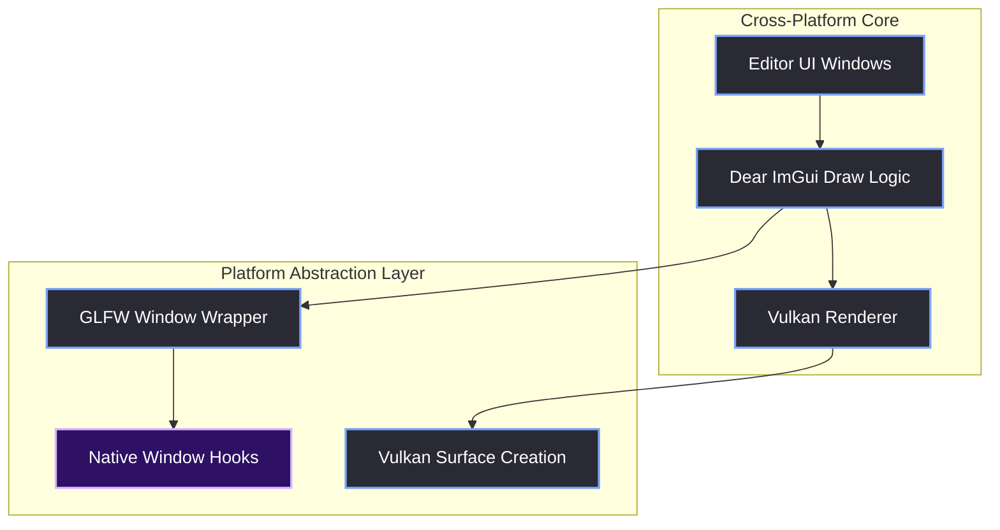
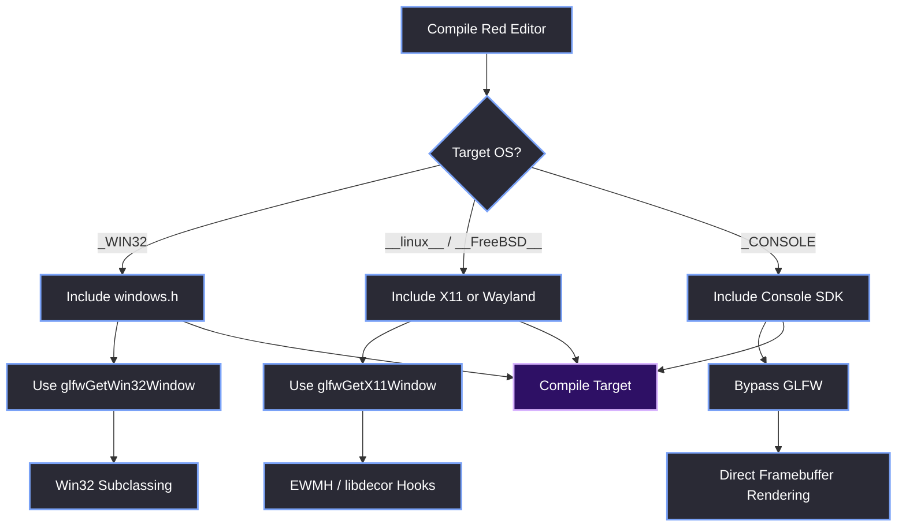

# Platform Agnosticism

> [!abstract] TL;DR
> The Red Editor and the Red Reality Engine (RR) are currently built for Windows 10/11. However, our architecture is designed to be highly portable. We have zero interest in Apple systems, but we *do* plan to port to Linux, FreeBSD, and Consoles. If you want to port this architecture, this note outlines the exact abstraction layers you need to build and the OS-specific code you must swap out.

## 1. The Cross-Platform Foundation
We chose GLFW, Dear ImGui, and Vulkan specifically because they do not lock us into Microsoft. If we decide to port the Red Editor to Linux or FreeBSD tomorrow, 90% of the UI code (`EditorWindow`, `WindowManager`, ImGui draw calls) will compile as-is. 

The remaining 10% is isolated entirely within the backend and window management layers. You must build a hard boundary between the cross-platform core and the platform-specific implementation.

## 2. What You Must Change (The Porting Checklist)

### 2.1 Native Window Handles
In our Windows implementation, we use `glfwGetWin32Window()` to grab the `HWND` so we can intercept Windows messages for our custom title bar. 
If you port to Linux or FreeBSD, you must replace this:
- **Linux/FreeBSD (X11):** Use `glfwGetX11Window()`. You will need to define `GLFW_EXPOSE_NATIVE_X11` before including the GLFW native header.
- **Linux (Wayland):** Use `glfwGetWaylandWindow()`. You will need to define `GLFW_EXPOSE_NATIVE_WAYLAND`.

*(Note: We deliberately skip macOS/Cocoa. MoltenVK is a translation layer, not native Vulkan, and we have no plans to support Apple hardware.)*

### 2.2 Custom Window Frame (Win32 Hooks)
In [[04.02 Borderless Window & Win32 Hooks]], we used `SetWindowSubclass` and intercepted `WM_NCCALCSIZE` / `WM_NCHITTEST` to make our borderless window draggable and resizable. 

This entire file must be rewritten for other platforms:
- **Linux (X11):** You will need to use Xlib and the EWMH (Extended Window Manager Hints) specification. You have to listen for `_NET_WM_MOVERESIZE` client messages to handle window dragging and resizing natively.
- **Linux (Wayland):** Wayland handles window decorations entirely differently. You usually have to implement client-side decorations (CSD) using the `libdecor` library or draw your own GTK/Qt window bounds.
- **Consoles (Xbox/PlayStation/Switch):** Consoles do not have a traditional desktop window manager. The concept of a draggable window doesn't exist. You will bypass GLFW entirely and render directly to the console's screen buffer.

### 2.3 Vulkan Surface Creation
GLFW abstracts the window creation, but you still have to tell Vulkan how to draw onto it. In our code, we call `vkCreateWin32SurfaceKHR()`.
- **Linux (X11):** Use `vkCreateXlibSurfaceKHR()`
- **Linux (Wayland):** Use `vkCreateWaylandSurfaceKHR()`

> [!tip] What I'd Do Differently
> Notice how GLFW handles all of this for you under the hood? Instead of calling `vkCreateWin32SurfaceKHR()` directly, use `glfwCreateWindowSurface()`. It dynamically links to the correct Vulkan surface extension for the OS it was compiled on. It makes porting to X11 or Wayland a one-line change.

## 3. The Porting Flowchart
When you compile the Red Editor on a new platform, the preprocessor directives determine which native code gets compiled.

## 4. High DPI & Retina Displays
Windows handles DPI scaling differently than Linux. Instead of per-monitor DPI scaling (which we have to manually manage on Win32 via the manifest), Linux environments rely on the window manager or desktop environment (like GNOME or KDE) to handle scaling.

GLFW exposes this via `glfwGetWindowContentScale`. You will need to multiply your ImGui font sizes and window sizes by this scale factor on Linux.

> [!bug] The Monolithic GUI Nightmare
> Before I stepped in to rewrite the UI, porting this engine to anything was a pipe dream because the UI architecture was a complete disaster.
> 
> The old UI used to create a **brand new OS window for every single state** of the editor (Launcher, Splash, Editor). Worse, it used the 1x1 window hack, creating a 1x1 GLFW window and drawing a massive ImGui window over it. For *each* of these windows, the engine team declared everything from scratch—Vulkan swapchains, GLFW contexts, ImGui contexts, you name it. 
> 
> All of this lived in one giant, monolithic `GUI.cpp` file packed with massive `if/else` conditionals checking the app state. 
> 
> The concept of `#ifdef _WIN32` was non-existent because the entire file was hopelessly tangled in Windows API calls. Porting it would have required nuking the file and starting over—which is exactly what I did during the UI rewrite.

> [!summary] What We Took Away
> - If you build a cleanly layered architecture, porting is an exercise in replacing the bottom layer (OS/windowing), not rewriting the whole engine.
> - GLFW's `glfw3native.h` header is your best friend for cross-platform window handle access.
> - We don't touch Apple. Our sights are set on Linux, FreeBSD, and Consoles.
> - Always wrap platform-specific headers in `#ifdef` blocks from day one.

---
*You can see I hate Apple, huh?*