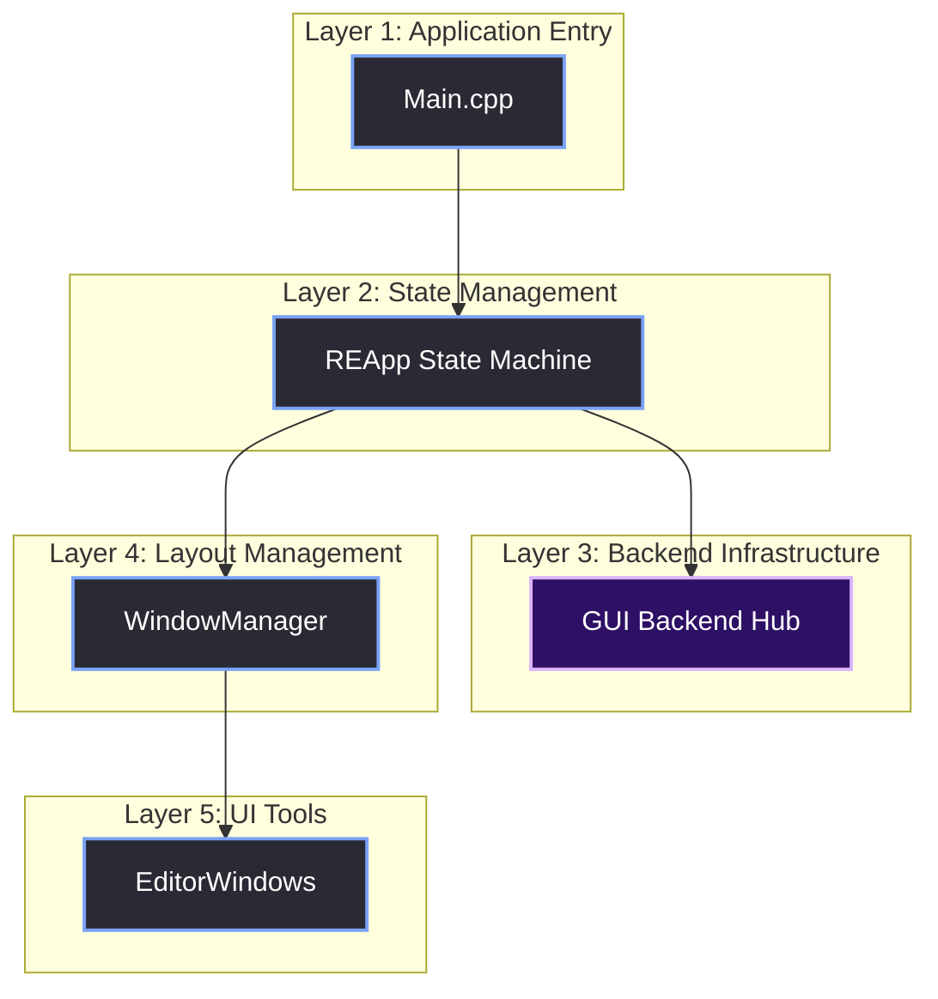

# High-Level Architecture

> [!abstract] TL;DR
> The Red Editor is split into five distinct layers. By strictly separating the OS/Graphics backend from the UI frontend, we ensured that adding a new tool doesn't require touching a single line of Vulkan code. This note analyzes the transition from the monolithic `GUI.cpp` to a modular, event-driven architecture.

## 1. The Monolithic Nightmare (The "Before" State)
Before the UI rewrite, the editor was a single `GUI.cpp` file that did everything. If you look at the original source code, you can see the severe architectural flaws:

- `LuncherUI()`, `initSplash()`, and `EditorUI()` were massive, independent functions.
- **Each function** called `glfwInit()`, created its own window, initialized Vulkan, created its own swapchain, and set up ImGui from scratch.
- The actual UI layout was deeply nested inside `ImGui::Begin()` blocks right next to `vkDeviceWaitIdle()` and `ImGui_ImplVulkanH_CreateOrResizeWindow()`.

If you wanted to change how the "Save" button looked, you had to scroll past Vulkan memory allocation code. If you wanted to add a new tool window, you had to modify the core backend file. This coupling made the codebase unmaintainable.

### The Global Variable Problem
Look at the old `GUI.h`. It exposed almost every Vulkan handle as a global `extern` variable:

```cpp
// Old GUI.h
extern VkInstance               g_Instance;
extern VkPhysicalDevice         g_PhysicalDevice;
extern VkDevice                 g_Device;
extern VkQueue                  g_Queue;
```

Any file in the entire codebase could accidentally call `vkDeviceWaitIdle(g_Device)` and freeze the application. There was no encapsulation, no state management, and no safety.

## 2. The Five Layers of the Red Editor
We split the architecture into five distinct layers. Data flows downward (input/events) and ownership flows upward.



### Layer 1: Main.cpp
This is the entry point. It does almost nothing except parse command-line arguments, initialize the logger, call `GUI::Init()`, and boot the `REApp`. 

### Layer 2: REApp (State Machine)
`REApp` is the director. It owns the main loop. It holds the `AppState` (Launcher, Splash, Editor) and decides what to draw every frame. It does *not* know about Vulkan or ImGui.

### Layer 3: GUI Backend Hub (`GUI` class)
This is the infrastructure. It owns the Vulkan instance, device, swapchain, and the ImGui context. It exposes simple methods like `GUI::BeginFrame()`, `GUI::EndFrame()`, and `GUI::LoadTextureFromFile()`. It does *not* know what a "Launcher" or an "Inspector" is.

### Layer 4: WindowManager
This layer handles the ImGui docking layout. It holds a list of all registered `EditorWindow` instances, builds the DockSpace, and tells every window to `Draw()` itself.

### Layer 5: EditorWindows
These are the actual tools (Console, Inspector, Scene View, Asset Browser). Every tool inherits from the `EditorWindow` base class. They only know how to draw themselves using ImGui; they don't know how the Vulkan backend works.

## 3. Technical Comparison: The Refactor
Here is the actual structural difference between the old `GUI.cpp` and the new architecture.

**Old `GUI.cpp` (`LuncherUI` function):**
```cpp
// The UI logic and the Backend logic are completely tangled together
glfwWindowHint(GLFW_DECORATED, GLFW_FALSE);
GLFWwindow* window = glfwCreateWindow(1, 1, "", nullptr, nullptr); // 1x1 Hack
GUI::SetupVulkan(extensions);
VkSurfaceKHR surface;
glfwCreateWindowSurface(g_Instance, window, g_Allocator, &surface);
GUI::SetupVulkanWindow(wd, surface, w, h);
ImGui::CreateContext();
ImGui_ImplVulkan_Init(&init_info);

// Actual UI Layout buried beneath setup code
ImGui::SetCursorPos(ImVec2(150, 95));
if (ImGui::Button("##d", ImVec2(115, 30))) { ... }
```

**New Architecture:**
```cpp
// Backend initialization happens ONCE in GUI::Init()
// The Launcher state is now just a clean UI class
class Launcher {
public:
    void Draw() {
        ImGui::SetCursorPos(ImVec2(150, 95));
        if (ImGui::Button("##OpenProject", ImVec2(115, 30))) { ... }
    }
};
```

> [!bug] I Hit This Issue
> The old engine team architecture had the `GUI.cpp` file creating a brand new OS window and destroying/recreating the Vulkan swapchain every time the app transitioned from Splash to Editor. 
> 
> That is why the UI rewrite was necessary. I had to physically rip the state management out of the Vulkan initialization and put it into the `REApp` layer, where it belongs.

> [!summary] What We Took Away
> - The backend (Vulkan/ImGui) must be a "dumb" rendering engine. It should not know about application logic.
> - State transitions belong in `REApp`, not in the swapchain initialization.
> - If a `cpp` file is over 1,000 lines and contains both `vkCmdPipelineBarrier` and `ImGui::Button`, it is a monolith and needs to be destroyed.