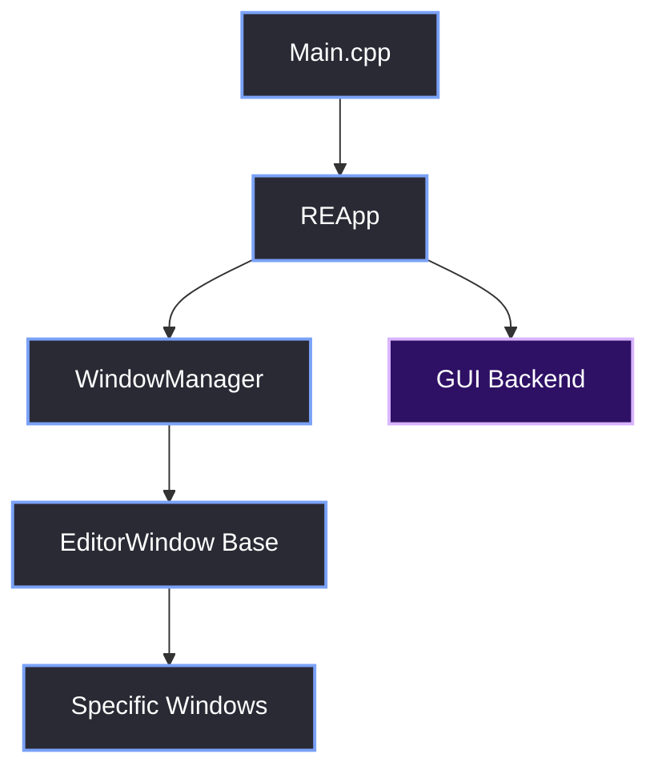
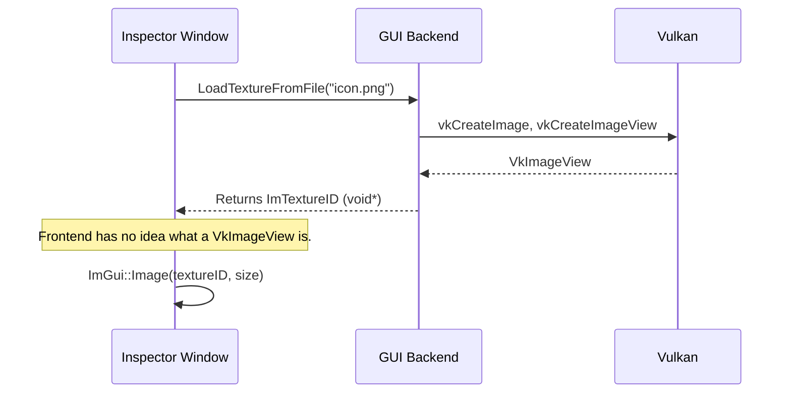

# Layered Design

> [!abstract] TL;DR
> This note defines the strict rules for each layer. If a piece of code violates these rules, it belongs in a different layer. We enforce these boundaries via compilation barriers and opaque handles, ensuring that the UI frontend is completely decoupled from the Vulkan backend.

## 1. The Dependency Graph
The layers are strictly hierarchical. A higher layer can call into a lower layer, but a lower layer must *never* call into a higher layer. If it does, you have a circular dependency, and the codebase becomes spaghetti.

## 2. Layer Responsibilities & Ownership

| Layer | Owns | Exposes | Must NOT do |
| :--- | :--- | :--- | :--- |
| **Main.cpp** | App entry point | `int main()` | Contain any Vulkan or ImGui logic. |
| **REApp** | Main loop, AppState | `Run()`, `Initialize()` | Call Vulkan APIs directly. |
| **GUI Backend** | Vulkan handles, ImGui context | `Init()`, `BeginFrame()`, `LoadTexture()` | Know about specific UI windows (e.g., Console). |
| **WindowManager** | Docking layout, Window registry | `RegisterWindow()`, `DrawAll()` | Create Vulkan objects or call `ImGui::Begin` directly for the host window. |
| **EditorWindows** | UI state (e.g., scroll pos) | `Draw()` | Call `vkQueueSubmit` or manipulate swapchains. |

## 3. The Compilation Barrier (Opaque Handles)
To enforce these boundaries, we do not include `<vulkan/vulkan.h>` or `<GLFW/glfw3.h>` in the frontend headers.

If an `EditorWindow` needs to display a Vulkan texture (like a preview of a 3D asset), it doesn't receive a `VkImageView`. The `GUI` backend wraps the texture in an opaque `GUI::TextureData` struct and returns an `ImTextureID` (which is just a `void*`).

The frontend only passes the `ImTextureID` to `ImGui::Image()`. It has no idea it's actually a Vulkan descriptor set.

This means if we ever swapped out Vulkan for DirectX 12, the frontend `EditorWindow` code would not need to change at all. Only the `GUI` backend would change.

## 4. Include Hierarchy
To maintain compile times and architectural boundaries, we strictly control what is included where.

### Allowed Includes by Layer:
- **Main.cpp:** `<REApp.h>`, `<UI/GUI.h>`, `<Utils/RrLog.h>`
- **REApp:** `<ThreadPool.h>`, `<WindowManager.h>`, `<Screens/Launcher.h>`
- **GUI Backend:** `<vulkan/vulkan.h>`, `<GLFW/glfw3.h>`, `<imgui.h>`
- **WindowManager:** `<EditorWindow.h>`, `<imgui.h>` (ImGui only, no Vulkan)
- **EditorWindows:** `<imgui.h>`, `<SelectionContext.h>` (ImGui only, no Vulkan)

> [!bug] I Hit This Issue
> In the original `GUI.cpp`, the UI code was tightly coupled to the Vulkan backend. For example, the old `LuncherUI` had direct access to `VkSurfaceKHR`, `g_Instance`, and `ImGui_ImplVulkanH_Window`.
> 
> Because `g_Device` and `g_Queue` were global variables exposed in `GUI.h`, any UI file could accidentally call `vkDeviceWaitIdle(g_Device)` and freeze the entire application. We had to lock down these globals and only expose safe wrapper functions.

> [!summary] What We Took Away
> - Dependencies only flow downward.
> - The frontend should deal in `ImTextureID` and `ImDrawList`, never in `VkImageView` or `VkCommandBuffer`.
> - If a frontend file includes `<vulkan.h>`, the code review is immediately rejected.

