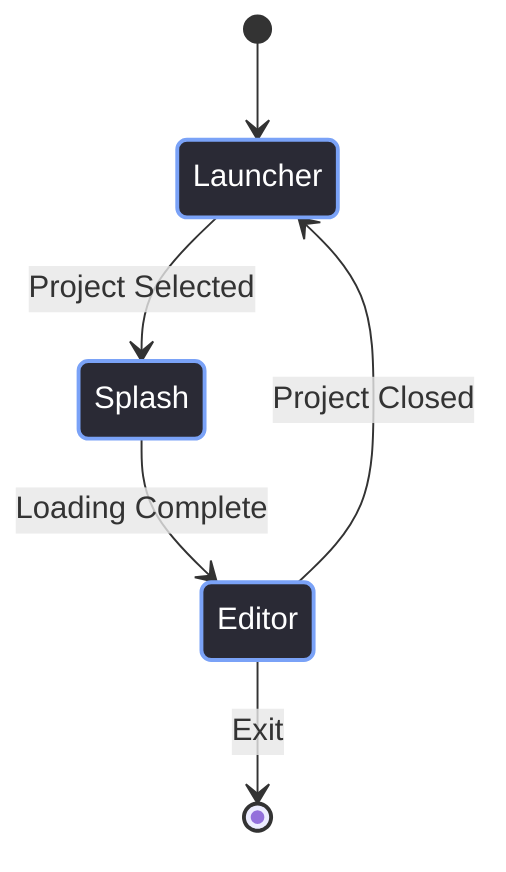
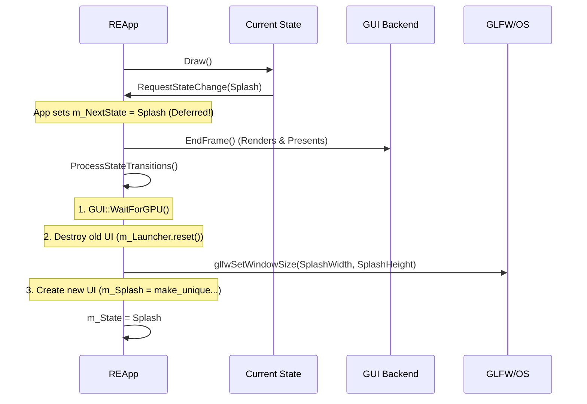

# Application State Machine

> [!abstract] TL;DR
> The Red Editor operates in three distinct states: **Launcher**, **Splash**, and **Editor**. To prevent the Vulkan swapchain from being destroyed and recreated on every transition, we keep a single OS window and a single Vulkan context alive for the entire lifecycle of the application. We just swap out which UI class is drawing to it.

## 1. The Three States (Corrected Flow)
When the Red Editor boots up, it does **not** show a Splash screen first. It boots directly into the Launcher. Why? Because the engine shouldn't start loading assets until the user has selected a project. 

Once a project is selected, it transitions to the Splash screen to load the heavy assets, and then finally opens the Editor.



## 2. The `REApp` Director
The `REApp` class owns the main loop, the `ThreadPool`, the `WindowManager`, and the state variables. 

```cpp
class REApp {
private:
    AppState m_State = AppState::Launcher;
    AppState m_NextState = AppState::Launcher;
    
    std::unique_ptr<Launcher> m_Launcher;
    std::unique_ptr<SplashScreen> m_Splash;
    WindowManager m_WindowManager;
    
    void ProcessStateTransitions();
};
```

## 3. The Deferred Transition Pattern
In the old engine, transitioning from Launcher to Editor would destroy the current OS window, destroy the Vulkan swapchain, create a new OS window, and build a new swapchain. Look at the old `GUI.cpp`: `LuncherUI`, `initSplash`, and `EditorUI` each had their own `glfwCreateWindow()` and `GUI::SetupVulkan()` calls. 

This caused massive memory leaks and frequent `VK_ERROR_DEVICE_LOST` crashes because the OS was constantly destroying and recreating the `HWND`.

We fixed this by keeping one window and one Vulkan context. We just change what we draw.

However, you cannot change states *inside* the `ImGui::BeginFrame()` and `ImGui::EndFrame()` cycle. If you destroy UI textures while the GPU is still queued to render them, Vulkan crashes.

We use a **deferred transition**. If a state wants to transition, it sets `m_NextState`. The actual transition happens *after* `GUI::EndFrame()` has safely submitted the draw commands.



## 4. The Transition Implementation
Here is how we actually handle the transition in `REApp::ProcessStateTransitions()`. Notice how we have to handle window resizing, because the Launcher is a small window (e.g., 900x650), the Splash is larger, and the Editor is maximized.

### Launcher -> Splash
When the user clicks "Create" or "Open", the Launcher sets `m_ProjectReady = true`. The `REApp` catches this and prepares the Splash screen.

```cpp
// Inside ProcessStateTransitions()
if (m_State == AppState::Launcher && m_NextState == AppState::Splash) {
    GUI::WaitForGPU(); 
    m_Launcher.reset(); // Destroy Launcher UI

    GLFWwindow* w = GUI::GetWindow();

    // Resize the OS window to Splash dimensions (SSOT)
    glfwSetWindowSize(w, WindowConfig::SplashWidth, WindowConfig::SplashHeight);
    CenterWindow(w, WindowConfig::SplashWidth, WindowConfig::SplashHeight);

    // Create the Splash Screen and start the async loading
    m_Splash = std::make_unique<SplashScreen>(m_Pool);
    m_Splash->SetMessage(m_NextMessage);
}
```

### Splash -> Editor
Once the async thread finishes loading the project, the Splash screen sets `m_Complete = true`. The `REApp` then destroys the Splash screen, registers all the editor windows, and maximizes the OS window.

```cpp
// Inside ProcessStateTransitions()
else if (m_State == AppState::Splash && m_NextState == AppState::Editor) {
    GUI::WaitForGPU();
    m_Splash.reset(); // Destroy Splash UI

    GLFWwindow* w = GUI::GetWindow();
    
    // Unlock resizing, set to editor size, and maximize
    glfwSetWindowAttrib(w, GLFW_RESIZABLE, GLFW_TRUE);
    glfwSetWindowSize(w, WindowConfig::EditorWidth, WindowConfig::EditorHeight);
    glfwMaximizeWindow(w);

    // Register all the EditorWindows (Console, Inspector, etc.)
    RegisterEditorWindows();
}
```

## 5. The Main Thread Blocking Bug
In the original `initSplash()` function in `GUI.cpp`, there was a literal `sleep_for` on the main thread right before transitioning to the editor:

```cpp
// Old GUI.cpp (initSplash)
if (!br) {
    std::this_thread::sleep_for(std::chrono::seconds(5));
}
```

This froze the OS window for 5 seconds. Windows would flag the application as "Not Responding," the window couldn't be dragged, and the spinning loading cursor would appear. The user would think the app crashed.

In the new architecture, the Splash screen uses the `ThreadPool` to load assets in the background. The main loop continues running at 60 FPS, draining progress events from the `UIEventQueue` and updating the loading text smoothly.

> [!bug] I Hit This Issue
> When I first implemented the state machine, I forgot to defer the transition. I called `GUI::WaitForGPU()` inside the Splash screen's `Draw()` method, then immediately swapped to the Editor state. 
> 
> The moment the loader finished, the app locked up and crashed with `VK_ERROR_DEVICE_LOST`. The GPU was still reading the Splash screen's textures while I was already deleting them. Deferring the transition to *after* `EndFrame()` fixed it instantly.
> 
> I also learned the hard way that you have to wait to update the state until the current frame of ImGui is completely finished. If you try to rip out the UI objects or swap states while ImGui is still building the draw lists mid-frame, it will crash. You must let `ImGui::EndFrame()` fire completely before you touch the state pointers.
> 
> I also learned that you have to call `glfwSetWindowSize()` *between* states. If you transition from a 900x650 Launcher to the Editor without calling `glfwMaximizeWindow()`, the entire docking layout breaks because ImGui calculates the DockBuilder splits based on a tiny window size.

> [!summary] What We Took Away
> - Never destroy Vulkan resources while a frame is in flight.
> - Never mutate the UI state tree while ImGui is mid-frame. Wait for `EndFrame()` to finish.
> - Keep one OS window for the entire lifetime of the application.
> - Never call `sleep_for` on the main UI thread. Use async tasks and a `UIEventQueue`.
> - The Launcher must come before the Splash screen so we know *which* project to load.

