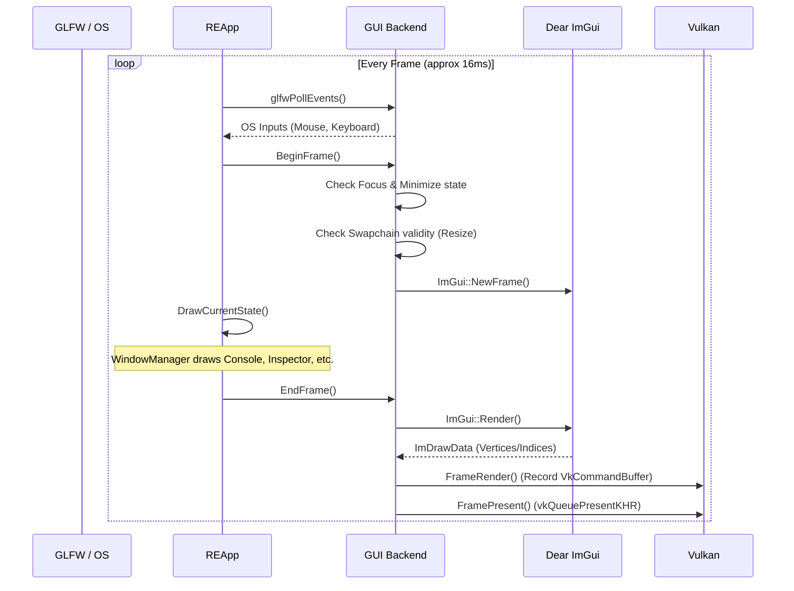
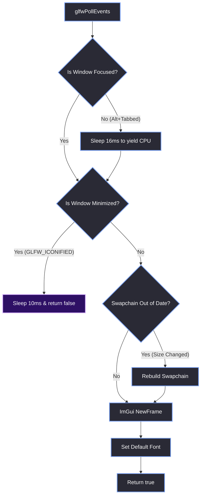
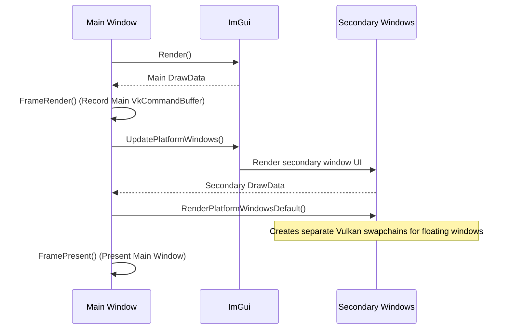

# Main Loop & Frame Lifecycle

> [!abstract] TL;DR
> Every frame of the Red Editor takes roughly 16 milliseconds. This note breaks down exactly what happens in that time window, from polling OS events to presenting the swapchain image to the screen. We will cover the CPU/GPU synchronization, how we handle window minimization, focus throttling, the swapchain rebuild logic, and the transition from hardcoded absolute positioning to dynamic layouts.

## 1. The Complete Frame Timeline
The main loop is a strictly ordered sequence. If you do things out of order, ImGui will assert, or Vulkan will crash. The CPU builds the UI and records the command buffers, and the GPU executes them.



## 2. The `REApp::Run()` Main Loop
Here is the actual code that drives the entire editor. Notice how small and clean it is. The `REApp` doesn't care about Vulkan fences, semaphores, or swapchains. It just calls the state machine.

```cpp
void REApp::Run() {
    while (!GUI::ShouldClose()) {
        // 1. Prevent rendering at full speed while minimized to save CPU/GPU
        // This prevents the editor from eating 100% of a CPU core in the background.
        if (glfwGetWindowAttrib(GUI::GetWindow(), GLFW_ICONIFIED)) {
            std::this_thread::sleep_for(std::chrono::milliseconds(10));
            continue;
        }

        // 2. Poll OS events, handle focus throttle, and start ImGui frame.
        // Returns false if the window is minimized (0x0 framebuffer).
        if (!GUI::BeginFrame()) continue;

        // 3. Draw the current state (Launcher, Splash, or Editor)
        DrawCurrentState();

        // 4. Render and present to the swapchain (Executes Vulkan commands)
        GUI::EndFrame();

        // 5. Handle deferred state transitions (e.g. Splash -> Editor)
        // This MUST happen after EndFrame() to prevent VK_ERROR_DEVICE_LOST.
        ProcessStateTransitions();
    }
}
```

## 3. Inside `GUI::BeginFrame()`
The `BeginFrame` function does a lot of heavy lifting before ImGui even knows a frame has started. Here is the exact decision tree it runs through every single frame:



### 3.1 Focus Throttling
If the user Alt-Tabs away from the editor, we don't want the app to keep rendering at 144 FPS and melting their CPU. We check `GLFW_FOCUSED`. If it's `0`, we sleep for 16ms per frame, effectively capping the background render rate to ~60 FPS.

### 3.2 Handling Minimized Windows (Vulkan's 0x0 Bug)
This is a famous Vulkan pitfall. If the user minimizes the window, the framebuffer size becomes `0x0`. If you try to acquire a swapchain image or begin a render pass with a `0x0` extent, Vulkan will throw a `VK_ERROR_DEVICE_LOST` and crash the application.

We handle this by checking `GLFW_ICONIFIED`. If the window is minimized, we return `false` from `BeginFrame()`, and `REApp::Run()` uses `continue` to skip the rest of the loop safely.

### 3.3 Swapchain Rebuild Logic
Resizing the window requires rebuilding the Vulkan swapchain, which is an expensive operation. We only do it if the framebuffer size actually changed.

```cpp
int fb_width, fb_height;
glfwGetFramebufferSize(m_Window, &fb_width, &fb_height);

// Only rebuild swapchain if size actually changed
if (fb_width > 0 && fb_height > 0) {
    if (g_MainWindowData.Width != fb_width || g_MainWindowData.Height != fb_height) {
        ImGui_ImplVulkan_SetMinImageCount(g_MinImageCount);
        GUI::SetupVulkanWindow(&g_MainWindowData, g_MainWindowData.Surface, fb_width, fb_height);
        g_MainWindowData.FrameIndex = 0;
        g_SwapChainRebuild = false;
    }
}
```

## 4. Inside `GUI::EndFrame()`
This is where the magic happens. Once the UI is built, we have to translate ImGui's draw lists into Vulkan commands and present them to the screen.

```cpp
void GUI::EndFrame() {
    ImGuiIO& io = ImGui::GetIO();
    
    // 1. Flatten ImGui UI into draw lists (Vertex/Index buffers)
    ImGui::Render();
    ImDrawData* main_draw_data = ImGui::GetDrawData();

    const bool main_is_minimized = (main_draw_data->DisplaySize.x <= 0.0f || main_draw_data->DisplaySize.y <= 0.0f);

    // 2. Define the clear color (Dark blue background)
    ImVec4 clear_color = ImVec4(0.033f, 0.057f, 0.111f, 1.0f);
    g_MainWindowData.ClearValue.color.float32[0] = clear_color.x * clear_color.w;
    // ... set other channels ...

    // 3. Record and Submit the main window draw commands
    if (!main_is_minimized) {
        GUI::FrameRender(&g_MainWindowData, main_draw_data);
    }

    // 4. Handle Multi-Viewport (secondary windows dragged outside the main app)
    if (io.ConfigFlags & ImGuiConfigFlags_ViewportsEnable) {
        ImGui::UpdatePlatformWindows();
        ImGui::RenderPlatformWindowsDefault();
    }

    // 5. Present the main window to the OS
    if (!main_is_minimized) {
        GUI::FramePresent(&g_MainWindowData);
    }
}
```

### The Multi-Viewport Sequence
Because we enabled `ImGuiConfigFlags_ViewportsEnable`, ImGui can create secondary OS windows (e.g., if you drag the Console window outside the main editor). This requires careful sequencing in `EndFrame()`.



## 5. The Absolute Positioning Nightmare
One of the biggest reasons the UI was so hard to maintain in the old `GUI.cpp` was the reliance on absolute cursor positions.

```cpp
// Old GUI.cpp (LuncherUI)
ImGui::SetNextWindowSize(ImVec2(700, 500));
ImGui::SetNextWindowPos(ImVec2(600, 300));
ImGui::SetCursorPos(ImVec2(150, 95));
if (ImGui::Button("##d", ImVec2(115, 30))) { ... }
```

Because the window was hardcoded to `700x500` and positioned at `600x300`, the UI broke entirely if the user had a monitor smaller than 1300x800, or if they tried to resize the window. 

The new architecture uses dynamic centering. In `Launcher.cpp`, we calculate the center of the current window at runtime and offset the elements based on that:

```cpp
// New Launcher.cpp
float w = ImGui::GetWindowWidth();
// We treat the layout as if it's 700px wide and center that block.
float startX = (w - 700.0f) * 0.5f;

ImGui::SetCursorPos(ImVec2(startX + 150, 95));
if (ImGui::Button("##OpenTab", ImVec2(115, 30))) { ... }
```

> [!bug] I Hit This Issue
> I hit the `g.WithinFrameScope` assertion in ImGui when minimizing the window. I was returning early from `BeginFrame()` if the window was iconified, but the main loop was still calling `DrawCurrentState()` and `EndFrame()`.
> 
> ImGui got completely confused because it received a `Render()` call without a corresponding `NewFrame()`. Returning a boolean from `BeginFrame()` and using `continue` in the loop was the fix. You absolutely have to ensure `NewFrame` and `EndFrame` are called in strict pairs. 
> 
> I also learned the hard way that you have to wait to update the application state (like swapping from Splash to Editor) until the current frame of ImGui is completely finished. If you rip out the UI objects while ImGui is still building the draw lists mid-frame, it will crash. You must let `EndFrame()` fire completely before you touch the state pointers.

> [!summary] What We Took Away
> - The frame is a strict sequence: Poll -> NewFrame -> Draw -> Render -> Present.
> - You must handle the `0x0` framebuffer size when the window is minimized, or Vulkan will crash.
> - Hardcoded UI coordinates are a recipe for disaster. Always use relative positioning and ImGui's layout tools.
> - Focus throttling (`sleep_for(16ms)` when unfocused) is essential to prevent the editor from eating 100% of a CPU core while running in the background.
> - Multi-viewport rendering must happen *between* `ImGui::Render()` and `FramePresent()`.