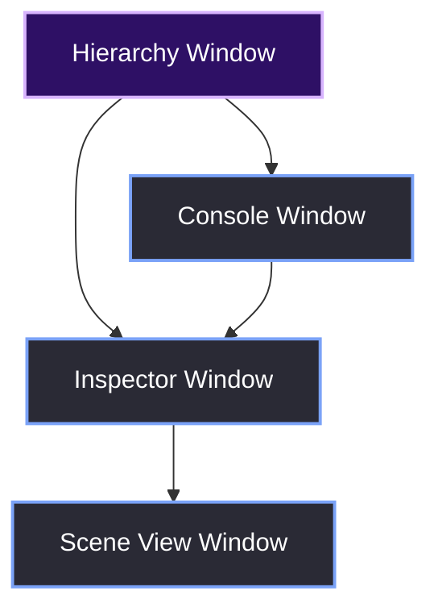
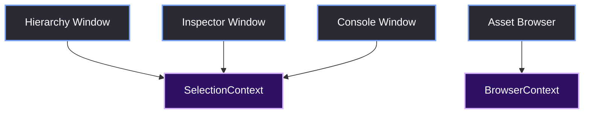
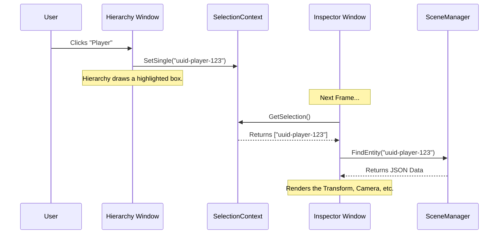

# Cross-Window State Management

> [!abstract] TL;DR
> In a modular editor, multiple windows often need to share state. For example, when you click an entity in the Hierarchy window, the Inspector window needs to know about it. If we passed raw pointers between windows, the codebase would become a tangled web of circular dependencies. Instead, we use decoupled, static Context singletons (`SelectionContext`, `BrowserContext`) to act as the communication bridge.

## 1. The Problem: The Spaghetti Web
If the `AttributesWindow` (Inspector) needs to know what is selected, you might be tempted to pass a pointer from the `WindowManager`. 
But what if the `ConsoleWindow` also needs to know? What if a plugin window needs to read the selection? Suddenly, every window needs a pointer to every other window. This violates the [[02.02 Layered Design]] rules.



## 2. The Solution: Decoupled Contexts
We solved this by introducing static Context classes. These are essentially namespaced, global state containers. Any window can read or write to them without knowing about any other window.



## 3. The `SelectionContext`
The most important context is `SelectionContext`. It stores a `std::set` of string UUIDs representing the entities the user has clicked on.

```cpp
class SelectionContext {
public:
    static void SetSingle(const std::string& id) {
        s_Selected.clear();
        s_Selected.insert(id);
    }

    static void Toggle(const std::string& id) {
        if (s_Selected.find(id) != s_Selected.end()) {
            s_Selected.erase(id);
        } else {
            s_Selected.insert(id);
        }
    }

    static const std::set<std::string>& GetSelection() { return s_Selected; }

private:
    inline static std::set<std::string> s_Selected;
};
```

### The Data Flow
Here is the exact sequence that happens when you click an entity in the Hierarchy window:



> [!bug] I Hit This Issue
> Because `SelectionContext` is a static singleton, I hit a massive crash when transitioning between the Editor and the Launcher. 
> 
> When the user closed a project, the `REApp` destroyed all the editor windows, but the `SelectionContext` still held the UUID of the last selected entity. When the user opened a *new* project, the `InspectorWindow` tried to look up that old UUID in the new scene, which returned a null pointer and crashed the app.
> 
> The fix was adding `SelectionContext::Clear()` inside `REApp::ProcessStateTransitions()` whenever we swap states. Always clean up your singletons!

## 4. The `BrowserContext`
Just like selection, the Asset Browser and the Folder Hierarchy need to share the current directory state. We use `BrowserContext` for this.

```cpp
class BrowserContext {
public:
    inline static std::filesystem::path ProjectRoot = "";
    inline static std::filesystem::path CurrentDirectory = "";
    inline static std::filesystem::path SelectedFile = "";

    // Used to trigger a scene load from the Asset Browser
    inline static std::string PendingSceneToOpen = "";

    static void SetProjectRoot(const std::filesystem::path& root) {
        ProjectRoot = root;
        CurrentDirectory = root;
        SelectedFile = "";
    }
};
```

> [!tip] What I'd Do Differently
> We used `inline static` variables in the header file (C++17 feature). This is incredibly convenient because it means we don't need a `.cpp` file for `BrowserContext`—the compiler handles the memory allocation.
> 
> However, if you are doing heavy multithreading, be careful. If a background thread is reading `BrowserContext::ProjectRoot` while the main thread is writing to it, you will get a data race. We eventually had to wrap `BrowserContext` in a mutex when we added the background asset hot-reloader.

> [!summary] What We Took Away
> - Passing pointers between UI windows creates unmaintainable spaghetti code.
> - Static Contexts (like `SelectionContext`) allow 1-to-many communication without tight coupling.
> - You must explicitly clear your Contexts when transitioning states (e.g., closing a project), or you will get dangling pointers.