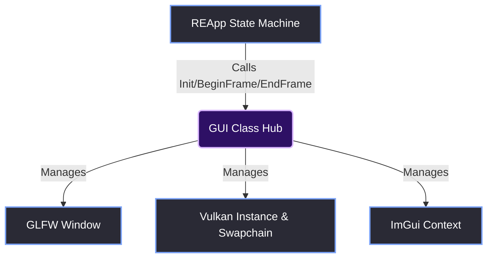
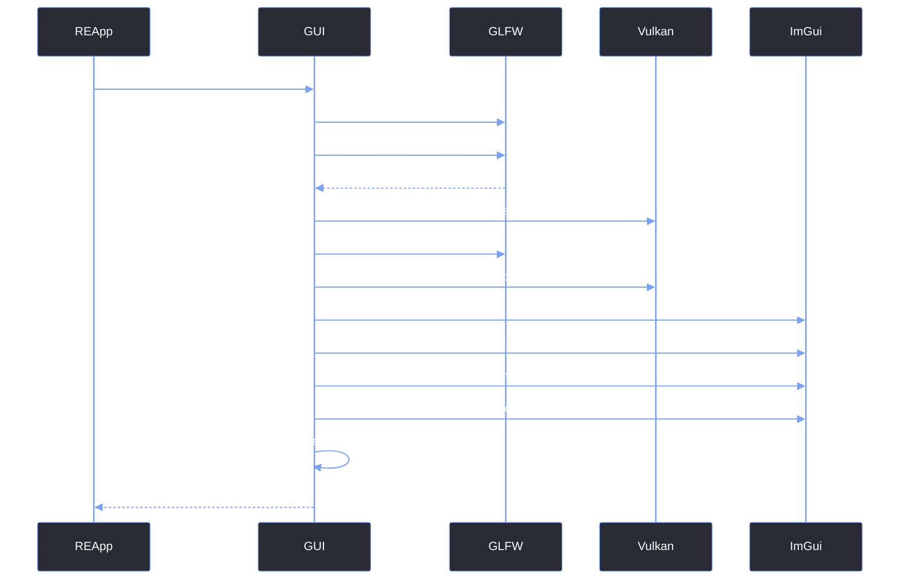

# GUI Class as Infrastructure Hub

> [!abstract] TL;DR
> The `GUI` class (`GUI.h` / `GUI.cpp`) is the absolute foundation of the Red Editor backend. It is an infrastructure hub that owns the OS window, the Vulkan context, and the ImGui backend state. It is designed to be a "dumb" renderer—it knows absolutely nothing about the Launcher, the Inspector, or the Editor state. It only knows how to begin a frame, end a frame, and load textures.

## 1. The Boundary of Responsibility
If you look at the architecture, the `GUI` class sits directly below `REApp` and directly above raw Vulkan. 

Its sole responsibility is to abstract away the agonizing boilerplate of Vulkan and GLFW. The frontend (Editor Windows, Launcher) should never see a `VkInstance`, a `VkCommandBuffer`, or a `GLFWwindow*`.



## 2. The Public API
The `GUI` class exposes an extremely small public API. Everything else is strictly `private`.

```cpp
class GUI {
public:
    // --- Core Engine Lifecycle ---
    static bool Init(const char* title, int width, int height, bool resizable);
    static bool BeginFrame();
    static void EndFrame();
    static void WaitForGPU();
    static void Shutdown();

    // --- Themes & Fonts ---
    static void SetTheme(int themeIndex);
    static int GetTheme();
    
    // --- Texture Management ---
    struct TextureData { ... };
    static bool LoadTextureFromFile(const char* filename, TextureData* tex_data);
    static void RemoveTexture(TextureData* tex_data);

    // --- Getters ---
    static GLFWwindow* GetWindow();
    static bool ShouldClose();
};
```

Notice what is **missing** from this API:
- There is no `GUI::DrawInspector()`.
- There is no `GUI::SetAppState(Editor)`.
- There is no `GUI::ShowLauncher()`.

The `GUI` class is completely agnostic to the application logic. If you wanted to use this exact `GUI` class to build a completely different application (like a standalone image editor or a text editor), you could do so without changing a single line of code in `GUI.cpp`.

## 3. The Vulkan Memory Model (Private State)
To hide Vulkan from the rest of the engine, the `GUI` class uses private static variables and opaque structs.

### The Opaque Texture Handle
The frontend needs to display images (icons, splash screens, asset previews). But the frontend cannot handle `VkImageView` or `VkDeviceMemory`. 

We solve this with `GUI::TextureData`:

```cpp
struct TextureData {
    VkDescriptorSet DS;      // This is what ImGui uses
    int             Width;
    int             Height;
    int             Channels;

    // The frontend doesn't touch these. Only GUI.cpp does.
    VkImageView     ImageView;
    VkImage         Image;
    VkDeviceMemory  ImageMemory;
    VkSampler       Sampler;
    VkBuffer        UploadBuffer;
    VkDeviceMemory  UploadBufferMemory;

    TextureData() { memset(this, 0, sizeof(*this)); }
};
```

When an `EditorWindow` wants to draw an image, it does this:
```cpp
ImGui::Image((ImTextureID)m_TexStrip.DS, ImVec2(700, 75));
```

It simply casts the `VkDescriptorSet` to an `ImTextureID` (which is just a `void*`). The frontend has no idea it is dealing with Vulkan. It just thinks it has an integer handle.

## 4. The Init Sequence
The `GUI::Init()` function is the single most complex piece of backend code. It performs the entire initialization sequence for GLFW, Vulkan, and ImGui in one go.



## 5. The `EndFrame()` Separation
The most critical architectural decision was moving the Vulkan submission *out* of the UI drawing and into `GUI::EndFrame()`.

In the old `GUI.cpp`, the `EditorUI()` function would literally call `vkQueueSubmit()` and `vkQueuePresentKHR()` at the bottom of the main loop.

In the new architecture, `REApp` calls `DrawCurrentState()` which just builds the ImGui draw lists. Then, `REApp` calls `GUI::EndFrame()`. This means the frontend doesn't even need to know that a GPU exists.

> [!bug] I Hit This Issue
> In the old `GUI.cpp`, the engine team had three massive functions: `LuncherUI`, `initSplash`, and `EditorUI`. 
> 
> Each of these functions called `glfwCreateWindow()` and `GUI::SetupVulkan()` from scratch. If you opened the Launcher, the app allocated a Vulkan instance. If you then opened the Editor, it destroyed that instance and created a new one. 
> 
> This caused horrific memory leaks and constant `VK_ERROR_DEVICE_LOST` crashes. When I started the UI rewrite, my very first task was ripping the Vulkan setup out of those UI functions and putting it exclusively inside `GUI::Init()`. The `GUI` class became the only thing in the entire codebase that was allowed to call `vkCreateInstance()`.

> [!summary] What We Took Away
> - The `GUI` class should be a "dumb" rendering backend.
> - Hide all Vulkan handles behind opaque `void*` types (like `ImTextureID`) when passing them to the frontend.
> - Centralize the initialization. Never initialize Vulkan more than once in the lifecycle of the application.
> - If a frontend file includes `<vulkan/vulkan.h>`, the architecture has failed.