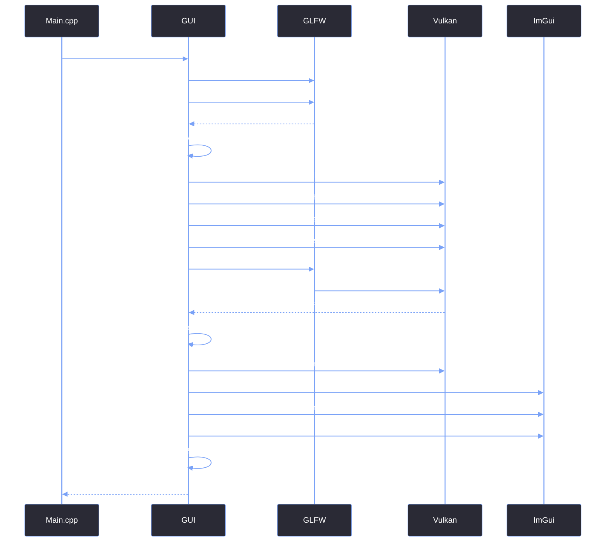
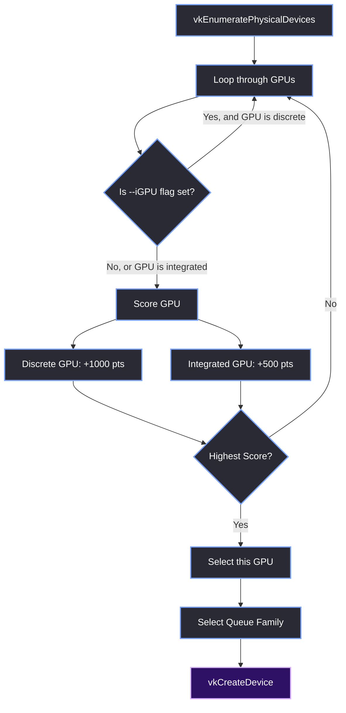

# Vulkan & ImGui Initialization

> [!abstract] TL;DR
> The `GUI::Init()` function is the largest single block of setup code in the editor. It bootstraps GLFW, creates the Vulkan instance and logical device, builds the swapchain, initializes the ImGui context, sets up the FreeType font atlas, and loads the default theme. This note breaks down the entire initialization sequence step-by-step.

## 1. The Initialization Sequence
We cannot simply call `ImGui::CreateContext()` and start drawing. ImGui's Vulkan backend requires a fully constructed Vulkan context (Instance, Physical Device, Logical Device, Queue, RenderPass, and Descriptor Pool) before it can initialize.

Here is the exact sequence of events that occurs inside `GUI::Init()`:



## 2. GLFW Window Creation
Before Vulkan can do anything, it needs a window to draw into. We use GLFW, but we specifically tell it **not** to create an OpenGL context.

```cpp
glfwSetErrorCallback(GUI::glfw_error_callback);
if (!glfwInit()) return false;

// We are using Vulkan, not OpenGL.
glfwWindowHint(GLFW_CLIENT_API, GLFW_NO_API);

// We handle the window frame ourselves via Win32 hooks.
glfwWindowHint(GLFW_DECORATED, GLFW_FALSE);

m_Window = glfwCreateWindow(width, height, title, nullptr, nullptr);
```

We also center the window on the primary monitor at startup so it doesn't spawn halfway off the screen.

## 3. Physical Device Selection (The `--iGPU` Flag)
We don't just pick the first GPU we find. The engine supports a `--iGPU` command-line argument, which forces the editor to use the integrated graphics (useful for having the engine graphics separate from the editor).

Here is the scoring logic inside `GUI::SetupVulkan()`:



> [!tip] What I'd Do Differently
> When implementing the `--iGPU` flag, I didn't actually hit a crash in testing, but I looked at the logic and realized a critical edge case: what if the user passes `--iGPU` but their machine *only* has a discrete GPU? 
> 
> The selection loop would skip every single GPU, resulting in a `VK_NULL_HANDLE` and a guaranteed crash when trying to create the logical device. I took preventative steps to fix it before it ever happened by adding a fallback check. If `g_PhysicalDevice == VK_NULL_HANDLE` after the loop, we log a warning and force the best available discrete GPU anyway. Defensive programming saves time.

## 4. The Descriptor Pool (Heap Corruption Prevention)
ImGui requires a `VkDescriptorPool` to handle font atlases and textures. If the pool is missing the correct descriptor types, ImGui will silently corrupt the heap when it tries to load the default font.

We allocate all 11 standard descriptor types with 1000 descriptors each to ensure we never run out.

```cpp
VkDescriptorPoolSize pool_sizes[] = {
    { VK_DESCRIPTOR_TYPE_SAMPLER, 1000 },
    { VK_DESCRIPTOR_TYPE_COMBINED_IMAGE_SAMPLER, 1000 },
    { VK_DESCRIPTOR_TYPE_SAMPLED_IMAGE, 1000 },
    { VK_DESCRIPTOR_TYPE_STORAGE_IMAGE, 1000 },
    { VK_DESCRIPTOR_TYPE_UNIFORM_TEXEL_BUFFER, 1000 },
    { VK_DESCRIPTOR_TYPE_STORAGE_TEXEL_BUFFER, 1000 },
    { VK_DESCRIPTOR_TYPE_UNIFORM_BUFFER, 1000 },
    { VK_DESCRIPTOR_TYPE_STORAGE_BUFFER, 1000 },
    { VK_DESCRIPTOR_TYPE_UNIFORM_BUFFER_DYNAMIC, 1000 },
    { VK_DESCRIPTOR_TYPE_STORAGE_BUFFER_DYNAMIC, 1000 },
    { VK_DESCRIPTOR_TYPE_INPUT_ATTACHMENT, 1000 }
};
```

## 5. ImGui Context & Flags
Once Vulkan is ready, we initialize ImGui. This is where we enable the core editor features.

```cpp
ImGui::CreateContext();
ImGuiIO& io = ImGui::GetIO();

// Apply Input Settings
if (g_KeyboardNav) io.ConfigFlags |= ImGuiConfigFlags_NavEnableKeyboard;
if (g_GamepadNav) io.ConfigFlags |= ImGuiConfigFlags_NavEnableGamepad;

// Enable Docking & Multi-Viewport
io.ConfigFlags |= ImGuiConfigFlags_DockingEnable;
if (g_EditorMultiViewport) io.ConfigFlags |= ImGuiConfigFlags_ViewportsEnable;

io.MouseDragThreshold = g_MouseDragThreshold;
io.KeyRepeatDelay = g_KeyRepeatDelay;
io.KeyRepeatRate = g_KeyRepeatRate;

// We handle layout saving manually, so we disable the default ini file.
io.IniFilename = nullptr;
```

> [!tip] What I'd Do Differently
> Setting `io.IniFilename = nullptr` is crucial. By default, ImGui tries to save the window layout to `imgui.ini` in the working directory. We disabled this because we wanted to control layout persistence manually (so layouts can be saved per-project rather than globally). 

## 6. ImGui Vulkan Backend Initialization
We fill out the `ImGui_ImplVulkan_InitInfo` struct. This is where we pass all the Vulkan handles we created earlier.

```cpp
ImGui_ImplVulkan_InitInfo init_info = {};
init_info.Instance = g_Instance;
init_info.PhysicalDevice = g_PhysicalDevice;
init_info.Device = g_Device;
init_info.QueueFamily = g_QueueFamily;
init_info.Queue = g_Queue;
init_info.PipelineCache = g_PipelineCache;
init_info.DescriptorPool = g_DescriptorPool;
init_info.RenderPass = wd->RenderPass; // From SetupVulkanWindow
init_info.MinImageCount = g_MinImageCount;
init_info.ImageCount = wd->ImageCount;
init_info.Allocator = g_Allocator;
init_info.CheckVkResultFn = GUI::check_vk_result;

// Apply MSAA based on settings
VkSampleCountFlagBits msaaSamples = VK_SAMPLE_COUNT_1_BIT;
if (g_EditorMSAA == 1) msaaSamples = VK_SAMPLE_COUNT_2_BIT;
else if (g_EditorMSAA == 2) msaaSamples = VK_SAMPLE_COUNT_4_BIT;
else if (g_EditorMSAA == 3) msaaSamples = VK_SAMPLE_COUNT_8_BIT;
init_info.PipelineInfoMain.MSAASamples = msaaSamples;

ImGui_ImplVulkan_Init(&init_info);
```

## 7. Font Loading & FreeType
We use FreeType for high-quality font rasterization. We load the internal SCP font directly from memory, and then safely load the Tinos fonts from disk.

```cpp
// Set the global FreeType loader once for the entire atlas.
io.Fonts->SetFontLoader(ImGuiFreeType::GetFontLoader());

ImFontConfig font_cfg;
font_cfg.FontDataOwnedByAtlas = false;
font_cfg.FontLoaderFlags = ImGuiFreeTypeBuilderFlags_LightHinting;

// Load internal memory font
FontSCP16 = io.Fonts->AddFontFromMemoryTTF(SCPregular, SCPregularsize, 16.5f, &font_cfg);

// Safe loading for hardcoded Tinos fonts
auto SafeLoadFont = [&](const char* path, float size) -> ImFont* {
    if (std::filesystem::exists(path)) {
        return io.Fonts->AddFontFromFileTTF(path, size, &font_cfg);
    }
    else {
        RR_LOG_WARN("GUI", "Missing font file: {}", path);
        return nullptr;
    }
};

FontTinos20 = SafeLoadFont("Resources/Fonts/Tinos Regular.ttf", 20.0f);
// ... load other sizes ...
```

> [!summary] What We Took Away
> - ImGui cannot initialize before Vulkan has a valid `VkRenderPass` and `VkDescriptorPool`.
> - Always allocate all 11 descriptor types in the pool to prevent heap corruption when loading fonts and textures.
> - Disable `io.IniFilename` if you want manual control over layout persistence.
> - Always use `std::filesystem::exists()` before loading a font from disk, or the entire application will abort if the user accidentally deletes a file.
> - Defensive programming saves time. Anticipate edge cases before they become crashes.