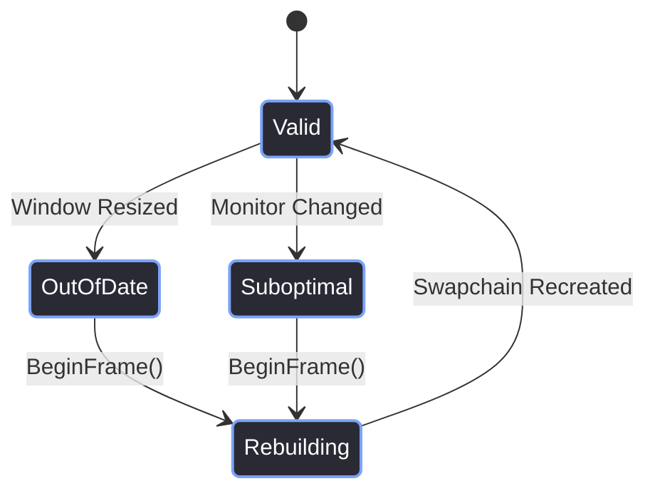
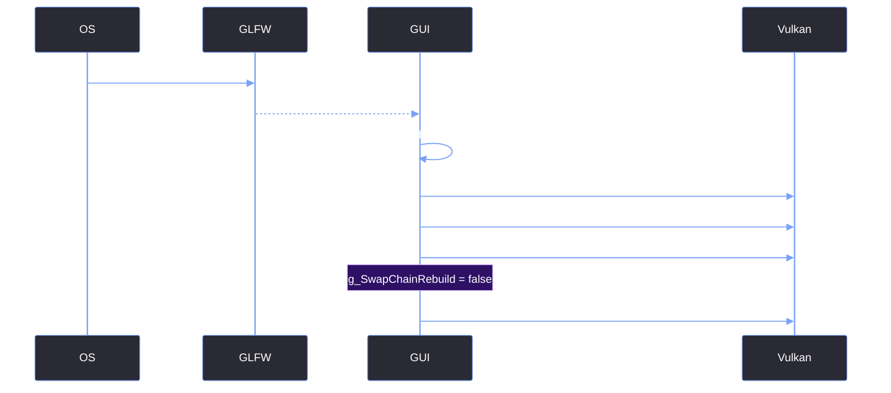

# Swapchain & Resize Handling

> [!abstract] TL;DR
> In Vulkan, the swapchain is the queue of images that gets presented to the OS window. When the window is resized, minimized, or moved to a different monitor, the swapchain becomes invalid. Rebuilding the swapchain is an expensive operation. If you rebuild it every frame, you get massive CPU stutters. If you rebuild it at the wrong time, you get a `VK_ERROR_DEVICE_LOST` crash. This note explains how we use the `g_SwapChainRebuild` flag to safely handle resizing.

## 1. The Resize Problem
When a user resizes the Red Editor window, the resolution of the swapchain no longer matches the resolution of the OS window. 

Vulkan signals this with two specific error codes:
- **`VK_ERROR_OUT_OF_DATE_KHR`**: The swapchain is completely invalid. You cannot render this frame.
- **`VK_SUBOPTIMAL_KHR`**: The swapchain still works, but the image quality or size is no longer perfect (e.g., the user dragged the window to a different DPI monitor). You *can* render, but you should rebuild soon.

If you ignore these errors, `vkAcquireNextImageKHR` will fail, and the screen will freeze or flicker.



## 2. The `g_SwapChainRebuild` Flag
We use a global boolean (`g_SwapChainRebuild`) to defer the actual swapchain destruction. 

We never destroy the swapchain mid-frame. We just set the flag to `true` when we detect a problem. Then, at the very beginning of the *next* frame, we check the flag and rebuild.

### Phase 1: Setting the Flag
Inside `GUI::FrameRender()` and `GUI::FramePresent()`, we check the result of the Vulkan calls:

```cpp
// Inside FrameRender()
VkResult err = vkAcquireNextImageKHR(...);
if (err == VK_ERROR_OUT_OF_DATE_KHR || err == VK_SUBOPTIMAL_KHR)
    g_SwapChainRebuild = true;
if (err == VK_ERROR_OUT_OF_DATE_KHR)
    return; // Abort this frame entirely
```

### Phase 2: Handling the Flag
Inside `GUI::BeginFrame()`, we check if the framebuffer size actually changed, *or* if the rebuild flag was tripped.

```cpp
int fb_width, fb_height;
glfwGetFramebufferSize(m_Window, &fb_width, &fb_height);

// Ignore 0x0 framebuffers (minimized window)
if (fb_width > 0 && fb_height > 0) {
    
    // If the size changed, or Vulkan told us it's out of date...
    if (g_MainWindowData.Width != fb_width || g_MainWindowData.Height != fb_height) {
        ImGui_ImplVulkan_SetMinImageCount(g_MinImageCount);
        
        // This destroys the old swapchain and creates a new one
        GUI::SetupVulkanWindow(&g_MainWindowData, g_MainWindowData.Surface, fb_width, fb_height);
        
        g_MainWindowData.FrameIndex = 0;
        g_SwapChainRebuild = false; // Clear the flag
    }
    else if (g_SwapChainRebuild) {
        // The size didn't change, but the driver said it was suboptimal.
        // We acknowledge the flag, but we don't do a full rebuild.
        g_SwapChainRebuild = false; 
    }
}
```

## 3. The Window Resize Sequence
Here is the exact sequence of events when a user drags the corner of the window:



## 4. The Minimize Bug (The 0x0 Framebuffer)
If the user minimizes the window, `glfwGetFramebufferSize` returns `0x0`. If you pass `0` into `ImGui_ImplVulkanH_CreateOrResizeWindow`, the Vulkan driver will throw a validation error or crash outright.

This is why we have the `if (fb_width > 0 && fb_height > 0)` guard. If the window is minimized, we simply skip the swapchain rebuild entirely.

> [!bug] I Hit This Issue
> When I first implemented the `g_SwapChainRebuild` flag, I hit a massive performance issue during Alt-Tab.
> 
> When the editor lost focus, Windows would occasionally report the swapchain as `VK_SUBOPTIMAL_KHR`. My code blindly rebuilt the entire swapchain every single time this happened. Because the editor was in the background, it was constantly rebuilding the swapchain 60 times a second, causing a massive CPU spike that tanked the framerate of whatever game or application the user had Alt-Tabbed *into*.
> 
> The fix was the `else if (g_SwapChainRebuild)` branch above. I realized that if the framebuffer size hasn't actually changed, we don't need to rebuild the swapchain. We just need to acknowledge the flag, clear it, and keep rendering. We also added the focus throttle (`sleep_for(16ms)`) to prevent the background loop from running at full speed.

## 5. Multi-Viewport Swaps
Because we enable `ImGuiConfigFlags_ViewportsEnable`, the user can drag an editor window (like the Console) outside the main application window. 

When this happens, ImGui creates a *secondary* OS window and a *secondary* swapchain. We don't manage these manually. Instead, `ImGui::RenderPlatformWindowsDefault()` handles the entire swapchain creation and presentation for these secondary windows.

```cpp
void GUI::EndFrame() {
    // ... render main window ...

    if (io.ConfigFlags & ImGuiConfigFlags_ViewportsEnable) {
        ImGui::UpdatePlatformWindows();
        ImGui::RenderPlatformWindowsDefault();
    }

    // ... present main window ...
}
```

> [!summary] What We Took Away
> - Never rebuild the swapchain in the middle of a frame. Defer it to `BeginFrame()`.
> - Ignore `VK_SUBOPTIMAL_KHR` unless the framebuffer size actually changed.
> - Always check for `fb_width > 0` and `fb_height > 0` to prevent crashes when the window is minimized.
> - Rebuilding the swapchain requires a full GPU wait (`vkDeviceWaitIdle`), which is why doing it unnecessarily causes frame-rate stutters.

