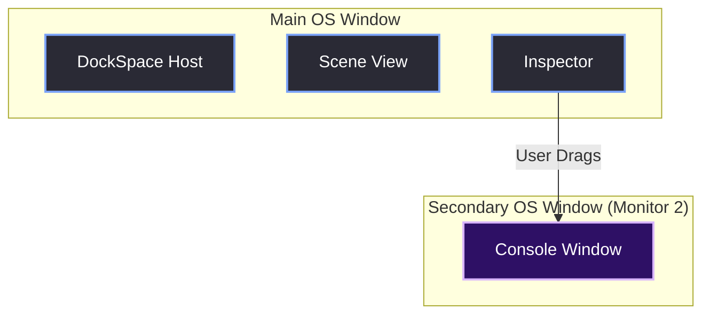
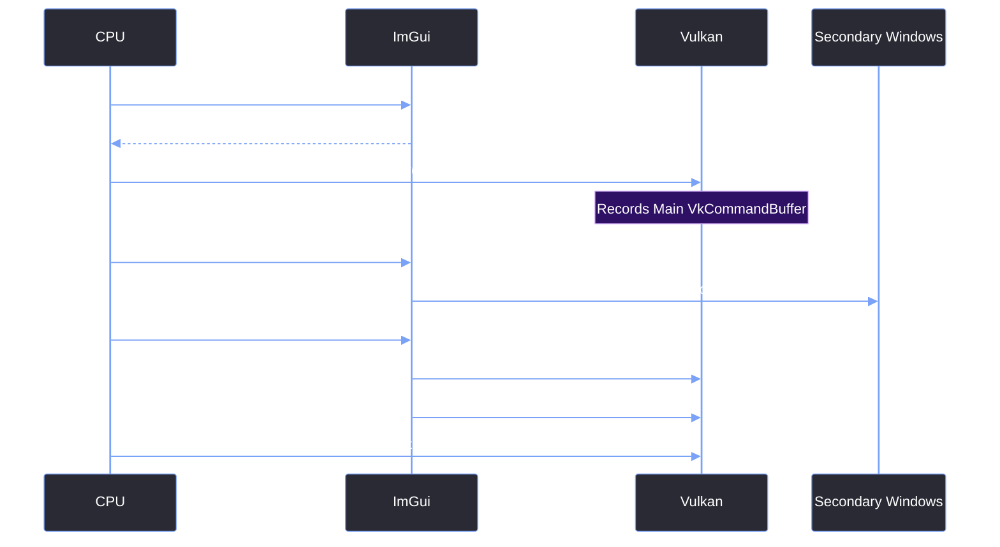

# Multi-Viewport Setup

> [!abstract] TL;DR
> Multi-viewport allows the user to drag an editor window (like the Asset Browser or Console) completely outside the main Red Editor application window, creating a brand new native OS window. This is crucial for multi-monitor setups. However, it requires careful sequencing during the render phase. You must update and render the secondary platform windows *after* the main window, but *before* presenting the final image to the screen.

## 1. What is Multi-Viewport?
In a traditional application, all UI lives inside one single OS window. If you want a tool on a second monitor, the entire application has to span across both monitors.

With Dear ImGui's docking branch, you can enable `ImGuiConfigFlags_ViewportsEnable`. When the user drags a docked window (e.g., the Console) out of the main editor frame, ImGui seamlessly creates a *new, native OS window* for that specific tool. The OS window manager treats it like any other application window (it gets its own taskbar icon, can be maximized independently, etc.).



## 2. The 1x1 Window Hack (Why It Broke)
In the original `GUI.cpp`, the engine team used the infamous "1x1 Window Hack." They created a GLFW window that was exactly 1 pixel by 1 pixel, and then drew a massive 1920x1080 ImGui window on top of it.

This completely broke multi-viewport. Because the native OS window was only 1 pixel wide, the OS window manager had no idea the application actually took up the whole screen. When a user tried to drag a tool window outside the main ImGui window, the OS would clip it immediately, or the window would vanish entirely. Aero Snap was also completely non-functional.

In the new architecture, we create a properly sized GLFW window (`900x650` for the Launcher, `1920x1080` for the Editor). The OS knows exactly how big the window is, so dragging secondary viewports outside the main frame works flawlessly.

## 3. The Rendering Sequence
Enabling multi-viewport is not as simple as setting a flag. You have to change the order of operations at the very end of your frame. 

If you just call `ImGui::Render()` and present, the secondary windows will flicker or fail to draw entirely.



## 4. The Code Implementation
Here is the exact code inside `GUI::EndFrame()` that makes this work.

```cpp
void GUI::EndFrame() {
    ImGuiIO& io = ImGui::GetIO();
    
    // 1. Flatten the main window UI
    ImGui::Render();
    ImDrawData* main_draw_data = ImGui::GetDrawData();

    const bool main_is_minimized = (main_draw_data->DisplaySize.x <= 0.0f || main_draw_data->DisplaySize.y <= 0.0f);

    // 2. Render the main window
    if (!main_is_minimized) {
        GUI::FrameRender(&g_MainWindowData, main_draw_data);
    }

    // 3. THE MAGIC: Handle Multi-Viewport
    if (io.ConfigFlags & ImGuiConfigFlags_ViewportsEnable) {
        ImGui::UpdatePlatformWindows();
        ImGui::RenderPlatformWindowsDefault();
    }

    // 4. Present the main window to the OS
    if (!main_is_minimized) {
        GUI::FramePresent(&g_MainWindowData);
    }
}
```

> [!warning] Order Matters
> You must call `RenderPlatformWindowsDefault()` *after* `FrameRender()` (which draws the main window) but *before* `FramePresent()`. 
> 
> If you call `RenderPlatformWindowsDefault()` before rendering the main window, the main window will draw over the secondary windows. If you call it after `FramePresent()`, you will get intense flickering because the main window and secondary windows are being presented to the OS at different times.

## 5. Swapchain Management for Viewports
You might notice that we never manually create a `VkSwapchainKHR` for the secondary windows. 

When you call `ImGui::RenderPlatformWindowsDefault()`, ImGui's Vulkan backend dynamically creates a new `ImGui_ImplVulkanH_Window` (which contains its own swapchain, render pass, and framebuffers) for *every* floating window. It handles all the resize events and presentation for these secondary windows internally. This means you don't have to write thousands of lines of boilerplate swapchain code for every window the user decides to drag onto their second monitor.

> [!summary] What We Took Away
> - Multi-viewport turns ImGui windows into real, native OS windows.
> - The 1x1 window hack completely destroys multi-viewport functionality. Use a properly sized OS window.
> - The render sequence is strict: Main Render -> Platform Windows Render -> Main Present.
> - ImGui handles the swapchain creation for secondary windows automatically.