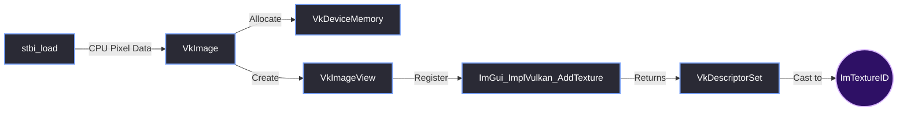
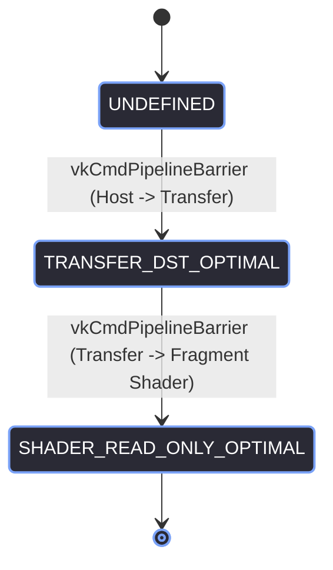

# Texture Loading (ImGui 1.93+)

> [!abstract] TL;DR
> Loading an image from disk and getting it onto the screen in Vulkan is a heavily involved process. You have to decode the image on the CPU, create a Vulkan Image, allocate GPU memory, create a staging buffer, record a command buffer to transition the image layout, and finally submit it to the GPU queue. On top of that, Dear ImGui 1.93+ changed how textures are registered. This note breaks down our `GUI::LoadTextureFromFile` implementation and how we hide all of this complexity behind an opaque `ImTextureID`.

## 1. The Bridge: `ImTextureID` to `VkDescriptorSet`
Dear ImGui operates entirely independently of the graphics API. To it, a texture is just an `ImTextureID`, which is fundamentally a `void*` (a pointer to literally anything). 

Vulkan, however, requires a `VkDescriptorSet` to sample an image in a shader. 

Our job in the `GUI` backend is to take the raw image data, create all the necessary Vulkan objects, and return an `ImTextureID` that ImGui can use.



## 2. The ImGui 1.93 Breaking Change
Before version 1.93, the function to register a texture looked like this:
```cpp
// Old ImGui
ImTextureID ImGui_ImplVulkan_AddTexture(VkSampler sampler, VkImageView imageView, VkImageLayout imageLayout);
```
You had to explicitly pass a `VkSampler` every time you loaded a texture.

In ImGui 1.93+, the backend manages a default sampler internally to support dynamic font atlases. The signature was changed to:
```cpp
// New ImGui 1.93+
ImTextureID ImGui_ImplVulkan_AddTexture(VkImageView imageView, VkImageLayout imageLayout);
```

Because we already create our own `VkSampler` in `LoadTextureFromFile`, we have to store it in our `TextureData` struct so we can destroy it properly later. But we do *not* pass it to `AddTexture` anymore.

## 3. The Upload Pipeline (Step-by-Step)
Here is the exact sequence of Vulkan commands required to get a `.png` file onto the GPU.

### Step 1: CPU Decoding
We use `stb_image` to decode the file into a flat array of RGBA bytes.
```cpp
tex_data->Channels = 4; // Force RGBA
unsigned char* image_data = stbi_load(filename, &tex_data->Width, &tex_data->Height, 0, tex_data->Channels);
```

### Step 2: Create the Image & GPU Memory
We create a `VkImage` in `VK_IMAGE_TILING_OPTIMAL` and allocate `VK_MEMORY_PROPERTY_DEVICE_LOCAL_BIT` memory for it.
```cpp
VkImageCreateInfo info = {};
info.imageType = VK_IMAGE_TYPE_2D;
info.format = VK_FORMAT_R8G8B8A8_UNORM;
info.extent.width = tex_data->Width;
info.extent.height = tex_data->Height;
info.usage = VK_IMAGE_USAGE_SAMPLED_BIT | VK_IMAGE_USAGE_TRANSFER_DST_BIT;
// ... create image and bind memory ...
```

### Step 3: The Staging Buffer
We cannot directly copy CPU data to device-local memory. We must create a `VkBuffer` in host-visible memory, map it, copy the `stbi` data into it, and unmap it.

```cpp
// Create VkBuffer with VK_MEMORY_PROPERTY_HOST_VISIBLE_BIT
void* map = NULL;
vkMapMemory(g_Device, tex_data->UploadBufferMemory, 0, image_size, 0, &map);
memcpy(map, image_data, image_size);
vkUnmapMemory(g_Device, tex_data->UploadBufferMemory);
```

### Step 4: Command Buffer & Barriers
This is the most critical part. We have to transition the `VkImage` layouts correctly, or the Vulkan validation layers will scream at us.



1.  **Transition 1:** `VK_IMAGE_LAYOUT_UNDEFINED` to `VK_IMAGE_LAYOUT_TRANSFER_DST_OPTIMAL`.
2.  **Copy:** `vkCmdCopyBufferToImage` (moves data from the staging buffer to the image).
3.  **Transition 2:** `VK_IMAGE_LAYOUT_TRANSFER_DST_OPTIMAL` to `VK_IMAGE_LAYOUT_SHADER_READ_ONLY_OPTIMAL`.

### Step 5: Submit and Wait
We submit the command buffer to the queue and *immediately wait for the GPU to finish* before returning.

```cpp
VkSubmitInfo end_info = {};
end_info.commandBufferCount = 1;
end_info.pCommandBuffers = &command_buffer;

vkEndCommandBuffer(command_buffer);
vkQueueSubmit(g_Queue, 1, &end_info, VK_NULL_HANDLE);
vkDeviceWaitIdle(g_Device); // <-- The performance killer
```

## 4. The `TextureData` Cleanup
Because we are manually managing Vulkan memory, we must clean up every single object. ImGui's `RemoveTexture` only frees the `VkDescriptorSet`. We have to manually destroy the sampler, image view, image, memory, and buffer.

```cpp
void GUI::RemoveTexture(TextureData* tex_data) {
    if (!tex_data) return;

    if (tex_data->DS)                 ImGui_ImplVulkan_RemoveTexture(tex_data->DS);
    if (tex_data->Sampler)            vkDestroySampler(g_Device, tex_data->Sampler, nullptr);
    if (tex_data->ImageView)          vkDestroyImageView(g_Device, tex_data->ImageView, nullptr);
    if (tex_data->Image)              vkDestroyImage(g_Device, tex_data->Image, nullptr);
    if (tex_data->ImageMemory)        vkFreeMemory(g_Device, tex_data->ImageMemory, nullptr);
    if (tex_data->UploadBuffer)       vkDestroyBuffer(g_Device, tex_data->UploadBuffer, nullptr);
    if (tex_data->UploadBufferMemory) vkFreeMemory(g_Device, tex_data->UploadBufferMemory, nullptr);

    memset(tex_data, 0, sizeof(*tex_data));
}
```

> [!tip] What I'd Do Differently
> While this synchronous loading works perfectly for the Launcher and Splash Screen (where we are loading a handful of icons and showing a loading bar anyway), it is a massive performance bottleneck for the Editor.
> 
> `vkDeviceWaitIdle` completely stalls the GPU pipeline. If an `EditorWindow` tries to load 50 textures at once using this function, the editor will freeze for several seconds because it's waiting for a full GPU sync on every single image.
> 
> If you are building a heavy asset browser, you should move texture loading to a background thread using a transfer queue, record all the copies into one command buffer, and submit them as a batch. But for the Red Editor's core UI icons, keeping it simple and synchronous was the right call.

> [!summary] What We Took Away
> - ImGui 1.93 removed the `VkSampler` argument from `ImGui_ImplVulkan_AddTexture`. You must manage the sampler yourself.
> - You cannot copy CPU memory directly to a `DEVICE_LOCAL` VkImage. You must use a host-visible staging buffer.
> - Image layout transitions (`TRANSFER_DST_OPTIMAL` -> `SHADER_READ_ONLY_OPTIMAL`) are mandatory before sampling.
> - `vkDeviceWaitIdle` is a synchronous bottleneck. Use it for UI icons, but batch it for heavy assets.
> - Always clean up the `VkSampler` manually in your `RemoveTexture` function.