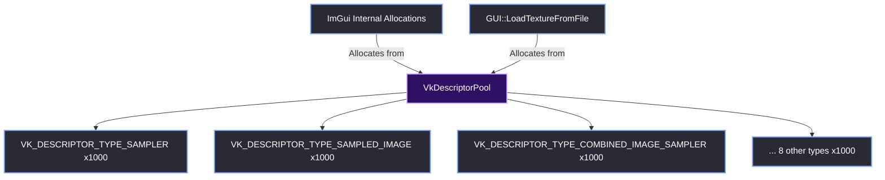

# Descriptor Pool Configuration

> [!abstract] TL;DR
> In Vulkan, you cannot just bind a texture to a shader out of thin air. You have to allocate descriptor sets from a `VkDescriptorPool`. Because Dear ImGui manages its own descriptor sets internally for fonts and textures, we have to give it a pool large enough to handle everything. If we guess the types or sizes wrong, ImGui will silently write out of bounds and corrupt the heap. To prevent this, we allocate all 11 standard descriptor types with a massive buffer.

## 1. The Role of the Descriptor Pool
Every time ImGui needs to draw an image (including its own internal font atlas), it requests a `VkDescriptorSet`. A descriptor set is essentially a contract that tells the GPU, "Here is the image view, here is the sampler, and here is how to read the memory."

In Vulkan, descriptor sets are not allocated individually. They are sub-allocated from a `VkDescriptorPool`. 

When we create that pool, we must explicitly declare exactly how many descriptors of each type we need, and how many total sets we want to be able to allocate.

## 2. The Heap Corruption Bug
If you look at older ImGui Vulkan tutorials, they often use a very minimal descriptor pool:

```cpp
// DANGEROUS: This will cause heap corruption if you load textures
VkDescriptorPoolSize pool_sizes[] = {
    { VK_DESCRIPTOR_TYPE_COMBINED_IMAGE_SAMPLER, 1 }
};
```

> [!bug] I Hit This Issue
> We hit a massive heap corruption crash when we upgraded to ImGui 1.93.0. 
> 
> The app would crash unexpectedly, and the validation layers eventually pointed us to a memory corruption issue. It turned out that ImGui 1.93.0 changed how it allocates descriptor sets for dynamic font atlases. It wasn't just using `COMBINED_IMAGE_SAMPLER` anymore; it was now explicitly requesting separate `SAMPLED_IMAGE` and `SAMPLER` descriptors.
> 
> Because our `VkDescriptorPool` didn't have those specific descriptor types registered, ImGui silently wrote out of bounds into memory. The allocation didn't fail with a clean Vulkan error; it just corrupted the heap and crashed the app. We had to fix the `VkDescriptorPool` initialization to include the missing descriptor types to prevent the memory corruption.

## 3. The Defensive Solution (All 11 Types)
To prevent this from ever happening again, we allocated all 11 standard Vulkan descriptor types with 1000 slots each. This provides a massive buffer for ImGui to do whatever it needs internally.

Here is the exact code from `GUI::SetupVulkan()`:

```cpp
VkDescriptorPoolSize pool_sizes[] = {
    { VK_DESCRIPTOR_TYPE_SAMPLER, 1000 },
    { VK_DESCRIPTOR_TYPE_COMBINED_IMAGE_SAMPLER, 1000 },
    { VK_DESCRIPTOR_TYPE_SAMPLED_IMAGE, 1000 },
    { VK_DESCRIPTOR_TYPE_STORAGE_IMAGE, 1000 },
    { VK_DESCRIPTOR_TYPE_UNIFORM_TEXEL_BUFFER, 1000 },
    { VK_DESCRIPTOR_TYPE_STORAGE_TEXEL_BUFFER, 1000 },
    { VK_DESCRIPTOR_TYPE_UNIFORM_BUFFER, 1000 },
    { VK_DESCRIPTOR_TYPE_STORAGE_BUFFER, 1000 },
    { VK_DESCRIPTOR_TYPE_UNIFORM_BUFFER_DYNAMIC, 1000 },
    { VK_DESCRIPTOR_TYPE_STORAGE_BUFFER_DYNAMIC, 1000 },
    { VK_DESCRIPTOR_TYPE_INPUT_ATTACHMENT, 1000 }
};

VkDescriptorPoolCreateInfo pool_info = {};
pool_info.sType = VK_STRUCTURE_TYPE_DESCRIPTOR_POOL_CREATE_INFO;

// Allow ImGui to free individual descriptor sets when textures are unloaded
pool_info.flags = VK_DESCRIPTOR_POOL_CREATE_FREE_DESCRIPTOR_SET_BIT;

// Calculate total max sets: 1000 (base) + 11,000 (sum of all pool sizes)
pool_info.maxSets = 1000;
for (VkDescriptorPoolSize& pool_size : pool_sizes)
    pool_info.maxSets += pool_size.descriptorCount;

pool_info.poolSizeCount = (uint32_t)IM_ARRAYSIZE(pool_sizes);
pool_info.pPoolSizes = pool_sizes;

VkResult err = vkCreateDescriptorPool(g_Device, &pool_info, g_Allocator, &g_DescriptorPool);
check_vk_result(err);
```

## 4. Why So Many?
You might be wondering why we allocate 11,000 descriptors for a simple UI editor. 

- **Fonts:** ImGui loads the font atlas into GPU memory. If we later add dynamic font sizes or icons, ImGui needs more descriptor sets.
- **UI Textures:** Every icon, splash screen, and thumbnail in the Asset Browser requires a descriptor set.
- **Multi-Viewport:** Every secondary OS window (floating editor window) created by ImGui gets its own pipeline and may request its own descriptor sets.
- **Safety Margin:** Descriptor memory is cheap. Allocating 11,000 descriptors costs less than a megabyte of VRAM. It is vastly cheaper than spending three days tracking down a heap corruption bug.



## 5. The `FREE_DESCRIPTOR_SET_BIT` Flag
Notice the `VK_DESCRIPTOR_POOL_CREATE_FREE_DESCRIPTOR_SET_BIT` flag. 

If you don't set this flag, you can allocate descriptor sets from the pool, but you can never free them individually. You would have to destroy the entire pool to reclaim the memory.

Because the Red Editor loads and unloads textures dynamically (e.g., when switching projects), we *must* be able to call `ImGui_ImplVulkan_RemoveTexture()` and have it actually return the descriptor set to the pool. Without this flag, we would eventually run out of descriptors and crash.

> [!summary] What We Took Away
> - Always declare all 11 standard descriptor types when creating an ImGui Vulkan pool.
> - ImGui 1.93.0 requires `SAMPLER` and `SAMPLED_IMAGE` descriptors, not just `COMBINED_IMAGE_SAMPLER`.
> - A missing descriptor type causes silent heap corruption, not a clean Vulkan error.
> - Set `VK_DESCRIPTOR_POOL_CREATE_FREE_DESCRIPTOR_SET_BIT` so ImGui can free textures dynamically.