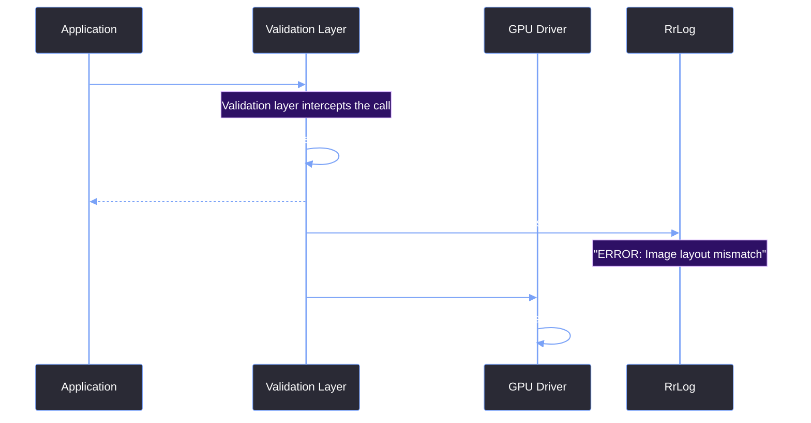

# Vulkan Validation Layers

> [!abstract] TL;DR
> Vulkan is notorious for being silent when you make a mistake. If you pass a bad handle or mess up synchronization, the driver might just crash, or worse, render a black screen with no error. To catch these issues during development, we enable the Khronos Validation Layers. They act as a middleman between the application and the driver, checking every API call for correctness.

## 1. Enabling the Layers
Validation layers are only enabled in Debug builds. We use a preprocessor macro `APP_USE_VULKAN_DEBUG_REPORT` to wrap the initialization logic. If this is defined, we append the validation layer name to our instance creation info.

```cpp
#ifdef APP_USE_VULKAN_DEBUG_REPORT
    const char* layers[] = { "VK_LAYER_KHRONOS_validation" };
    create_info.enabledLayerCount = 1;
    create_info.ppEnabledLayerNames = layers;
    instance_extensions.push_back("VK_EXT_debug_report");
#endif

VkResult err = vkCreateInstance(&create_info, g_Allocator, &g_Instance);
```

> [!warning] Shipping with Validation
> Never ship a release build with validation layers enabled. They add massive overhead (often 2x to 10x slower) and require the user to have the Vulkan SDK installed. They are strictly for developer machines.

## 2. Creating the Debug Callback
Enabling the layer is only half the battle. We also need to tell Vulkan where to send the error messages. We use the `VK_EXT_debug_report` extension to register a C-style callback function.

```cpp
auto f_vkCreateDebugReportCallbackEXT = (PFN_vkCreateDebugReportCallbackEXT)vkGetInstanceProcAddr(g_Instance, "vkCreateDebugReportCallbackEXT");

VkDebugReportCallbackCreateInfoEXT debug_report_ci = {};
debug_report_ci.sType = VK_STRUCTURE_TYPE_DEBUG_REPORT_CALLBACK_CREATE_INFO_EXT;
// We want errors, warnings, and performance warnings
debug_report_ci.flags = VK_DEBUG_REPORT_ERROR_BIT_EXT | VK_DEBUG_REPORT_WARNING_BIT_EXT | VK_DEBUG_REPORT_PERFORMANCE_WARNING_BIT_EXT;
debug_report_ci.pfnCallback = debug_report;
debug_report_ci.pUserData = nullptr;

err = f_vkCreateDebugReportCallbackEXT(g_Instance, &debug_report_ci, g_Allocator, &g_DebugReport);
```

## 3. The Callback Implementation
The callback itself is a simple function that receives the error message and prints it. We route it through our custom logger so it shows up in the Console window.

```cpp
VKAPI_ATTR VkBool32 VKAPI_CALL GUI::debug_report(
    VkDebugReportFlagsEXT flags, 
    VkDebugReportObjectTypeEXT objectType, 
    uint64_t object, 
    size_t location, 
    int32_t messageCode, 
    const char* pLayerPrefix, 
    const char* pMessage, 
    void* pUserData) 
{
    // We route the Vulkan error directly into our RrLog system
    RR_LOG_ERROR("Vulkan", "[{}] {}", pLayerPrefix, pMessage);
    return VK_FALSE;
}
```

## 4. The Validation Flow



> [!summary] What We Took Away
> - Validation layers are mandatory for development.
> - Use `VK_LAYER_KHRONOS_validation` and the `VK_EXT_debug_report` extension.
> - The callback receives formatted strings that can be routed directly into your UI console.
> - Always wrap validation layer setup in `#ifdef _DEBUG` macros.