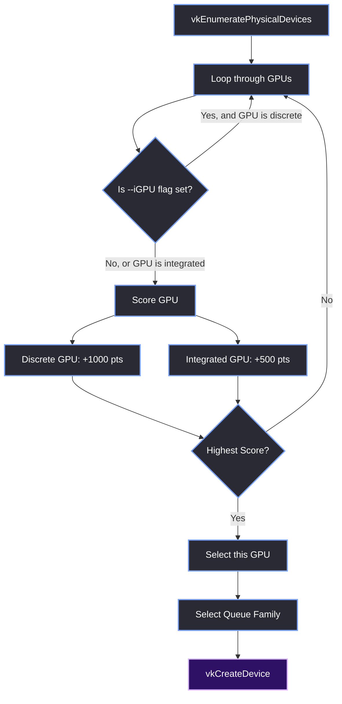

# GPU Selection

> [!abstract] TL;DR
> Modern machines (especially laptops) have multiple GPUs: a weak integrated GPU (iGPU) for battery life and a powerful discrete GPU (dGPU) for gaming. By default, Vulkan will just pick the first one it finds, which is usually the iGPU. We implemented a custom scoring system to automatically pick the most powerful GPU, along with a `--iGPU` command-line flag for users who want to dedicate the dGPU to the game engine while the editor runs on the iGPU.

## 1. The Scoring Algorithm
When we enumerate the available physical devices, we don't just grab index 0. We iterate through all of them and assign a "score" based on their type.

```cpp
uint32_t gpu_count = 0;
vkEnumeratePhysicalDevices(g_Instance, &gpu_count, nullptr);
// ... allocate array of VkPhysicalDevice ...

int bestScore = -1;
g_PhysicalDevice = VK_NULL_HANDLE;

for (uint32_t i = 0; i < gpu_count; ++i) {
    VkPhysicalDeviceProperties props;
    vkGetPhysicalDeviceProperties(gpus[i], &props);

    // If the user passed --iGPU, skip any discrete GPUs
    if (g_ForceIGPU && props.deviceType != VK_PHYSICAL_DEVICE_TYPE_INTEGRATED_GPU) {
        continue; 
    }

    int score = 0;
    if (props.deviceType == VK_PHYSICAL_DEVICE_TYPE_DISCRETE_GPU)   score += 1000;
    if (props.deviceType == VK_PHYSICAL_DEVICE_TYPE_INTEGRATED_GPU) score += 500;

    if (score > bestScore) {
        bestScore = score;
        g_PhysicalDevice = gpus[i];
    }
}
```

<table style="width: 100%; border-collapse: collapse; color: #cdd6f4; margin-bottom: 20px; font-size: 0.95em;">
  <tr style="background-color: #2e1065; color: #ffffff;">
    <th style="border: 1px solid #7aa2f7; padding: 10px; text-align: left;">Device Type</th>
    <th style="border: 1px solid #7aa2f7; padding: 10px; text-align: left;">Score</th>
    <th style="border: 1px solid #7aa2f7; padding: 10px; text-align: left;">Reason</th>
  </tr>
  <tr style="background-color: #2a2a35;">
    <td style="border: 1px solid #7aa2f7; padding: 10px;"><code>DISCRETE_GPU</code></td>
    <td style="border: 1px solid #7aa2f7; padding: 10px;">+1000</td>
    <td style="border: 1px solid #7aa2f7; padding: 10px;">Always preferred for performance.</td>
  </tr>
  <tr style="background-color: #1e1e2e;">
    <td style="border: 1px solid #7aa2f7; padding: 10px;"><code>INTEGRATED_GPU</code></td>
    <td style="border: 1px solid #7aa2f7; padding: 10px;">+500</td>
    <td style="border: 1px solid #7aa2f7; padding: 10px;">Used if no dGPU exists, or forced via <code>--iGPU</code>.</td>
  </tr>
</table>

## 2. The `--iGPU` Flag
In `Main.cpp`, we parse the command-line arguments. If `--iGPU` is passed, we set a global flag.

```cpp
for (int i = 1; i < argc; ++i) {
    std::string arg = argv[i];
    if (arg == "--iGPU") {
        g_ForceIGPU = true;
    }
}
```

This is incredibly useful for laptops. If you are developing a game, you want the game engine to run on the powerful discrete GPU. But the editor UI is just a bunch of 2D windows; it doesn't need the dGPU. By running the editor on the iGPU, you leave the dGPU completely dedicated to rendering the game viewport.

## 3. The Selection Flowchart



> [!tip] What I'd Do Differently
> When implementing the `--iGPU` flag, I didn't actually hit a crash in testing, but I looked at the logic and realized a critical edge case: what if the user passes `--iGPU` but their machine *only* has a discrete GPU? 
> 
> The selection loop would skip every single GPU, resulting in a `VK_NULL_HANDLE` and a guaranteed crash when trying to create the logical device. I took preventative steps to fix it before it ever happened by adding a fallback check. If `g_PhysicalDevice == VK_NULL_HANDLE` after the loop, we log a warning and force the best available discrete GPU anyway. Defensive programming saves time.

> [!summary] What We Took Away
> - Never trust that `VkPhysicalDevice[0]` is the best GPU.
> - Use `VkPhysicalDeviceType` to score the GPUs and pick the discrete one by default.
> - The `--iGPU` flag allows developers to isolate the heavy game rendering from the editor UI.
> - Always write a fallback in case the user's requested GPU doesn't exist on their system.