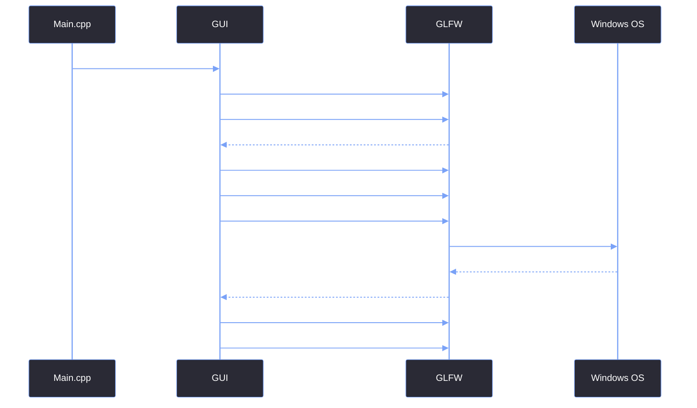

# GLFW Window Creation

> [!abstract] TL;DR
> The foundation of the Red Editor is the raw OS window. We use GLFW to create it, but we don't just call `glfwCreateWindow` with default settings. We must explicitly tell GLFW that we are using Vulkan (not OpenGL), that we want a borderless window (so we can draw our own ImGui header), and that the window should start centered on the primary monitor.

## 1. The GLFW Initialization Pipeline
Before we can create a window, GLFW needs to initialize the platform-specific windowing APIs. If this fails, the entire application aborts.

```cpp
// Register a callback to catch GLFW errors
glfwSetErrorCallback(GUI::glfw_error_callback);

// Initialize the GLFW library
if (!glfwInit()) {
    return false;
}
```

## 2. The Critical Window Hints
A "hint" in GLFW is a configuration flag that must be set *before* the window is created. If you set them after, they have no effect. We rely on three critical hints to build the Red Editor.

```cpp
// 1. Tell GLFW we are using Vulkan, not OpenGL. 
// This prevents GLFW from creating an OpenGL context, which we don't need.
glfwWindowHint(GLFW_CLIENT_API, GLFW_NO_API);

// 2. Tell GLFW to remove the OS title bar and borders.
// This is what allows us to draw our own CustomFrame using ImGui.
glfwWindowHint(GLFW_DECORATED, GLFW_FALSE);

// 3. Set the window to be resizable.
// We pass this in as a parameter because the Launcher is fixed-size, 
// but the Editor needs to be resizable.
glfwWindowHint(GLFW_RESIZABLE, resizable ? GLFW_TRUE : GLFW_FALSE);
```

<table style="width: 100%; border-collapse: collapse; color: #cdd6f4; margin-bottom: 20px; font-size: 0.95em;">
  <tr style="background-color: #2e1065; color: #ffffff;">
    <th style="border: 1px solid #7aa2f7; padding: 10px; text-align: left;">GLFW Hint</th>
    <th style="border: 1px solid #7aa2f7; padding: 10px; text-align: left;">Value</th>
    <th style="border: 1px solid #7aa2f7; padding: 10px; text-align: left;">Why?</th>
  </tr>
  <tr style="background-color: #2a2a35;">
    <td style="border: 1px solid #7aa2f7; padding: 10px;"><code>GLFW_CLIENT_API</code></td>
    <td style="border: 1px solid #7aa2f7; padding: 10px;"><code>GLFW_NO_API</code></td>
    <td style="border: 1px solid #7aa2f7; padding: 10px;">We use Vulkan. If we don't set this, GLFW tries to create an OpenGL context and fails.</td>
  </tr>
  <tr style="background-color: #1e1e2e;">
    <td style="border: 1px solid #7aa2f7; padding: 10px;"><code>GLFW_DECORATED</code></td>
    <td style="border: 1px solid #7aa2f7; padding: 10px;"><code>GLFW_FALSE</code></td>
    <td style="border: 1px solid #7aa2f7; padding: 10px;">Removes the OS title bar and borders, allowing us to draw our custom ImGui header.</td>
  </tr>
  <tr style="background-color: #2a2a35;">
    <td style="border: 1px solid #7aa2f7; padding: 10px;"><code>GLFW_RESIZABLE</code></td>
    <td style="border: 1px solid #7aa2f7; padding: 10px;"><code>GLFW_TRUE/FALSE</code></td>
    <td style="border: 1px solid #7aa2f7; padding: 10px;">The Launcher is a fixed 900x650. The Editor is fully resizable.</td>
  </tr>
</table>

## 3. Creating and Centering the Window
Once the hints are set, we create the window. The parameters are `width`, `height`, `title`, `monitor`, and `share`. We pass `nullptr` for the monitor to make it a windowed application (not fullscreen), and `nullptr` for share since we aren't sharing contexts.

```cpp
m_Window = glfwCreateWindow(width, height, title, nullptr, nullptr);
if (!m_Window) {
    glfwTerminate();
    return false;
}
```

Because we removed `GLFW_DECORATED`, Windows will spawn the window at the top-left corner of the screen by default. We must manually query the monitor resolution and center it.

```cpp
GLFWmonitor* monitor = glfwGetPrimaryMonitor();
if (monitor) {
    const GLFWvidmode* mode = glfwGetVideoMode(monitor);
    if (mode) {
        // Calculate the center of the screen based on window size
        int centerX = (mode->width - width) / 2;
        int centerY = (mode->height - height) / 2;
        glfwSetWindowPos(m_Window, centerX, centerY);
    }
}
```

## 4. The Initialization Flow



## 5. Verifying Vulkan Support
Before we go any further, we must ensure the user's machine actually supports Vulkan. If they are running on an ancient GPU or a remote desktop session, `glfwVulkanSupported()` will return false.

```cpp
if (!glfwVulkanSupported()) {
    printf("GLFW: Vulkan Not Supported\n");
    return false;
}
```

> [!bug] I Hit This Issue
> When I first set up the window, I spent an hour trying to figure out why the title bar was still showing up even though I set `GLFW_DECORATED` to `GLFW_FALSE`. 
> 
> It turned out I had placed `glfwWindowHint(GLFW_DECORATED, GLFW_FALSE)` *after* calling `glfwCreateWindow`. GLFW hints are strictly pre-creation. If you set them after, they are silently ignored until the next window creation. Always set your hints first.

> [!summary] What We Took Away
> - Never use OpenGL if you are using Vulkan. Set `GLFW_CLIENT_API` to `GLFW_NO_API`.
> - Removing `GLFW_DECORATED` means you lose OS window management. You must center the window manually.
> - Always set window hints *before* calling `glfwCreateWindow`.
> - Always check `glfwVulkanSupported()` before initializing the Vulkan backend.