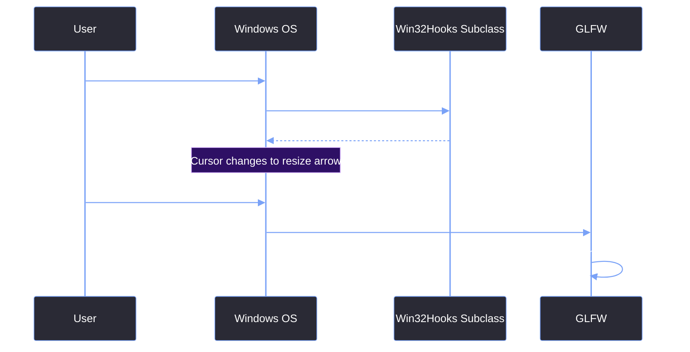

# Borderless Window & Win32 Hooks

> [!abstract] TL;DR
> Removing the standard Windows title bar is easy. Re-implementing native window dragging, resizing, and Aero Snap from scratch is incredibly difficult. We solved this by hooking into the Windows message loop using `SetWindowSubclass`. We intercept specific messages like `WM_NCCALCSIZE` to remove the invisible borders, `WM_NCHITTEST` to define custom resize zones, and `WM_GETMINMAXINFO` to enforce minimum window sizes.

## 1. The Problem with `GLFW_DECORATED = FALSE`
When you set `glfwWindowHint(GLFW_DECORATED, GLFW_FALSE);`, GLFW tells the Windows OS to create a window without a frame or a caption. 

While this gives you a clean, borderless canvas for ImGui to draw into, it completely breaks native OS window behavior:
- You cannot drag the window.
- You cannot resize the window.
- You lose Aero Snap (dragging the window to the edge of the screen to snap it).
- You lose the drop shadow rendered by the Desktop Window Manager (DWM).
- Double-clicking the title bar to maximize does nothing.

To fix this, we have to trick Windows into thinking the window *still has* a title bar, even though we are drawing over it.

## 2. Hooking the Message Loop (`SetWindowSubclass`)
Every Windows application has a `WndProc` (Window Procedure) function that receives messages from the OS. GLFW has its own internal `WndProc` that handles inputs and resizing.

If we replace the `WndProc` entirely, we break GLFW. Instead, we use `SetWindowSubclass` from `<commctrl.h>`. This allows us to attach a custom callback function to the window. Our function runs *first*, processes the messages we care about, and then passes the rest back to GLFW.

```cpp
// Inside Win32Hooks::Install()
s_Hwnd = glfwGetWin32Window(window);

// We must restore the WS_OVERLAPPEDWINDOW style. 
// Without this, Windows DWM will not draw drop shadows, and Aero Snap will be disabled.
LONG_PTR style = ::GetWindowLongPtr(s_Hwnd, GWL_STYLE);
style &= ~WS_POPUP;
style |= WS_OVERLAPPEDWINDOW | WS_VISIBLE;
::SetWindowLongPtr(s_Hwnd, GWL_STYLE, style);
::SetWindowPos(s_Hwnd, nullptr, 0, 0, 0, 0, SWP_FRAMECHANGED | SWP_NOMOVE | SWP_NOSIZE | SWP_NOZORDER | SWP_NOACTIVATE);

// Attach our subclass procedure
::SetWindowSubclass(s_Hwnd, SubclassProc, 1, 0);
```

## 3. The Core Win32 Messages
Our `SubclassProc` function intercepts three critical Windows messages.

<table style="width: 100%; border-collapse: collapse; color: #cdd6f4; margin-bottom: 20px; font-size: 0.95em;">
  <tr style="background-color: #2e1065; color: #ffffff;">
    <th style="border: 1px solid #7aa2f7; padding: 10px; text-align: left;">Message</th>
    <th style="border: 1px solid #7aa2f7; padding: 10px; text-align: left;">Purpose</th>
    <th style="border: 1px solid #7aa2f7; padding: 10px; text-align: left;">Our Implementation</th>
  </tr>
  <tr style="background-color: #2a2a35;">
    <td style="border: 1px solid #7aa2f7; padding: 10px;"><code>WM_NCCALCSIZE</code></td>
    <td style="border: 1px solid #7aa2f7; padding: 10px;">Calculates the size of the non-client area (title bar, borders).</td>
    <td style="border: 1px solid #7aa2f7; padding: 10px;">Return 0 to tell Windows the title bar takes 0 pixels.</td>
  </tr>
  <tr style="background-color: #1e1e2e;">
    <td style="border: 1px solid #7aa2f7; padding: 10px;"><code>WM_NCHITTEST</code></td>
    <td style="border: 1px solid #7aa2f7; padding: 10px;">Determines what part of the window the mouse is hovering over.</td>
    <td style="border: 1px solid #7aa2f7; padding: 10px;">Return <code>HTLEFT</code>, <code>HTTOP</code>, etc., if the mouse is within 6 pixels of the edge.</td>
  </tr>
  <tr style="background-color: #2a2a35;">
    <td style="border: 1px solid #7aa2f7; padding: 10px;"><code>WM_GETMINMAXINFO</code></td>
    <td style="border: 1px solid #7aa2f7; padding: 10px;">Determines the minimum and maximum size of the window.</td>
    <td style="border: 1px solid #7aa2f7; padding: 10px;">Set <code>ptMinTrackSize</code> to 640x400 so the UI doesn't break.</td>
  </tr>
</table>

### 3.1 WM_NCCALCSIZE (Removing the invisible border)
When Windows draws a window, it separates the "Client Area" (where you draw) from the "Non-Client Area" (the title bar and borders). `WM_NCCALCSIZE` is sent to calculate the size of the non-client area.

By returning `0` and not modifying the `NCCALCSIZE_PARAMS`, we tell Windows: "The non-client area is exactly 0 pixels." The client area now stretches over the entire window.

```cpp
case WM_NCCALCSIZE:
    if (wParam == TRUE) {
        NCCALCSIZE_PARAMS& params = *reinterpret_cast<NCCALCSIZE_PARAMS*>(lParam);
        
        // BUG FIX: If the window is maximized, Windows by default will expand the 
        // window to cover the taskbar. We must clamp it to the monitor's work area.
        if (::IsZoomed(hwnd)) {
            MONITORINFO mi{ sizeof(mi) };
            if (::GetMonitorInfo(::MonitorFromWindow(hwnd, MONITOR_DEFAULTTONEAREST), &mi))
                params.rgrc[0] = mi.rcWork;
        }
        return 0; 
    }
    break;
```

> [!bug] I Hit This Issue
> When I first implemented `WM_NCCALCSIZE`, maximizing the window caused it to cover the Windows Taskbar entirely. The user couldn't click the Start menu or see the clock. 
> 
> I had to add the `IsZoomed(hwnd)` check above. When a borderless window is maximized, Windows doesn't automatically reserve space for the taskbar. We have to manually query the `MONITORINFO` and clamp the window to `mi.rcWork` (the work area), which excludes the taskbar.

### 3.2 WM_NCHITTEST (Restoring resize borders)
Now that the client area covers the whole window, Windows thinks the user is clicking inside the application even when they are at the very edge. We intercept `WM_NCHITTEST` to define a 6-pixel invisible resize border.

```cpp
case WM_NCHITTEST: {
    POINT pt{ GET_X_LPARAM(lParam), GET_Y_LPARAM(lParam) };
    RECT win; ::GetWindowRect(hwnd, &win);

    bool left   = pt.x < win.left + RESIZE_BORDER;
    bool right  = pt.x > win.right - RESIZE_BORDER;
    bool top    = pt.y < win.top + RESIZE_BORDER;
    bool bottom = pt.y > win.bottom - RESIZE_BORDER;

    // Return native Windows hit test codes
    if (top && left)     return HTTOPLEFT;
    if (top && right)    return HTTOPRIGHT;
    if (bottom && left)  return HTBOTTOMLEFT;
    if (bottom && right) return HTBOTTOMRIGHT;
    if (left)            return HTLEFT;
    if (right)           return HTRIGHT;
    if (top)             return HTTOP;
    if (bottom)          return HTBOTTOM;
    
    return HTCLIENT; // Normal click inside the app
}
```

### 3.3 WM_GETMINMAXINFO (Enforcing minimum size)
Because the window is borderless, the user could technically drag the bottom corner all the way to the top corner, collapsing the window into a 0x0 sliver. We must enforce a minimum size.

```cpp
case WM_GETMINMAXINFO: {
    auto* mmi = reinterpret_cast<MINMAXINFO*>(lParam);
    mmi->ptMinTrackSize.x = 640;
    mmi->ptMinTrackSize.y = 400;
    return 0;
}
```

## 4. The Flow of a Resize



## 5. The Macro Collision War Story
> [!bug] I Hit This Issue
> I once spent hours chasing a `LNK2019: unresolved external symbol` for `bool IsMaximized()` inside this file. 
> 
> The compiler didn't crash, but it didn't generate the object code for the function either. It turns out that `<windowsx.h>` defines a preprocessor macro called `IsMaximized(hwnd)`. When the compiler hit our definition `bool IsMaximized()`, the preprocessor tried to expand the macro, blew up with a `C4003` warning (not a hard error), and skipped compiling the function. 
> 
> Because `Win32Hooks.obj` didn't contain the symbol, linking failed. `CustomFrame.cpp` didn't include `<windowsx.h>`, so its call resolved correctly to the intended symbol — hence the mismatch. The fix was renaming the function to `IsWindowMaximized()`.

> [!summary] What We Took Away
> - `SetWindowSubclass` is non-destructive and allows us to hook into GLFW's window messages without breaking it.
> - `WM_NCCALCSIZE` removes the title bar, but you must handle `IsZoomed` to prevent the window from covering the taskbar.
> - `WM_NCHITTEST` restores resize borders by returning `HTLEFT`, `HTTOP`, etc.
> - `WM_GETMINMAXINFO` prevents the user from shrinking the window into an unusable state.
> - Watch out for Windows header macros silently destroying your function signatures.