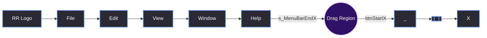
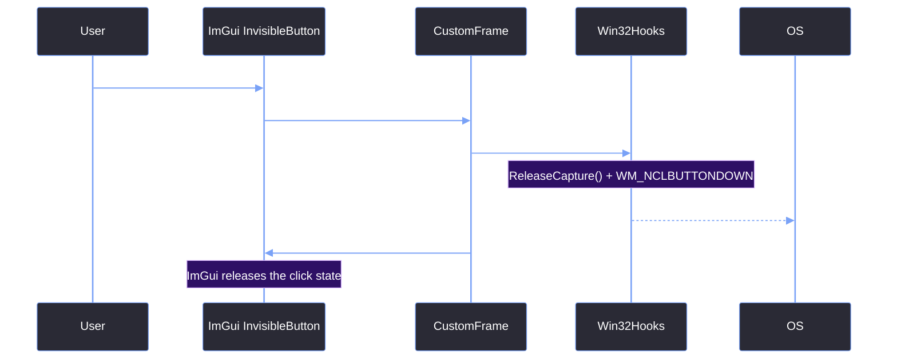

# Custom ImGui Title Bar

> [!abstract] TL;DR
> Because we stripped away the native Windows title bar in [[04.02 Borderless Window & Win32 Hooks]], we are responsible for drawing our own. The `CustomFrame` class handles this by drawing a 35-pixel tall ImGui window at the top of the screen. It manages the menu bar (File, Edit, View, Window, Help), the window control buttons (Minimize, Maximize, Close), and an invisible drag region that hands mouse interactions back to the OS.

## 1. The ImGui Window Flags
To make a standard ImGui window behave like a native title bar, we have to strip away almost all of its default behaviors. If you leave `ImGuiWindowFlags_NoBringToFrontOnFocus` off, clicking the title bar will accidentally hide any open dropdown menus.

```cpp
ImGuiWindowFlags flags = 
    ImGuiWindowFlags_NoTitleBar | 
    ImGuiWindowFlags_NoResize | 
    ImGuiWindowFlags_NoMove | 
    ImGuiWindowFlags_NoScrollbar | 
    ImGuiWindowFlags_NoScrollWithMouse | 
    ImGuiWindowFlags_NoCollapse | 
    ImGuiWindowFlags_NoDocking | 
    ImGuiWindowFlags_NoBringToFrontOnFocus | 
    ImGuiWindowFlags_NoNavFocus;

ImGui::Begin("##RedEditorCustomFrame", nullptr, flags);
```

<table style="width: 100%; border-collapse: collapse; color: #cdd6f4; margin-bottom: 20px; font-size: 0.95em;">
  <tr style="background-color: #2e1065; color: #ffffff;">
    <th style="border: 1px solid #7aa2f7; padding: 10px; text-align: left;">Flag</th>
    <th style="border: 1px solid #7aa2f7; padding: 10px; text-align: left;">Why we need it</th>
  </tr>
  <tr style="background-color: #2a2a35;">
    <td style="border: 1px solid #7aa2f7; padding: 10px;"><code>NoTitleBar</code></td>
    <td style="border: 1px solid #7aa2f7; padding: 10px;">We are drawing the title bar. Without this, ImGui draws a title bar <em>inside</em> our custom title bar.</td>
  </tr>
  <tr style="background-color: #1e1e2e;">
    <td style="border: 1px solid #7aa2f7; padding: 10px;"><code>NoBringToFrontOnFocus</code></td>
    <td style="border: 1px solid #7aa2f7; padding: 10px;">If you click the title bar, it would normally jump in front of the dropdown menus. This prevents that.</td>
  </tr>
  <tr style="background-color: #2a2a35;">
    <td style="border: 1px solid #7aa2f7; padding: 10px;"><code>NoDocking</code></td>
    <td style="border: 1px solid #7aa2f7; padding: 10px;">Prevents the user from accidentally docking a tool window <em>into</em> the title bar.</td>
  </tr>
</table>

## 2. The Layout Math (Menus & Buttons)
The layout of the title bar is split into three sections: the menu buttons on the left, the window controls on the right, and the drag region in the middle.



### The Dynamic Drag Region
One of the biggest issues with hardcoding a drag region is that the width of the menu buttons changes depending on the font size and the text (e.g., "File" is narrower than "Window"). 

Instead of hardcoding a width, we dynamically calculate the right edge of the last menu button (`s_MenuBarEndX`) every frame.

```cpp
// Inside DrawMenuBar()
// After drawing the "Help" button
s_MenuBarEndX = ImGui::GetItemRectMax().x + 8.0f;
```

Then, inside `CustomFrame::Draw()`, we calculate the drag width:

```cpp
// Start the drag region immediately after the last menu button.
float dragX = s_MenuBarEndX;

// Reserve the full width of the 3 standard window buttons (45px each)
float btnBlock = 45.0f * 3.0f;
float btnStartX = ImGui::GetWindowWidth() - btnBlock;

// 4px safety gap between the drag hitbox and the buttons.
float dragW = btnStartX - dragX - 4.0f;

if (dragW > 0.0f) {
    ImGui::SetCursorPos(ImVec2(dragX, 0));
    ImGui::InvisibleButton("##FrameDrag", ImVec2(dragW, Height()));
}
```

## 3. Decoupled Menu Callbacks
The `CustomFrame` class should not know about `SceneManager`, `HistoryManager`, or `ProjectManager`. If we included those headers, the title bar would become tightly coupled to the editor's core logic.

Instead, we use `std::function` callbacks. `REApp` registers the callbacks when the Editor state starts, and `CustomFrame` just invokes them.

```cpp
// In CustomFrame.h
static std::function<void()> s_SaveSceneCb;
static void SetSaveSceneCallback(std::function<void()> cb) { s_SaveSceneCb = cb; }

// In CustomFrame.cpp (DrawMenuBar)
if (ImGui::MenuItem("Save Scene", "Ctrl+S")) { 
    if (s_SaveSceneCb) s_SaveSceneCb(); 
}
```

This allows us to populate the menus dynamically (like the Theme selector) without hardcoding the themes into `CustomFrame`.

```cpp
if (ImGui::BeginMenu("Theme")) {
    for (int i = 0; i < (int)Themes::g_ThemeRegistry.size(); ++i) {
        bool isSelected = (GUI::GetTheme() == i);
        if (ImGui::MenuItem(Themes::g_ThemeRegistry[i].Name, nullptr, isSelected)) {
            GUI::SetTheme(i);
        }
    }
    ImGui::EndMenu();
}
```

## 4. The Drag Interaction Sequence



> [!bug] I Hit This Issue
> We hit a frustrating UX bug when we first added the `InvisibleButton` for the drag region. If the user double-clicked the title bar to maximize the window, the first click would trigger `BeginNativeDrag()`, and the second click would be swallowed by the OS window manager, preventing the double-click event from ever reaching ImGui.
> 
> We had to manually check for `ImGui::IsMouseDoubleClicked(0)` *before* calling `BeginNativeDrag()`:
> ```cpp
> if (ImGui::IsItemHovered() && ImGui::IsMouseDoubleClicked(0)) 
>     Win32Hooks::ToggleMaximize();
> else if (ImGui::IsItemActivated()) 
>     Win32Hooks::BeginNativeDrag();
> ```
> This ensures a double-click maximizes the window, while a single-click-and-hold initiates the native OS drag.

> [!summary] What We Took Away
> - Always use `NoBringToFrontOnFocus` on a custom title bar, or your menus will render underneath it.
> - Use `GetItemRectMax().x` to track the end of your menu bar dynamically, rather than hardcoding a width.
> - `InvisibleButton` is a perfect trick for creating OS-level drag regions because it handles hover and click states for you.
> - Decouple the title bar from the engine using `std::function` callbacks so the UI doesn't become spaghetti code.