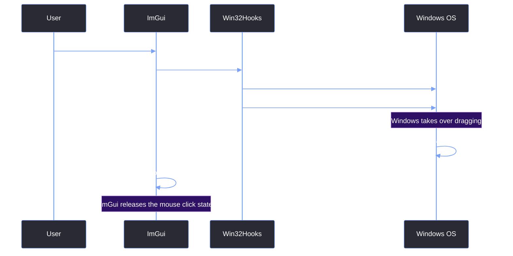

# Dragging, Resizing, Aero Snap

> [!abstract] TL;DR
> When the user clicks and drags our ImGui title bar, we want the OS to handle the window movement. This gives us free Aero Snap (dragging to the edge of the screen to snap the window) and multi-monitor support. We achieve this by releasing ImGui's mouse capture and sending a native `WM_NCLBUTTONDOWN` message to Windows.

## 1. The Aero Snap Trick
If you just move the GLFW window by calculating the mouse delta in ImGui, you lose all OS-level window features. The window won't snap to the edges of the screen, it won't integrate with Windows Snap Layouts (hovering over the maximize button), and it will stutter if the UI thread is busy.

We let Windows do the heavy lifting. When the user activates the drag region, we call `Win32Hooks::BeginNativeDrag()`.

```cpp
void BeginNativeDrag() {
    if (!s_Hwnd) return;
    
    // 1. Release the mouse capture from ImGui
    ::ReleaseCapture();
    
    // 2. Tell Windows the user is dragging the caption area
    ::SendMessage(s_Hwnd, WM_NCLBUTTONDOWN, HTCAPTION, 0);
}
```

## 2. Why ReleaseCapture?
When you click inside an ImGui window, ImGui "captures" the mouse. It stops sending mouse inputs to the rest of the OS because it assumes the user is interacting with the UI.

If we don't call `ReleaseCapture()`, Windows won't receive the mouse movement events required to drag the window. 

## 3. Disabling the ImGui Click
Once we pass the drag to Windows, ImGui still thinks the mouse is held down. We have to manually tell ImGui to release the mouse button so it doesn't get stuck in a "clicked" state, which would cause the UI to break on the next frame.

```cpp
else if (ImGui::IsItemActivated()) {
    Win32Hooks::BeginNativeDrag();
    
    // Tell ImGui the mouse button was released
    ImGui::GetIO().AddMouseButtonEvent(0, false); 
}
```

## 4. The Native Drag Sequence



## 5. Resizing via Native Borders
We don't actually handle resizing in ImGui. We completely delegate it to the OS using the `WM_NCHITTEST` interception we set up in [[04.02 Borderless Window & Win32 Hooks]].

Because we return `HTLEFT`, `HTTOP`, etc., when the mouse gets close to the edge of the window, Windows automatically handles the resize loop. The ImGui layer never even knows the user is dragging the border.

## 6. Double-Click to Maximize
Native Windows title bars maximize when you double-click them. Because we are using an `InvisibleButton` for the drag region, we have to manually implement this behavior.

```cpp
if (ImGui::IsItemHovered() && ImGui::IsMouseDoubleClicked(0)) 
    Win32Hooks::ToggleMaximize();
else if (ImGui::IsItemActivated()) {
    Win32Hooks::BeginNativeDrag();
    ImGui::GetIO().AddMouseButtonEvent(0, false);
}
```

> [!warning] The Double-Click Race Condition
> You must check for `IsMouseDoubleClicked` *before* you check `IsItemActivated`. If you check for activation first, the OS takes over the drag on the first click, and ImGui never receives the second click, breaking the double-click-to-maximize behavior.

> [!summary] What We Took Away
> - Never manually move a window using ImGui mouse coordinates; you lose OS integration.
> - `ReleaseCapture()` + `WM_NCLBUTTONDOWN` hands the drag operation over to Windows.
> - Always force ImGui to release the mouse button so it doesn't get stuck in a "clicked" state.
> - Native border resizing is completely handled by `WM_NCHITTEST`; ImGui doesn't touch it.