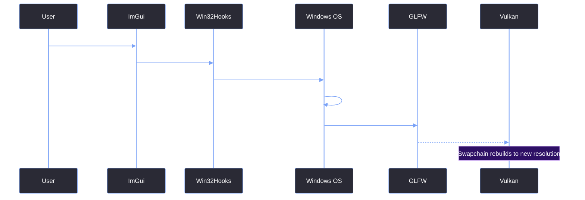

# Handling Minimize & Maximize

> [!abstract] TL;DR
> Because we draw our own title bar, the standard OS window controls no longer exist. We must implement the Minimize, Maximize, and Restore functionality ourselves by calling the Win32 `ShowWindow` API. Furthermore, we must intercept `WM_GETMINMAXINFO` to prevent the user from shrinking the borderless window into an unusable sliver. Finally, we must handle the infamous `0x0` framebuffer crash that occurs in Vulkan when the window is minimized.

## 1. Wiring the Custom Buttons
In [[04.03 Custom ImGui Title Bar]], we added the visual buttons for Minimize and Maximize. Now, we have to connect those buttons to the native OS window manager.

We wrap the Win32 API calls inside `Win32Hooks` so the frontend doesn't have to include `<Windows.h>`.

```cpp
void Win32Hooks::Minimize() {
    if (s_Hwnd) ::ShowWindow(s_Hwnd, SW_MINIMIZE);
}

void Win32Hooks::ToggleMaximize() {
    if (!s_Hwnd) return;
    
    // Check if the window is currently maximized. 
    // If it is, restore it. If it isn't, maximize it.
    ::ShowWindow(s_Hwnd, ::IsZoomed(s_Hwnd) ? SW_RESTORE : SW_MAXIMIZE);
}

bool Win32Hooks::IsWindowMaximized() {
    if (!s_Hwnd) return false;
    return ::IsZoomed(s_Hwnd) != 0;
}
```

<table style="width: 100%; border-collapse: collapse; color: #cdd6f4; margin-bottom: 20px; font-size: 0.95em;">
  <tr style="background-color: #2e1065; color: #ffffff;">
    <th style="border: 1px solid #7aa2f7; padding: 10px; text-align: left;">Function</th>
    <th style="border: 1px solid #7aa2f7; padding: 10px; text-align: left;">Win32 API</th>
    <th style="border: 1px solid #7aa2f7; padding: 10px; text-align: left;">Behavior</th>
  </tr>
  <tr style="background-color: #2a2a35;">
    <td style="border: 1px solid #7aa2f7; padding: 10px;"><code>Minimize()</code></td>
    <td style="border: 1px solid #7aa2f7; padding: 10px;"><code>ShowWindow(SW_MINIMIZE)</code></td>
    <td style="border: 1px solid #7aa2f7; padding: 10px;">Collapses the window to the taskbar.</td>
  </tr>
  <tr style="background-color: #1e1e2e;">
    <td style="border: 1px solid #7aa2f7; padding: 10px;"><code>ToggleMaximize()</code></td>
    <td style="border: 1px solid #7aa2f7; padding: 10px;"><code>ShowWindow(SW_MAXIMIZE)</code></td>
    <td style="border: 1px solid #7aa2f7; padding: 10px;">Expands the window to fill the monitor's work area.</td>
  </tr>
  <tr style="background-color: #2a2a35;">
    <td style="border: 1px solid #7aa2f7; padding: 10px;"><code>IsWindowMaximized()</code></td>
    <td style="border: 1px solid #7aa2f7; padding: 10px;"><code>IsZoomed()</code></td>
    <td style="border: 1px solid #7aa2f7; padding: 10px;">Returns true if the window is currently maximized.</td>
  </tr>
</table>

## 2. Enforcing a Minimum Window Size
When a window has a native OS title bar, Windows enforces a minimum size so the title bar and close button remain accessible. Because we removed the native frame, the user could technically resize the window down to `0x0` pixels.

We intercept `WM_GETMINMAXINFO` in our subclass to enforce a `640x400` minimum.

```cpp
case WM_GETMINMAXINFO: {
    auto* mmi = reinterpret_cast<MINMAXINFO*>(lParam);
    mmi->ptMinTrackSize.x = 640;
    mmi->ptMinTrackSize.y = 400;
    return 0;
}
```

## 3. The Minimize Crash (Vulkan's 0x0 Bug)
When the user minimizes the window, Windows reports the framebuffer size as `0x0`. 

If you pass `0` into `vkAcquireNextImageKHR` or try to recreate the swapchain with `0` width and height, Vulkan will throw a `VK_ERROR_DEVICE_LOST` and crash the entire application.

To fix this, we check `GLFW_ICONIFIED` at the very beginning of `GUI::BeginFrame()`.

```cpp
bool GUI::BeginFrame() {
    glfwPollEvents();

    // If minimized, skip the frame entirely
    if (glfwGetWindowAttrib(m_Window, GLFW_ICONIFIED) != 0) {
        ImGui_ImplGlfw_Sleep(10); // Sleep to prevent 100% CPU usage
        return false;             // Tell REApp to skip this frame
    }
    
    // ... rest of frame setup ...
    return true;
}
```

Then, inside `REApp::Run()`, we use `continue` to skip the rendering logic.

```cpp
while (!GUI::ShouldClose()) {
    if (!GUI::BeginFrame()) {
        continue; // Skip DrawCurrentState(), EndFrame(), etc.
    }
    // ...
}
```

## 4. The Maximize Sequence



> [!bug] I Hit This Issue
> When I first implemented the minimize logic, I hit the infamous `g.WithinFrameScope` ImGui assertion.
> 
> I was returning early from `GUI::BeginFrame()` if the window was iconified, but the main loop was still calling `DrawCurrentState()` and `GUI::EndFrame()`. ImGui got completely confused because it received a `Render()` call without a corresponding `NewFrame()`.
> 
> Returning a boolean from `BeginFrame()` and using `continue` inside the main loop was the fix. You absolutely have to ensure `NewFrame` and `EndFrame` are called in strict pairs, and if you skip one, you must skip both.

> [!summary] What We Took Away
> - Use `ShowWindow(SW_MINIMIZE)` and `ShowWindow(SW_MAXIMIZE)` to control the window natively.
> - `IsZoomed()` is the Win32 way to check if a window is maximized.
> - `WM_GETMINMAXINFO` is mandatory for borderless windows to prevent them from collapsing to `0x0`.
> - Vulkan will crash if you try to render to a `0x0` framebuffer. Use `GLFW_ICONIFIED` to skip rendering entirely.
> - Never break the `NewFrame()` / `EndFrame()` pair, or ImGui will assert.