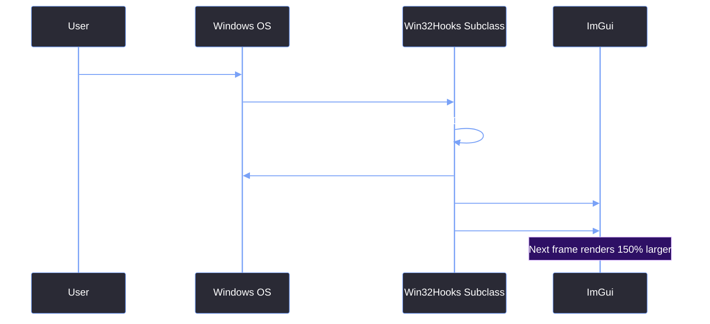

# Per-Monitor DPI Awareness

> [!abstract] TL;DR
> If the Red Editor is dragged from a 1080p monitor to a 4K monitor, Windows will try to stretch the window. This causes ImGui text to become blurry. To fix this, we declare the application as Per-Monitor DPI Aware and handle the `WM_DPICHANGED` message to manually scale the UI and resize the window frame. However, mixing DPI awareness with custom borderless windows often breaks the Win32 hit-testing logic, requiring careful handling.

## 1. The Blurry Text Problem
By default, Windows treats legacy applications as "DPI Unaware". When you drag a 1080p window to a 4K monitor (which has a higher pixel density), Windows takes a screenshot of the window, stretches it by 150% or 200%, and draws it to the screen. This results in incredibly blurry ImGui text and fuzzy UI elements.

To fix this, we must tell Windows that our application knows how to scale itself.

## 2. Enabling DPI Awareness (The Manifest)
While you can set `glfwInitHint(GLFW_SCALE_TO_MONITOR, GLFW_TRUE);`, the most reliable way to enable DPI awareness in a C++ Windows application is through the application manifest.

We add this to our `.exe` manifest:

```xml
<application xmlns="urn:schemas-microsoft-com:asm.v3">
    <windowsSettings>
        <dpiAware xmlns="http://schemas.microsoft.com/SMI/2005/WindowsSettings">true/pm</dpiAware>
        <dpiAwareness xmlns="http://schemas.microsoft.com/SMI/2016/WindowsSettings">PerMonitorV2</dpiAwareness>
    </windowsSettings>
</application>
```

`PerMonitorV2` allows Windows to notify the app when it moves between monitors with different DPI settings, rather than just stretching the window.

## 3. Handling `WM_DPICHANGED`
When the window is dragged to a monitor with a different DPI, Windows sends the `WM_DPICHANGED` message to our subclass procedure. We must intercept this in `Win32Hooks.cpp`.

```cpp
case WM_DPICHANGED: {
    // 1. Extract the new DPI scale (e.g., 144 DPI = 150% scale)
    float newDpiScale = HIWORD(wParam) / 96.0f; 
    
    // 2. Windows provides a suggested new window rect. We MUST apply it,
    // otherwise the window will be sized incorrectly.
    RECT* const prcNewWindow = (RECT*)lParam;
    SetWindowPos(hwnd, NULL,
        prcNewWindow->left,
        prcNewWindow->top,
        prcNewWindow->right - prcNewWindow->left,
        prcNewWindow->bottom - prcNewWindow->top,
        SWP_NOZORDER | SWP_NOACTIVATE);
        
    // 3. Inform ImGui to scale its fonts and UI elements
    ImGui::GetIO().FontGlobalScale = newDpiScale;
    ImGui::GetStyle().ScaleAllSizes(newDpiScale);
    break;
}
```

<table style="width: 100%; border-collapse: collapse; color: #cdd6f4; margin-bottom: 20px; font-size: 0.95em;">
  <tr style="background-color: #2e1065; color: #ffffff;">
    <th style="border: 1px solid #7aa2f7; padding: 10px; text-align: left;">DPI Setting</th>
    <th style="border: 1px solid #7aa2f7; padding: 10px; text-align: left;">Behavior</th>
  </tr>
  <tr style="background-color: #2a2a35;">
    <td style="border: 1px solid #7aa2f7; padding: 10px;"><strong>Unaware</strong></td>
    <td style="border: 1px solid #7aa2f7; padding: 10px;">Windows stretches the window. Blurry text.</td>
  </tr>
  <tr style="background-color: #1e1e2e;">
    <td style="border: 1px solid #7aa2f7; padding: 10px;"><strong>System Aware</strong></td>
    <td style="border: 1px solid #7aa2f7; padding: 10px;">App renders sharply on the primary monitor, but still stretches on secondary monitors.</td>
  </tr>
  <tr style="background-color: #2a2a35;">
    <td style="border: 1px solid #7aa2f7; padding: 10px;"><strong>Per-Monitor V2</strong></td>
    <td style="border: 1px solid #7aa2f7; padding: 10px;">App renders sharply on all monitors. Requires manual UI scaling logic.</td>
  </tr>
</table>

## 4. The DPI Flow



> [!bug] I Hit This Issue
> When I enabled `PerMonitorV2` DPI awareness, it completely broke my custom borderless window resizing. The `WM_NCCALCSIZE` and `WM_NCHITTEST` messages started receiving scaled coordinates, so the invisible 6-pixel resize border became a 9-pixel border on 150% monitors, and sometimes the Aero Snap stopped working entirely.
> 
> The fix was to ensure that inside `WM_NCHITTEST`, I wasn't hardcoding pixel values based on the physical screen. I had to ensure the `RESIZE_BORDER` constant was scaled by the DPI scale before comparing it to the mouse coordinates. DPI awareness affects *every* Win32 message, not just font rendering.

> [!summary] What We Took Away
> - Without `PerMonitorV2` in the manifest, ImGui text will be blurry on 4K monitors.
> - Always handle `WM_DPICHANGED` by applying the suggested `RECT` and scaling ImGui styles.
> - `io.FontGlobalScale` and `ImGui::GetStyle().ScaleAllSizes()` handle the ImGui side of things.
> - DPI scaling also scales Win32 message coordinates, which can break custom hit-testing on borderless windows.