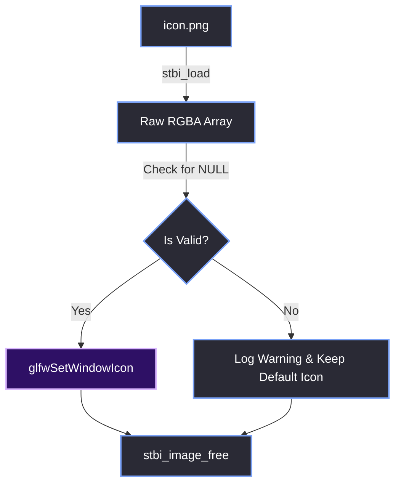

# Window Icon & Taskbar Integration

> [!abstract] TL;DR
> By default, a GLFW window uses the default GLFW icon in the Windows taskbar (a generic grey window). To make the Red Editor look professional, we load a PNG icon using `stb_image` and pass it to `glfwSetWindowIcon`. This ensures the brand identity is present in the taskbar, Alt-Tab menu, and title bar.

## 1. The Image Loading Pipeline
GLFW expects the icon data to be a raw 32-bit RGBA array (4 channels). We use the `stb_image` library to decode the `.png` file into the correct format.

```cpp
// 1. Create a GLFWimage struct to hold the pixel data
GLFWimage images[1];

// 2. Load the PNG from disk (force 4 channels for RGBA)
images[0].pixels = stbi_load(
    "Resources/Image/icon.png", 
    &images[0].width, 
    &images[0].height, 
    0, 
    4 // Force RGBA
);
```

## 2. Applying the Icon
Once loaded, we pass the array to `glfwSetWindowIcon`. This must be done *after* the window is created (`m_Window` exists), but it can be done anytime during the application's lifetime.

```cpp
if (images[0].pixels) {
    glfwSetWindowIcon(m_Window, 1, images);
    
    // 3. Free the CPU memory
    stbi_image_free(images[0].pixels);
}
```

## 3. The Null Pointer Crash
It is critical to check `if (images[0].pixels)` before calling `glfwSetWindowIcon`. 

If the user deletes `icon.png`, or runs the editor from a different working directory where the `Resources` folder doesn't exist, `stbi_load` will return `NULL`. Passing `NULL` to `glfwSetWindowIcon` will cause a segmentation fault and crash the editor before it even opens.

## 4. The Loading Flow



> [!tip] What I'd Do Differently
> I would recommend using an `.ico` file instead of a `.png` for the Windows taskbar. While `stbi_image` handles `.png` perfectly for the window itself, `.ico` files contain multiple resolutions (16x16, 32x32, 48x48, 256x256). If you pass a single 256x256 `.png` to Windows, it will aggressively downscale it for the Alt-Tab menu, which sometimes looks slightly blurry. However, for a quick and dirty setup, the `.png` approach works perfectly fine.

> [!summary] What We Took Away
> - Use `stbi_load` with 4 channels (RGBA) to load the icon.
> - Call `glfwSetWindowIcon` immediately after creating the window.
> - Always check if `stbi_load` succeeded to prevent a null pointer crash.
> - Free the image data with `stbi_image_free` after passing it to GLFW. If you don't, you leak memory.