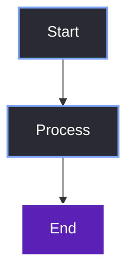

# {{title}}

> [!abstract] TL;DR
> [One-paragraph summary of what this note covers and why it matters.]

## 1. Context
[What problem did this system solve for us? Where does it sit in the overall architecture?]

## 2. Design Rationale
[Why did we choose this design? What alternatives did we reject? Mention Vulkan, ImGui threading, or Win32 constraints if applicable.]

## 3. Component Overview
- **File(s):** `path/to/file.h`, `path/to/file.cpp`
- **Class(es):** `ClassName`
- **Dependencies:** [What does this need?]
- **Consumers:** [What relies on this?]

## 4. Diagram & Architecture

[Explain what the diagram shows before displaying it.]



## 5. Code Walkthrough

```cpp
// Annotated code snippet
class Example {
    // ...
};
```

## 6. Integration Points
[How do other systems call into this one? Show the call-site or the callback registration.]

## 7. Common Pitfalls

> [!bug] I Hit This Issue
> [Personal blog-style story about a bug you encountered while building this.]

> [!warning] Watch Out
> [A technical constraint or ImGui quirk developers should know.]

## 8. Verification
[How did we confirm this system works? What is the observable behavior?]

> [!summary] What We Took Away
> - [Key takeaway 1]
> - [Key takeaway 2]