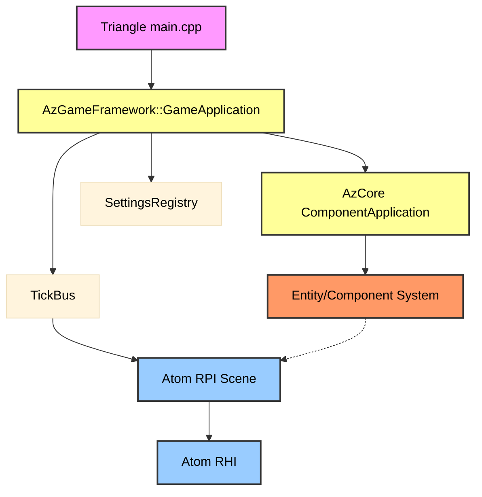
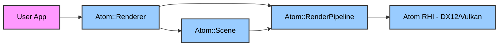
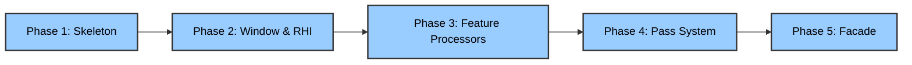

# 1 Architectural Decoupling & Usability Overhaul.md

### Part 1: The Anatomy of the Problem (Why Atom is Not Standalone)

Atom is not a library; it is a subsystem. It operates entirely at the mercy of the O3DE `ComponentApplication`. 

**The Bootstrapping Nightmare:**
Look at `examples/Triangle/source/main.cpp`. To draw a single triangle, you must instantiate `AzGameFramework::GameApplication`, which triggers the entire `AzCore` reflection, memory allocation, and settings registry bootstrap. You cannot simply link a `.lib` and start drawing. 



*The red boxes represent the Game Engine framework. The blue boxes represent the Renderer. Notice how the Renderer is completely choked by the Game Engine framework.*

**The Entity/Component Anchor:**
The rendering scene is heavily tied to the `AZ::Entity` system. `FeatureProcessors` (like the `AuxGeomFeatureProcessor`) are registered as components. The `Scene` itself manages `SceneRequestBus` handlers and relies on `AzFramework::EntityContextId` to resolve entities. This means the renderer cannot exist without the game engine's entity registry.

**The TickBus Dependency:**
`ComponentApplication::Tick()` broadcasts `TickBus::Broadcast(&TickEvents::OnTick, ...)`. Inside `Scene.h`, the `Simulate()` and `PrepareRender()` functions are driven by this broadcast. If you don't have the `TickBus`, the renderer doesn't update.

---

### Part 2: The Architectural Goal (What Standalone Looks Like)

A truly decoupled Atom should look like a standard graphics API (like bgfx, Vulkan, or WebGPU). The user should not know that `AzCore` or `Entity` systems even exist. 

**The Dream API:**
```cpp
#include <Atom/Atom.h>

int main() {
    // 1. Initialize the renderer and window
    Atom::Renderer renderer;
    renderer.Initialize({ .Title = "My App", .Width = 1920, .Height = 1080 });

    // 2. Create a scene and a camera
    Atom::Scene* scene = renderer.CreateScene();
    Atom::Camera* camera = scene->CreateCamera();

    // 3. Create a render pipeline (no PassTrees, no RPI system interface)
    Atom::RenderPipeline* pipeline = renderer.CreatePipeline(scene, camera);

    // 4. Main loop (no TickBus, no ComponentApplication)
    while (renderer.IsRunning()) {
        renderer.Update(0.016f); // Delta time
        renderer.Render();
    }
    return 0;
}
```



---

### Part 3: The Technical Methods of Decoupling

To achieve this, we have three distinct architectural strategies. We must discuss the trade-offs of each.

| Strategy | Core Philosophy | Technical Impact | Risk Level |
| :--- | :--- | :--- | :--- |
| **A: True Decoupling** | Complete severance from `AzCore` and `AzFramework`. | Replaces `AZStd` with `std`. Removes `ComponentApplication`, `Entity`, and `TickBus`. | Extremely High |
| **B: Hybrid Decoupling** | Sever the Game/Entity layer. Keep `AzCore` for memory, math, and threading. | Removes `GameApplication` and `AZ::Component`. Directly initializes `RPI::Scene`. | Medium |
| **C: The Facade** | Wrap the existing O3DE architecture in a clean API. | Hides complexity but does not remove it. Performance overhead remains. | Low |

#### Strategy A: The "True Decoupling" (The Core Rewrite)
This is the most radical and difficult approach. We completely sever all ties between `Atom/RPI` and `AzCore` / `AzFramework`.

*   **Memory & Allocations:** We replace `AZ_CLASS_ALLOCATOR` and `AZStd::` containers with `std::` containers or custom, lightweight allocators.
*   **The Window System:** We strip out `AzFramework::NativeWindowHandle` and introduce a generic `Atom::WindowHandle` (a `void*`). The user is responsible for creating the window (using SDL3, GLFW, or raw Win32).
*   **The Asset System:** We remove the `SettingsRegistry` and `.pak` file dependency. We create a simple `Atom::AssetLoader` that takes absolute file paths.
*   **Feature Processors:** We remove `AZ::Component` inheritance. They become standard C++ classes managed by the `Scene`.
*   **The TickBus:** We remove `TickBus::Broadcast`. The `Scene` gets an `Update(deltaTime)` method called directly by the `Atom::Renderer`.

#### Strategy B: The "Hybrid Decoupling" (The Pragmatic Path)
We do not remove `AzCore` completely (because it provides valuable memory tracking, threading, and math), but we remove the **Game Framework** and the **Entity/Component** layer from the rendering path.

*   **Bypass `GameApplication`:** We create a new `Atom::Application` class. It still uses `AZ::ComponentApplication` (for memory and the SettingsRegistry), but it does *not* load `AzGameFramework`. 
*   **Direct RPI Initialization:** We initialize the `RPI::Scene` and `RPI::RenderPipeline` directly in the main loop, without waiting for `BootstrapNotificationBus` events.
*   **Decouple the Tick:** The `Atom::Application` manually calls `m_scene->Simulate(deltaTime)` and `m_scene->PrepareRender(deltaTime)` in its own main loop.

#### Strategy C: The "Facade" (The Illusion of Simplicity)
We create a wrapper library, `Atom_Facade.lib`, that sits on top of the existing O3DE architecture. 

*   **The Implementation:** Inside `Atom::Renderer::Initialize()`, it secretly instantiates `AzGameFramework::GameApplication` and loads all the modules.
*   **The Trade-off:** This is a quick win. But it solves nothing. The performance overhead is still there. The complexity is still there. 

---

### Part 4: Deep Dive into the Technical Subsystems (with Code)

If we choose Strategy A or B, we must solve these specific technical challenges in the code.

**1. The Window Abstraction (`RenderPipeline.h`)**
Currently, `RenderPipeline` uses `AzFramework::NativeWindowHandle`. If we decouple, we must change this to `Atom::NativeWindowHandle`, which is simply a `void*`. 

```cpp
// Current (Tied to O3DE)
AzFramework::NativeWindowHandle m_windowHandle = nullptr;

// Proposed (Standalone)
using NativeWindowHandle = void*;
NativeWindowHandle m_windowHandle = nullptr;
```

**2. The Feature Processor Lifecycle (`Scene.h`)**
Currently, `Scene::EnableFeatureProcessor` relies on `FeatureProcessorFactory` and `AZ::RTTI`. We need to change this to a template-based or ID-based registration system that doesn't use `AZ::Uuid`.

```cpp
// Current (Heavy RTTI Dependency)
template<typename FeatureProcessorType>
FeatureProcessorType* Scene::EnableFeatureProcessor() {
    return static_cast<FeatureProcessorType*>(EnableFeatureProcessor(FeatureProcessorId{ FeatureProcessorType::RTTI_TypeName() }));
}

// Proposed (Standalone)
std::unordered_map<std::type_index, std::unique_ptr<FeatureProcessor>> m_featureProcessors;
template<typename T>
T* Scene::EnableFeatureProcessor() {
    auto fp = std::make_unique<T>();
    T* ptr = fp.get();
    m_featureProcessors[typeid(T)] = std::move(fp);
    return ptr;
}
```

**3. The Pass System (`RenderPipeline.h`)**
The `PassTree` and `PassAsset` system (JSON-based render graphs) is deeply tied to the `AssetManager` and `AssetCatalog`. To decouple, we need a `PassFactory` that reads a JSON string directly and builds the `PassTree` in memory at runtime, rather than relying on the compiled `.azasset` binary format.

```cpp
// Proposed: Bypassing the AssetProcessor for runtime Pass generation
void RenderPipeline::LoadPassFromJson(const std::string& jsonString) {
    rapidjson::Document doc;
    doc.Parse(jsonString.c_str());
    // Recursively build PassTree from raw JSON instead of Data::Asset<PassAsset>
    BuildPassTree(doc);
}
```

**4. The Settings Registry (`ComponentApplication.h`)**
We need to remove `m_settingsRegistry->Get(...)` calls from the RPI. All configuration should be passed via a simple `Atom::RendererConfig` struct in C++. 

```cpp
// Current
m_settingsRegistry->Get(width, AZ::SettingsRegistryMergeUtils::FilePathKey_Width);

// Proposed
struct RendererConfig {
    uint32_t width;
    uint32_t height;
    bool enableVSync;
};
```

**5. The Render Tick (`main.cpp`)**
We need to eliminate `app.PumpSystemEventLoopUntilEmpty()` and `app.Tick()`. The `Atom::Renderer` should have its own `Update()` method that completely bypasses the `ComponentApplication::Tick()` and the `TickBus`.

```cpp
// Current (Triangle example)
while (!app.WasExitMainLoopRequested()) {
    app.PumpSystemEventLoopUntilEmpty();
    app.Tick();
    if (rpiSystem) rpiSystem->RenderTick();
}

// Proposed (Standalone)
while (renderer.IsRunning()) {
    renderer.Update(deltaTime); // Polls OS events, updates Scene
    renderer.Render();          // Calls RPI::RenderTick internally
}
```

---

### Part 5: The Implementation Sequence

We cannot do this all at once. We need a phased approach. The diagram below outlines the logical sequence of architectural changes required to achieve the Hybrid Decoupling (Strategy B), moving from the outer shell to the core systems.



**Phase 1: Skeleton**
Create the `Atom_Standalone` CMake target. Attempt to compile the RPI against only `AzCore` (without `AzFramework`). This will expose the exact list of hidden dependencies.

**Phase 2: Window & RHI Abstraction**
Replace `AzFramework::NativeWindowHandle` with a generic `void*`. Strip `WindowContext` and `WindowBus` from the RPI. Create a minimal DX12/Vulkan swapchain creation path that does not use the O3DE RHI factory.

**Phase 3: Feature Processor Decoupling**
Remove the `AZ::Component` inheritance from `FeatureProcessor`. Replace the RTTI-based `FeatureProcessorFactory` with a simple C++ template or ID-based registry managed directly by the `Scene`.

**Phase 4: Pass System Refactoring**
Create a runtime JSON parser for `.pass` files that does not rely on the `AssetProcessor` or the compiled `.azasset` binary format. Allow the `RenderPipeline` to load pass templates from raw memory or disk paths.

**Phase 5: Facade & API Wrapping**
Wrap the entire decoupled system in a clean `Atom::Renderer` class. Write the Dream API shown in Part 2 and create a new standalone example that uses it.

---

### Conclusion & Next Steps

The "True Decoupling" (Strategy A) is the holy grail. It would make Atom one of the most attractive open-source renderers in the world. But it is a monumental engineering task. 

The "Hybrid Decoupling" (Strategy B) is the realistic path. It gives us 80% of the benefit for 20% of the effort. We keep `AzCore` for memory and math, but we completely sever the `GameApplication` and the `Entity` system from the rendering loop.

**Discussion Point:** 
Do we want to pursue Strategy A (pure, but risky), Strategy B (pragmatic, keeps `AzCore`), or Strategy C (facade, quick but doesn't solve the core issue)? 

Once we decide this, we can dive into **Method 2: The Compositor Abstraction**, which will define how developers interact with the newly decoupled pipeline.