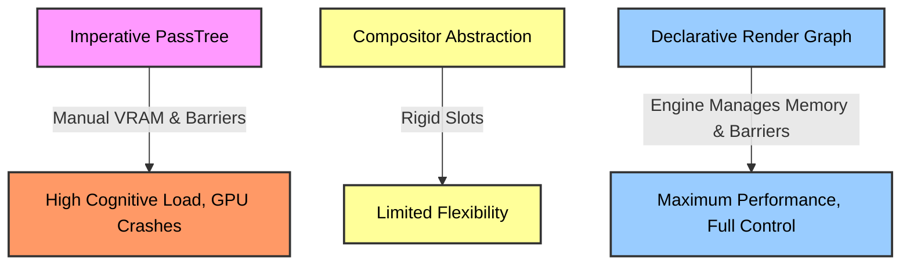
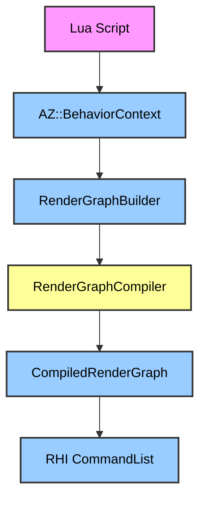
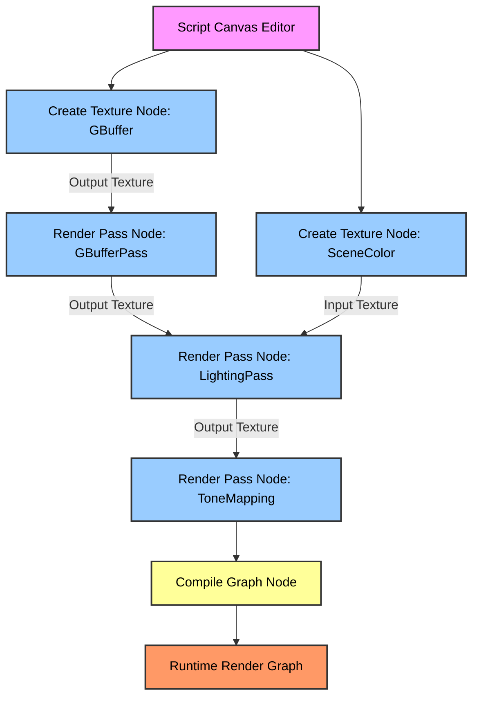

```mermaid
graph LR
    A[Render Graph Builder] --> B[Topological Sort]
    B --> C[Resource Lifetime Analysis]
    C --> D[Memory Aliasing]
    D --> E[Barrier Generation]
    E --> F[Compiled Render Graph]

    style A fill:#9cf,stroke:#333,stroke-width:2px,color:#000
    style B fill:#9cf,stroke:#333,stroke-width:2px,color:#000
    style C fill:#9cf,stroke:#333,stroke-width:2px,color:#000
    style D fill:#9cf,stroke:#333,stroke-width:2px,color:#000
    style E fill:#9cf,stroke:#333,stroke-width:2px,color:#000
    style F fill:#ff9,stroke:#333,stroke-width:2px,color:#000
```

# 2 The Render Graph & Scripting Architecture.md

### Architectural Critique: Why Current Approaches Fail

The current Atom `PassTree` (`RenderPipeline.h`) requires imperative construction. Developers manually instantiate `PassTemplate` JSON assets, bind `PassAttachmentBindings`, allocate transient VRAM for render targets, and insert explicit `RHI::ResourceBarrier` transitions before executing a pass. Failure to track resource lifetimes results in GPU crashes or VRAM leaks. The engine forces the developer to act as a memory manager and scheduler.

A Compositor (Godot-style) abstracts the barrier and memory problem but introduces rigid constraints. By defining fixed injection slots (`BeforeForward`, `AfterPostProcess`), it prevents the implementation of advanced rendering techniques like clustered deferred rendering, custom global illumination, or multi-pass temporal upscalers. It is a black box that limits architectural flexibility.

A Render Graph is a declarative DAG (Directed Acyclic Graph). The developer defines resources and pass dependencies. The engine compiles the graph, performs topological sorting, executes memory aliasing, inserts minimal barriers, and culls unused passes.



---

### Part 1: The C++ Render Graph Builder API

The builder uses a fluent interface to construct the graph. It abstracts `RHI::ResourceState` and memory allocation.

```cpp
namespace Atom::RPI {

class RenderGraphBuilder {
public:
    // Resource Creation
    TextureHandle CreateTexture(const AZ::Name& name);
    BufferHandle CreateBuffer(const AZ::Name& name);

    // Pass Construction
    PassBuilder AddPass(const AZ::Name& passName);
    
    // Graph Compilation
    CompiledRenderGraph Compile();
};

class PassBuilder {
public:
    PassBuilder& Read(TextureHandle texture);
    PassBuilder& Write(TextureHandle texture);
    PassBuilder& Read(BufferHandle buffer);
    PassBuilder& Write(BufferHandle buffer);
    PassBuilder& SetPipelineState(RHI::PipelineState* pso);
    PassBuilder& SetExecutionCallback(AZStd::function<void(RHI::CommandList*)> callback);
};

} // namespace Atom::RPI
```

**Usage Example:**

```cpp
Atom::RPI::RenderGraphBuilder builder;

// 1. Declare Resources
auto gbufferNormal = builder.CreateTexture("GBufferNormal")
                            .SetFormat(Atom::RHI::Format::RGBA16F)
                            .SetUsage(Atom::RHI::TextureUsage::RenderTarget | Atom::RHI::TextureUsage::ShaderRead);

auto gbufferAlbedo = builder.CreateTexture("GBufferAlbedo")
                            .SetFormat(Atom::RHI::Format::RGBA8)
                            .SetUsage(Atom::RHI::TextureUsage::RenderTarget | Atom::RHI::TextureUsage::ShaderRead);

auto sceneColor    = builder.CreateTexture("SceneColor")
                            .SetFormat(Atom::RHI::Format::RGBA16F)
                            .SetUsage(Atom::RHI::TextureUsage::RenderTarget | Atom::RHI::TextureUsage::ShaderRead);

// 2. Declare Passes and Dependencies
builder.AddPass("GBufferPass")
       .Write(gbufferNormal)
       .Write(gbufferAlbedo)
       .SetPipelineState(GBufferPipelineState);

builder.AddPass("LightingPass")
       .Read(gbufferNormal)
       .Read(gbufferAlbedo)
       .Write(sceneColor)
       .SetPipelineState(LightingPipelineState);

builder.AddPass("ToneMappingPass")
       .Read(sceneColor)
       .Write(Atom::RPI::Backbuffer)
       .SetPipelineState(ToneMappingPipelineState);

// 3. Compile and Execute
Atom::RPI::CompiledRenderGraph compiledGraph = builder.Compile();
compiledGraph.Execute(rhiCommandList);
```

---

### Part 2: Compiler Internals

The compiler transforms the DAG into a linear execution sequence with optimized memory usage and synchronized resource states.

**Stage 1: Topological Sort**
Traverses the DAG using Depth-First Search (DFS) to produce a linear array of passes. Ensures no pass executes before its dependencies are satisfied.

**Stage 2: Resource Lifetime Analysis**
Iterates the sorted passes. For each resource, it records:
*   `firstWritePassIndex`: The index of the first pass that writes to the resource.
*   `lastReadPassIndex`: The index of the final pass that reads from the resource.
If a resource is written multiple times (ping-pong buffers), it tracks the `version` of the resource.

```cpp
struct ResourceLifetime {
    RHI::ResourceId m_resourceId;
    uint32_t m_version;
    uint32_t m_firstWritePassIndex;
    uint32_t m_lastReadPassIndex;
    uint64_t m_sizeInBytes;
};
```

**Stage 3: Memory Aliasing**
Uses a greedy algorithm to assign physical VRAM offsets within a single large heap.
1. Sort `ResourceLifetime` array by `m_firstWritePassIndex`.
2. Iterate through the sorted array.
3. For each resource, check existing `HeapBlock` instances.
4. If a `HeapBlock` has a `lastUsedPassIndex` < resource's `m_firstWritePassIndex`, alias the resource into that block.
5. Otherwise, allocate a new `HeapBlock`.

```cpp
struct HeapBlock {
    uint64_t m_physicalOffset;
    uint64_t m_sizeInBytes;
    uint32_t m_lastUsedPassIndex;
};

for (auto& resource : sortedResources) {
    bool aliased = false;
    for (auto& block : heapBlocks) {
        if (block.m_lastUsedPassIndex < resource.m_firstWritePassIndex) {
            resource.m_physicalOffset = block.m_physicalOffset;
            block.m_lastUsedPassIndex = resource.m_lastReadPassIndex;
            aliased = true;
            break;
        }
    }
    if (!aliased) {
        uint64_t newOffset = currentHeapSize;
        currentHeapSize += resource.m_sizeInBytes;
        heapBlocks.push_back({newOffset, resource.m_sizeInBytes, resource.m_lastReadPassIndex});
        resource.m_physicalOffset = newOffset;
    }
}
```

**Stage 4: Barrier Generation**
The compiler maintains a state map: `std::unordered_map<RHI::ResourceId, RHI::ResourceState> currentState`.
For each pass:
1.  For every resource read: If `currentState[id] != ShaderRead`, push an `RHI::ResourceBarrier` transition and update `currentState`.
2.  For every resource written: If `currentState[id] != RenderTarget` (or `UnorderedAccess`), push a transition and update `currentState`.

```cpp
std::unordered_map<RHI::ResourceId, RHI::ResourceState> stateMap;

for (auto& pass : sortedPasses) {
    for (auto& read : pass.m_reads) {
        if (stateMap[read.m_id] != RHI::ResourceState::ShaderRead) {
            pass.m_barriers.push_back({
                read.m_id, 
                stateMap[read.m_id], 
                RHI::ResourceState::ShaderRead
            });
            stateMap[read.m_id] = RHI::ResourceState::ShaderRead;
        }
    }
    for (auto& write : pass.m_writes) {
        if (stateMap[write.m_id] != RHI::ResourceState::RenderTarget) {
            pass.m_barriers.push_back({
                write.m_id, 
                stateMap[write.m_id], 
                RHI::ResourceState::RenderTarget
            });
            stateMap[write.m_id] = RHI::ResourceState::RenderTarget;
        }
    }
}
```



---

### Part 3: Execution Layer

The `CompiledRenderGraph` acts as a linear command stream. It binds the aliased physical memory to the logical render targets expected by the passes.

```cpp
void CompiledRenderGraph::Execute(RHI::CommandList* commandList) {
    for (auto& pass : m_sortedPasses) {
        // 1. Transition RHI states
        for (auto& barrier : pass.m_barriers) {
            commandList->PipelineBarrier(barrier);
        }

        // 2. Bind aliased physical VRAM to logical slots
        for (auto& binding : pass.m_resourceBindings) {
            RHI::ImageView* physicalView = m_physicalHeap->CreateView(binding.m_logicalResource, binding.m_physicalOffset);
            commandList->SetRenderTarget(binding.m_slot, physicalView);
        }

        // 3. Execute RHI commands
        pass.m_executionCallback(commandList);
    }
}
```

---

### Part 4: Scripting Layer (Lua/Python)

Expose the `RenderGraphBuilder` to `AZ::BehaviorContext`. This bypasses C++ recompilation for pipeline modifications.

**BehaviorContext Registration:**
```cpp
behaviorContext->Class<RenderGraphBuilder>("RenderGraphBuilder")
    ->Method("CreateTexture", &RenderGraphBuilder::CreateTexture)
    ->Method("AddPass", &RenderGraphBuilder::AddPass)
    ->Method("Compile", &RenderGraphBuilder::Compile);

behaviorContext->Class<PassBuilder>("PassBuilder")
    ->Method("Read", &PassBuilder::Read)
    ->Method("Write", &PassBuilder::Write)
    ->Method("SetShader", &PassBuilder::SetShader)
    ->Method("SetParameter", &PassBuilder::SetParameter);
```

**Lua Script Execution:**
The engine loads the Lua script, executes it, and receives a compiled graph. Hot-reloading is achieved by watching the file system for `.lua` changes. On change, the old `CompiledRenderGraph` is discarded, the Lua script is re-evaluated, and the new graph is swapped into the `RenderPipeline`.

```lua
local RenderGraph = Atom.RPI.RenderGraph

function BuildRenderPipeline()
    local builder = RenderGraph.new()

    -- Create Resources
    local gbufferNormal = builder:CreateTexture("GBufferNormal"):SetFormat("RGBA16F"):SetUsage("RenderTarget", "ShaderRead")
    local gbufferAlbedo = builder:CreateTexture("GBufferAlbedo"):SetFormat("RGBA8"):SetUsage("RenderTarget", "ShaderRead")
    local sceneColor    = builder:CreateTexture("SceneColor"):SetFormat("RGBA16F"):SetUsage("RenderTarget", "ShaderRead")

    -- Add Passes
    builder:AddPass("GBufferPass")
           :Write(gbufferNormal)
           :Write(gbufferAlbedo)
           :SetShader("Shaders/GBuffer.azshader")

    builder:AddPass("LightingPass")
           :Read(gbufferNormal)
           :Read(gbufferAlbedo)
           :Write(sceneColor)
           :SetShader("Shaders/Lighting.azshader")

    -- Custom Post-Process Pass
    builder:AddPass("CustomLUTPass")
           :Read(sceneColor)
           :Write("Backbuffer")
           :SetComputeShader("Shaders/CustomLUT.azcs")
           :SetParameter("LUTTexture", "Textures/MyLUT.dds")
           :SetParameter("Intensity", 0.8)

    return builder:Compile()
end
```



---

### Part 5: Visual Node Graph Editor (Script Canvas)

Integration with Script Canvas requires mapping the C++ builder API to node primitives.

*   **CreateTextureNode:** Inputs: Name, Format, Usage. Outputs: TextureHandle pin.
*   **RenderPassNode:** Inputs: PassName, PipelineState, TextureHandles (Read/Write).
*   **CompileGraphNode:** Inputs: RenderGraphBuilder. Outputs: CompiledRenderGraph.



---

### Part 6: Migration Strategy

Direct replacement of the `PassTree` is not feasible due to O3DE's existing dependency on it for built-in Gems (Lighting, Shadows, Sky). Coexistence is required.

**Phase 1: Core Implementation (C++)**
Implement `RenderGraphBuilder`, `RenderGraphCompiler`, and `CompiledRenderGraph` in `Atom/RPI`. Write unit tests for memory aliasing and barrier generation using a mock RHI backend.

**Phase 2: Adapter Layer (RenderGraph to PassTree)**
Create `RenderGraphToPassTreeAdapter`. This translates a `CompiledRenderGraph` into a legacy `PassTree` (instantiating `PassTemplate` and `PassAttachmentBinding` objects) so the existing `RPI::RenderPipeline` can execute it without engine modifications.

```cpp
AZ::RPI::Ptr<AZ::RPI::PassTree> legacyTree = adapter.Convert(compiledGraph);
pipeline->SetPassTree(legacyTree);
```

**Phase 3: Scripting Bindings**
Expose the builder to `AZ::BehaviorContext`. Implement the Lua hot-reload watcher in the `RenderPipeline` component.

**Phase 4: Visual Editor Nodes**
Develop Script Canvas nodes that generate the intermediate representation for the builder.

**Phase 5: Native Support and Deprecation**
Use the Render Graph natively for new features. Over time, rewrite O3DE's built-in rendering passes as Render Graph passes, eventually deprecating the raw `PassTree` API.