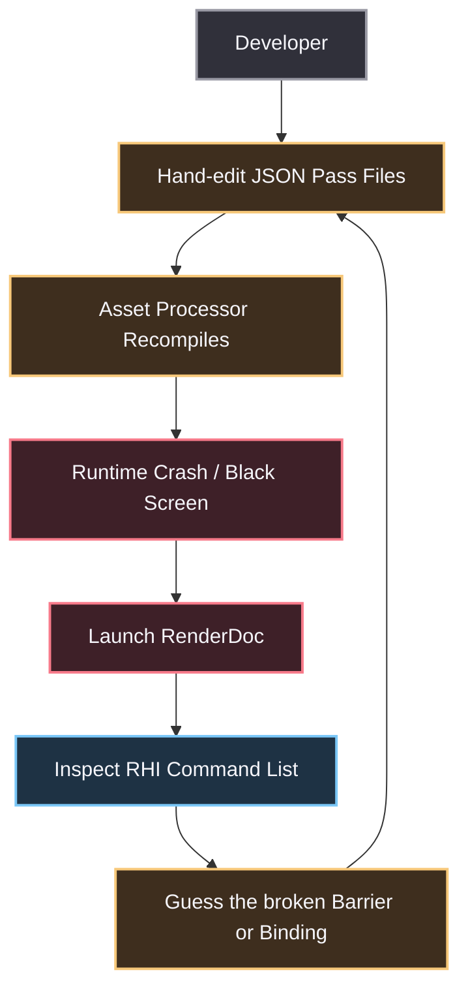
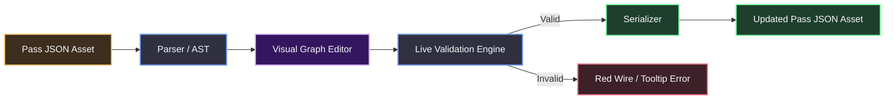
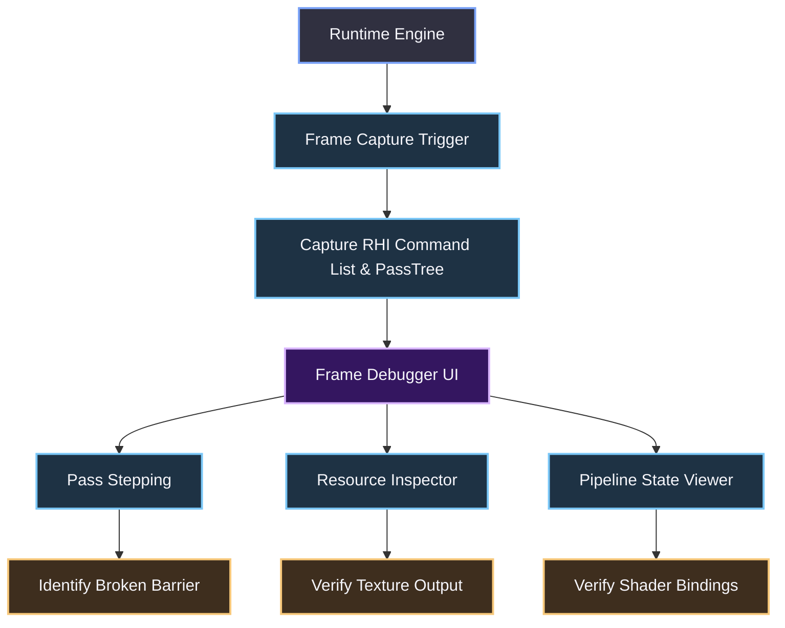
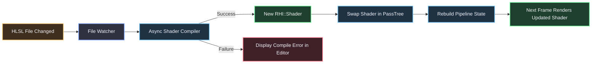

### The Problem: JSON Archaeology and Blind Debugging

The current Atom workflow expects you to author complex rendering pipelines by hand-editing JSON files (`.pass`, `.materialpipeline`). Open `PassAsset.h` and `PassTemplate.h`. The engine demands that you manually define the `PassTree`, `PassAttachmentBindings`, and resource dependencies in raw text. There is no schema validation. There is no visual feedback. If you typo a `PassAttachmentBinding` name, the engine either silently fails to render or hard-crashes on a GPU barrier violation. You are doing archaeology in a text editor.

Then there is the shader debugging pipeline. Look at the `ShaderAssetBuilder` discussed in your worktree analysis. The build system strips out debugging information. It does not preserve PDBs (Program Database files) for DX12 or proper debug symbols for Vulkan. When a shader renders a black screen or crashes the driver, you are left with two options: `RenderDoc`, or guessing. The `AssetProcessor` does not hot-reload shaders effectively. You tweak a line of HLSL, wait for a recompile, restart the engine, and realize the bug is still there. This is a terrible iteration loop.



### The Solution: Visual Pass Editor, Runtime Frame Debugger, and Live Shader Debugging

We need to attack this on three fronts: authoring, runtime inspection, and shader compilation. 

#### 1. The Visual Pass Graph Editor (Authoring)

Stop treating `.pass` files as text. Treat them as visual graphs. Atom already has the concept of a `PassTree` (a directed acyclic graph). We need a visual editor that parses the JSON into an AST (Abstract Syntax Tree) and renders it as a node graph. 

**Architecture of the Visual Pass Editor:**
*   **Parser:** Reads `.pass` JSON and maps it to `PassNode`, `ResourceNode`, and `BindingNode` structures.
*   **Graph Renderer:** Uses O3DE's existing Qt/ImGui editor framework to draw nodes and wires. 
*   **Live Validation:** As you drag wires, the editor validates the connection. Does the `PassAttachmentBinding` match the `RHI::Format` of the input? Does the `PipelineViewTag` exist in the `Scene`? If not, the wire turns red.
*   **Serializer:** Once the graph is valid, it serializes the AST back to JSON.



**The Editor Data Structures (C++):**
```cpp
namespace Atom::Editor {

    struct PassNode {
        AZ::Name m_passName;
        AZ::Name m_templateName;
        std::vector<PassAttachmentBinding> m_bindings;
    };

    struct ResourceNode {
        AZ::Name m_resourceName;
        RHI::Format m_format;
        RHI::ResourceState m_initialState;
    };

    struct GraphEdge {
        uint32_t m_sourceNodeId;
        uint32_t m_targetNodeId;
        AZ::Name m_sourceSlot;
        AZ::Name m_targetSlot;
    };

    class PassGraphEditor {
    public:
        void LoadFromJson(const AZStd::string& jsonString);
        void RenderGraph();
        void ValidateGraph();
        AZStd::string SerializeToJson();
    private:
        AZStd::vector<PassNode> m_nodes;
        AZStd::vector<GraphEdge> m_edges;
    };
}
```

#### 2. The Runtime Frame Debugger (Inspection)

Hand-editing and visual editing are only half the battle. When the frame renders incorrectly, you need to inspect the exact state of the GPU. You cannot rely on external tools like RenderDoc for everyday iteration; it is too slow and disconnected from the engine's `PassTree`.

We build a **Runtime Frame Debugger** directly into the engine.

**Features:**
*   **Frame Capture:** Capture a single frame's `RHI::CommandList` and `CompiledRenderGraph` (from Method 2) or `PassTree`.
*   **Pass Stepping:** Replay the frame one pass at a time. See the exact `RHI::ResourceBarrier` transitions inserted by the compiler.
*   **Resource Inspector:** Click on any `PassNode` to view its input and output textures in a side panel. See the actual pixels.
*   **Pipeline State View:** Inspect the active `RHI::PipelineState`, shader bytecode, and bound `ShaderResourceGroup` (SRG) data for each draw call.



**Implementation Strategy:**
*   Hook into `RPI::RPISystemInterface::RenderTick()`. 
*   Introduce a `FrameCaptureManager` that serializes the `RHI::CommandList` into a binary blob when a specific console command (`r_captureFrame`) is issued.
*   The `FrameDebugger` UI reads this blob, maps the RHI calls back to the high-level `Pass` objects, and renders the UI overlay.

#### 3. Live Shader Debugging & Hot-Reload

This is the most critical fix for artist workflow. The `ShaderAssetBuilder` must be rewritten to support proper debugging and live patching.

**A. Fixing the Shader Build Pipeline (PDB Generation)**
Currently, the build system strips debug symbols. We need to modify the `ShaderAssetBuilder` to:
1.  Detect the build configuration (Debug, Profile, Release).
2.  In Debug/Profile configurations, pass the `-Zi` flag (for DX12/DXC) or `-g` flag (for Vulkan/SPIR-V) to the shader compiler.
3.  Ensure the `.pdb` files are copied to the `Cache/pc/` directory alongside the compiled `.azshader` assets.
4.  Configure the `RHI` backend to load the PDB when a shader is created, enabling `PIX` (Windows) or `RenderDoc` (cross-platform) to display the HLSL source code during a debug session.

```cpp
// Inside ShaderAssetBuilder.cpp
if (buildConfig == BuildConfig::Debug || buildConfig == BuildConfig::Profile) {
    // Inject debug flags based on the platform
    if (platform == Platform::Windows) {
        compilerArguments.push_back("-Zi"); // Generate debug info
        compilerArguments.push_back("-Od"); // Disable optimization
    } else if (platform == Platform::Vulkan) {
        compilerArguments.push_back("-g");  // Generate SPIR-V debug info
    }
    // Preserve the PDB/SPIR-V debug files in the output directory
    preserveDebugSymbols(outputPath);
}
```

**B. The Hot-Reload Pipeline**
We implement a file watcher that monitors `.azshader` and `.hlsl` files. When a file is saved:
1.  The watcher triggers an asynchronous recompile on a background thread.
2.  If the compile succeeds, the new `RHI::Shader` is created.
3.  The `RPI::RenderPipeline` is notified. It iterates through its `PassTree` and swaps the old shader handle for the new one.
4.  The `RHI::PipelineState` (PSO) is rebuilt if the shader's vertex layout or render state changed.
5.  The next frame renders with the new shader. No engine restart. No loading screens.



**C. Live Shader Patching (Advanced)**
For rapid iteration, we can implement a "Live Patch" system. Instead of recompiling the entire shader, the engine injects a `#define` or modifies a constant buffer. 
*   The `Editor` sends a patch request to the `RHI` backend.
*   The `RHI` backend uses `D3D12`'s `ID3D12ShaderReflection` or `Vulkan`'s `VkPipelineExecutableInfoKHR` to hot-swap a specific shader stage without rebuilding the entire PSO. 
*   This allows changing a single line of code (e.g., changing `float3 color = float3(1,0,0)` to `float3(1,1,0)`) and seeing the result in milliseconds.

### Migration & Implementation Phases

**Phase 1: Shader Debugging Fixes (Immediate)**
Modify `ShaderAssetBuilder.cpp` to inject `-Zi` / `-g` flags and preserve PDBs. This is a build system change that requires no runtime engine modification. It immediately improves the debugging experience in RenderDoc.

**Phase 2: Shader Hot-Reload (Short-Term)**
Implement the file watcher and asynchronous recompiler. Add a `SwapShader(RHI::ShaderHandle oldShader, RHI::ShaderHandle newShader)` function to `RPI::Pass`. Wire the watcher to call this function.

**Phase 3: Runtime Frame Debugger (Medium-Term)**
Implement `FrameCaptureManager` in `Atom/RPI`. Serialize `RHI::CommandList` to a binary blob. Create a standalone UI (or an Editor panel) that reads the blob and visualizes the `PassTree` execution, resource states, and textures.

**Phase 4: Visual Pass Graph Editor (Long-Term)**
Build the `PassGraphEditor` in the O3DE Editor. Parse `.pass` JSON to AST. Render nodes and wires. Implement live validation. Serialize back to JSON.

**Phase 5: Integration with Render Graph (Method 2)**
If the Render Graph (Method 2) is adopted, the Visual Pass Graph Editor simply becomes a frontend for the `RenderGraphBuilder`. The `FrameDebugger` visualizes the `CompiledRenderGraph` instead of the `PassTree`. The hot-reload system triggers a graph recompile instead of a shader recompile.