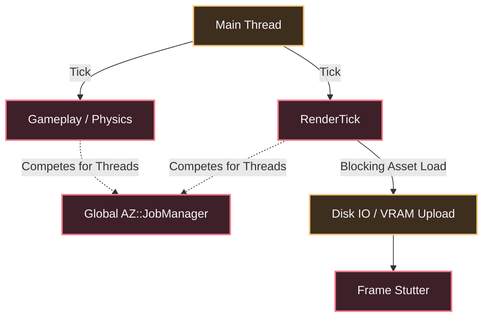
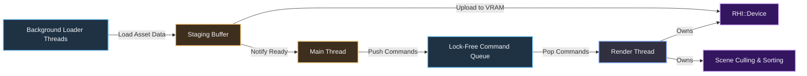

### The Problem: Blocking the Main Thread and Global Job Contention

Look at `Scene.h`. The `Simulate()` and `PrepareRender()` functions accept an `RHI::JobPolicy`. This implies multithreading, but it relies on `AZ::JobCompletion` and the global `AZ::JobManagerComponent` registered in `ComponentApplication.cpp`. 

This creates two critical flaws:

First, the renderer shares the global job pool with gameplay logic, physics, and animation. A heavy physics simulation will starve the renderer of worker threads, causing frame drops.

Second, asset loading is inherently blocking. The `AssetManagerComponent` and `AssetCatalogComponent` (`ComponentApplication.h`) load assets synchronously on the main thread or via a job system that still requires the main thread to wait for completion before proceeding. If you load a 4K texture, the entire engine stutters. There is no dedicated render thread. The `main.cpp` loop calls `app.Tick()` and `rpiSystem->RenderTick()` on the same thread.



### The Solution: Dedicated Render Thread & Async Streaming

We separate the engine into two distinct execution contexts: the Main Thread (Gameplay) and the Render Thread (GPU). The Main Thread simulates the world. The Render Thread culls, sorts, and submits RHI commands. They communicate via a lock-free command queue. Assets are loaded asynchronously on background threads and uploaded directly to the GPU via staging buffers.



### Technical Implementation: The Render Thread

The `Renderer` class (from Method 1) spawns a dedicated thread during initialization. The `RHI::Device` is created on and owned by this thread. The Main Thread never touches the `RHI::Device` directly.

```cpp
namespace Atom::RPI {

class RenderThread {
public:
    void Start() {
        m_thread = AZStd::thread([this]() {
            // 1. Initialize RHI Device on this thread
            m_rhiDevice = RHI::Device::Create(m_backend);
            
            // 2. Main Render Loop
            while (m_running) {
                // Wait for commands from the main thread
                Command cmd = m_commandQueue.Pop();
                ExecuteCommand(cmd);
                
                // Render the frame
                m_scene->Render(m_rhiDevice);
            }
        });
    }

    void SubmitCommand(Command&& cmd) {
        m_commandQueue.Push(AZStd::move(cmd));
    }

private:
    AZStd::thread m_thread;
    RHI::Ptr<RHI::Device> m_rhiDevice;
    LockFreeQueue<Command> m_commandQueue;
    AZStd::atomic_bool m_running{ true };
};

} // namespace Atom::RPI
```

### Asynchronous Asset Streaming

The current `AssetManager` forces the Main Thread to wait for `AssetCatalog` lookups and disk IO. We replace this with a `StreamingManager` that operates entirely on background threads.

**The Streaming Pipeline:**
1.  **Request:** The Main Thread requests an asset (e.g., "Textures/Rock.dds"). It receives a future handle (`AZStd::future<AssetHandle>`).
2.  **Load:** A background thread reads the file from disk into a raw byte buffer.
3.  **Stage:** The raw bytes are copied into a `RHI::StagingBuffer` (a CPU-visible, GPU-invisible buffer).
4.  **Upload:** The `StreamingManager` pushes a command to the Render Thread's `LockFreeQueue`. The Render Thread copies the staging buffer to a `RHI::Texture` (VRAM) and signals a fence.
5.  **Ready:** Once the fence is reached, the `StreamingManager` marks the asset as ready. The Main Thread polls the future handle and attaches the `RHI::Texture` to the `Scene`.

```cpp
namespace Atom::RPI {

class StreamingManager {
public:
    AZStd::future<AssetHandle> LoadTextureAsync(const AZStd::string& path) {
        return AZStd::async([this, path]() {
            // 1. Disk Read
            auto fileData = FileIO::Read(path);
            
            // 2. Create Staging Buffer
            auto stagingBuffer = m_rhiDevice->CreateStagingBuffer(fileData.size());
            memcpy(stagingBuffer->GetCpuAddress(), fileData.data(), fileData.size());
            
            // 3. Queue Upload to Render Thread
            m_renderThread.SubmitCommand(UploadTextureCommand{
                .stagingBuffer = stagingBuffer,
                .targetTexture = CreateTextureDesc(path)
            });
            
            // 4. Wait for GPU Fence (non-blocking for Main Thread)
            return m_fenceManager.WaitForFence(stagingBuffer);
        });
    }
};

} // namespace Atom::RPI
```

### Lock-Free Command Queue

To prevent the Main Thread from stalling when the Render Thread is busy, we use a Single-Producer Single-Consumer (SPSC) lock-free queue. The Main Thread pushes `Command` structs. The Render Thread pops them.

```cpp
template<typename T>
class LockFreeQueue {
public:
    void Push(T&& item) {
        // ... atomic ring buffer implementation ...
    }

    T Pop() {
        // ... atomic ring buffer implementation ...
    }

private:
    // Circular buffer with atomic head/tail indices
    AZStd::atomic<uint32_t> m_head{ 0 };
    AZStd::atomic<uint32_t> m_tail{ 0 };
    AZStd::vector<T> m_buffer;
};
```

### Integration with Method 1 (Decoupling)

This method is the natural conclusion of Method 1. If we want a standalone renderer, we must own our thread. We cannot rely on the `ComponentApplication` to tick our render loop. The `Atom::Renderer` starts the `RenderThread`, and the user's `main()` loop simply pushes simulation commands.

```cpp
// User Main Loop
while (renderer.IsRunning()) {
    // 1. Main Thread: Update Gameplay
    gameplay.Update(deltaTime);
    
    // 2. Main Thread: Submit Render Commands (non-blocking)
    renderer.SubmitCameraUpdate(camera);
    renderer.SubmitDrawCall(meshHandle);
    
    // 3. Main Thread: Poll Asset Futures
    if (rockTextureFuture.IsReady()) {
        scene->AttachTexture(rockTextureFuture.Get());
    }
    
    // 4. Render Thread: Renders the frame independently
}
```

### Migration Strategy

**Phase 1: Staging Buffer Uploads (Short-Term)**
Implement the `StagingBuffer` path. Instead of creating `RHI::Texture` objects directly on the Main Thread, use a staging buffer and upload via the `RHI::Device`. This is a prerequisite for multi-threading.

**Phase 2: Async Asset Loading (Medium-Term)**
Introduce `StreamingManager`. Keep the Main Thread loop, but defer asset loading to background threads. The Main Thread receives a future handle and polls it.

**Phase 3: Dedicated Render Thread (Long-Term)**
Move the `RHI::Device` to a dedicated thread. Implement the `LockFreeQueue`. The Main Thread only pushes commands. This eliminates all GPU-related stalls on the Main Thread.

**Phase 4: Render Thread Job System (Advanced)**
Give the Render Thread its own `JobManager` (separate from the global `AZ::JobManager`). The Render Thread can now parallelize culling, sorting, and command list generation across its own worker threads without interfering with gameplay.