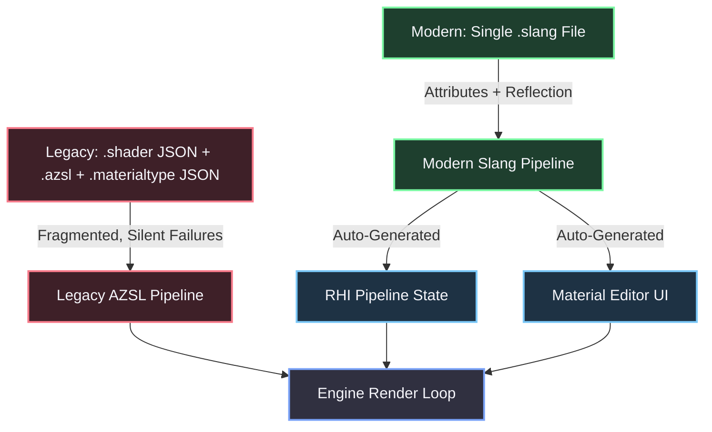
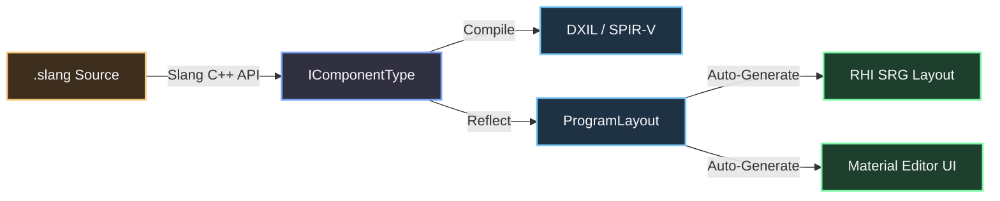
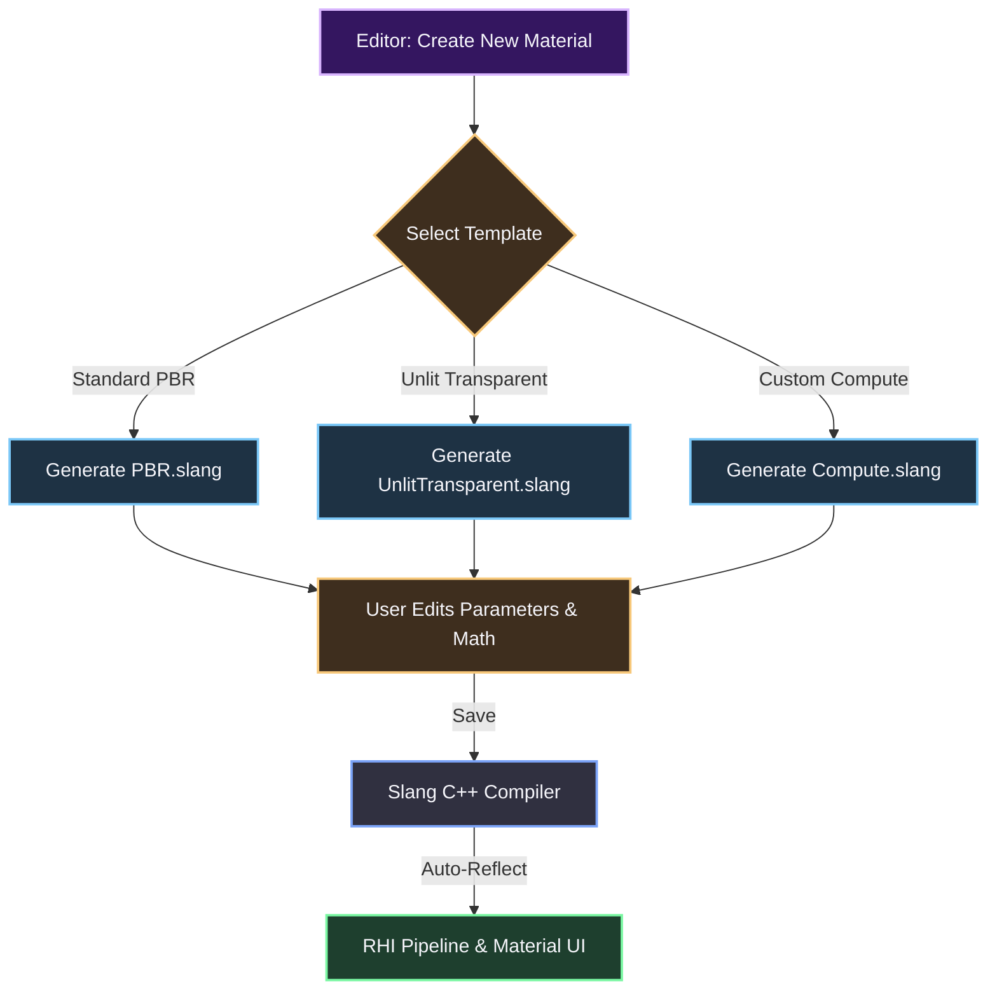
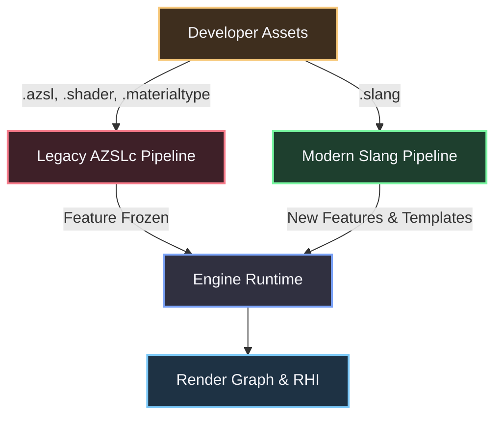

# Method 7: The Slang Shader & Material Compiler Pipeline

### The Core Thesis: State Fragmentation and the Dead-End of AZSL

The current Atom material architecture forces developers to manually synchronize state across three disconnected authorities:
1.  **`.shader` JSON**: Defines the RHI pipeline state (blend, depth, cull).
2.  **`.azsl`**: Defines the shader logic and Shader Resource Group (SRG) layouts.
3.  **`.materialtype` JSON**: Defines the properties exposed to the Material Editor.

Because these files are authored independently, the engine is forced to guess intent when they disagree. This results in catastrophic silent failures: if a developer uses a standard HLSL enum (`SourceAlpha`) instead of the obscure O3DE equivalent (`AlphaSource`), the JSON parser fails and the engine silently falls back to an Opaque render state. Furthermore, `AZSLc` (the AZSL transpiler) routinely optimizes out SRGs, causing Material Editor sliders to become dead UI elements with no compiler warning. 

To make material authoring predictable and advanced graphics accessible, we must pivot to **Slang**, an open-source, actively maintained HLSL superset. By linking `slang.lib` directly into the C++ engine, we eliminate the external transpiler, kill the JSON schemas, and use Slang's C++ Reflection API to drive the entire material and pipeline state.



---

### 1. Kill the JSON (Attribute-Driven Pipelines)

**The Problem:** Developers must manually synchronize RHI states in `.shader` JSON with properties in `.materialtype` JSON. If a shader outputs alpha but the JSON lacks a `BlendState`, the engine silently renders it as Opaque. 

**The Improvement:** For the Slang path, we push all RHI state and UI definitions directly into the shader using attributes. The C++ host compiler reads these attributes via the Slang Reflection API and generates both the `RHI::PipelineState` and the Material Editor UI directly from the code.

```slang
// StandardMaterial.slang

[BlendState(SourceAlpha, InvSourceAlpha, Add)]
[DepthStencilState(DepthTest: Less, DepthWrite: Off)]
[RenderState(CullMode: Back)]
[ParameterBlock]
struct MaterialParams {
    float3 BaseColor [[UI_Color]];
    float Roughness [[UI_Slider(0.0, 1.0)]];
    Texture2D AlbedoTexture [[UI_Texture]];
};

[shader("fragment")]
float4 fragmentMain(VSOutput input) : SV_Target {
    // ... shader math ...
}
```

**How C++ handles it:**
*   The C++ `MaterialCompiler` uses `slang::ProgramLayout` to read the `BlendState` and `DepthStencilState` attributes and constructs the `RHI::PipelineStateDescriptor` entirely in C++. If the shader writes to `SV_Target.a` but lacks a `BlendState`, the compiler throws a hard error. No silent Opaque fallbacks.
*   It reads the `MaterialParams` struct. The `[[UI_Slider]]`, `[[UI_Color]]`, and `[[UI_Texture]]` attributes are parsed by the C++ engine to automatically generate the Material Editor UI.
*   **Result:** No `.shader` JSON. No `.materialtype` JSON. One `.slang` file contains the logic, the RHI state, and the UI layout.

---

### 2. True C++ / Slang Integration (The End of Dead Sliders)

**The Problem:** `AZSLc` optimizes out the `ShaderResourceGroup` (SRG), and the Material Editor sliders go dead. The engine provides no feedback.

**The Fix:** Atom links directly against the Slang C++ library (`slang.lib`). The engine initializes a global Slang `IGlobalSession` and creates an `ISession` for the renderer. When a shader is loaded, the C++ host creates a `slang::IComponentType` from the module. 

Because we use the Slang Reflection API, the C++ host knows *exactly* what is in the SRG. If the UI expects a slider for `Roughness`, but the compiler optimized it out, the C++ reflection will fail to find the parameter, and the compile throws a hard error. 

```cpp
// C++ Host resolving a Slang Shader
slang::ComPtr<slang::IComponentType> program;
slang::ComPtr<slang::IBlob> diagnostics;
slang::ComPtr<slang::IBlob> code;

// Compile Slang to DXIL / SPIR-V directly in C++
module->getEntryPointCode(0, 0, code.writeRef(), diagnostics.writeRef());

// Extract Reflection Data for the Render Graph and Material UI
auto* programLayout = program->getLayout();
// Iterate parameters, build SRG layouts, and auto-generate UI
```

*   **Specialization:** Instead of compiling every permutation, C++ passes `SpecializationArgs` to the Slang API. The shader compiles instantly for that specific state, or you use Slang's `[Specialization]` attributes to let the GPU handle it.



---

### 3. Slang Interfaces & Generics (Advanced Graphics Made Easy)

**The Problem:** In AZSL, writing renderer passes that interact with different material types (e.g., Opaque vs. Transparent) requires massive, unmaintainable shader permutation explosions. 

**The Fix:** Slang supports interfaces and generics. You define a material interface, and the C++ engine binds the specific implementation to the generic pass at runtime.

```slang
interface IMaterialEvaluator {
    float4 EvaluateSurface(float3 worldPos);
};

struct OpaqueMaterial : IMaterialEvaluator { ... }
struct TransparentMaterial : IMaterialEvaluator { ... }

[shader("compute")]
void csMain(ParameterBlock<SceneData> scene, IMaterialEvaluator material) {
    float4 color = material.EvaluateSurface(pos);
}
```

**How C++ handles it:** The C++ engine holds a `Material` object that wraps the Slang `IComponentType`. When the renderer needs to draw, it binds the specific material implementation to the generic pass via the Slang C++ API. This completely eliminates shader permutation hell for complex rendering techniques.

---

### 4. Render Graph & Slang Modules (Auto-Binding Resources)

**The Problem:** Sampling global resources (like scene depth or motion vectors) requires manually including specific `.azsli` files and writing platform-specific math (like reversed-Z reconstruction). It frequently breaks the renderer.

**The Fix:** Slang supports modules. The engine ships pre-compiled core modules (e.g., `Atom.Core`, `Atom.SceneDepth`). 

```slang
// MyCustomPass.slang
import Atom.SceneDepth;
import Atom.Transforms;

[shader("fragment")]
float4 fragmentMain(VSOutput input) : SV_Target {
    float linearDepth = SceneDepth::GetLinearDepth(input.screenUV);
    float3 worldPos = Transforms::GetWorldPosition(input);
}
```

**How C++ handles it:** The C++ `RenderGraphCompiler` inspects the Slang AST. It sees the dependency on `Atom.SceneDepth`. The Render Graph automatically allocates the depth texture, injects the `RHI::ResourceBarrier`, and binds it to the parameter block. The developer never touches SRGs or barriers; C++ and the Render Graph handle the memory management and synchronization.

---

### 5. The Zero-Config Template System (Instant Onboarding)

**The Problem:** Even with a simplified Slang pipeline, a developer still has to write the `ParameterBlock`, define the `[shader("fragment")]` entry points, and set up the RHI attributes. For 90% of use cases (Standard PBR, Unlit, Transparent, Post-Process), this is repetitive boilerplate. It creates friction for new users who just want to get to work.

**The Fix:** We provide an official **Template Registry** built directly into the Editor. When a user creates a new material or shader, they select a template. The engine generates a fully functional, pre-configured `.slang` file with standard parameters, RHI states, and a basic lighting model already wired up.

**Technical Implementation:**
*   The templates are shipped as read-only `.slang` assets (e.g., `Templates/StandardPBR.slang`, `Templates/UnlitTransparent.slang`, `Templates/PostProcessCompute.slang`).
*   When selected, the C++ Editor code instantiates a copy of the template, renames the struct and entry points, and assigns a new UUID.
*   The user opens the file and is immediately greeted with working code. They can delete unused parameters, add their own `[[UI_Slider]]` attributes, and hit compile. The C++ Reflection API handles the rest.

```slang
// Example: Generated from the "Unlit Transparent" Template

[BlendState(SourceAlpha, InvSourceAlpha, Add)]
[DepthStencilState(DepthTest: Less, DepthWrite: Off)]
[RenderState(CullMode: Back)]
[ParameterBlock]
struct UnlitTransparentParams {
    float4 BaseColor [[UI_Color]];
    float Opacity [[UI_Slider(0.0, 1.0)]];
    Texture2D ColorTexture [[UI_Texture]];
};

[shader("fragment")]
float4 fragmentMain(VSOutput input) : SV_Target {
    float4 texColor = ColorTexture.Sample(LinearSampler, input.uv);
    float4 finalColor = texColor * BaseColor;
    finalColor.a *= Opacity;
    return finalColor;
}
```



**Why this works:** It solves the "blank page" problem. The user doesn't need to read a 50-page manual on Slang attributes or RHI state mapping to render a transparent object. The template handles the boilerplate, they handle the art.

---

### 6. The Community Strategy: Strategic Coexistence (No Forced Migration)

**The Reality:** The community will riot if we hard-deprecate AZSL and break backwards compatibility overnight. We will not force a migration, and we will not build a buggy transpiler.

**The Strategy:** We run both pipelines in parallel. The engine checks the file extension (`.azsl` vs `.slang`) and routes it to the appropriate compiler. 

However, **sacrifices are required to move the engine forward.** The sacrifice is feature stagnation for the legacy path.

1.  **The Legacy Path (AZSL):** Maintained, but frozen. If a developer uses `.azsl`, `.shader`, and `.materialtype`, their code continues to work exactly as it does today. But they do not get Render Graph auto-binding. They do not get Slang generics. They do not get the new UI attribute generation or the Zero-Config Templates.
2.  **The Modern Path (Slang):** The future. All new advanced features (auto-barriers, generic materials, C++ reflection, template generation) are exclusive to Slang.
3.  **Easing Them In:** We provide a **C++ Source-to-Source Tool** in the Editor. It takes an AZSL file and generates a baseline Slang file with the JSON attributes pre-filled. It won't be perfect, but it gives them a 90% head start on migration.

**Why this works:**
We respect their backwards compatibility. We don't break their existing projects. But we make it clear that the industry is moving toward advanced graphics, and the only way to access those features in Atom is through Slang. The community migrates voluntarily because the "carrot" (Slang's power and the Zero-Config Templates) is too good to ignore, and the "stick" (AZSL stagnation) becomes unbearable for serious graphics programmers.



---

### Summary of the Improved Architecture

1.  **One File (Slang Path):** `.slang` replaces `.shader`, `.materialtype`, and `.azsl`. 
2.  **Attribute-Driven:** Slang attributes define RHI state and UI sliders, eliminating JSON synchronization.
3.  **C++ as the Host:** The C++ `MaterialCompiler` uses the Slang Reflection API to generate SRGs, UI, and PipelineStates, turning silent failures into hard compile errors.
4.  **Render Graph Auto-Binding:** The C++ Render Graph compiler reads Slang module imports and automatically binds resources and barriers.
5.  **Generics:** Slang interfaces allow for advanced, material-agnostic rendering techniques without permutation explosions.
6.  **Zero-Config Templates:** Built-in material templates eliminate boilerplate, allowing developers to get to work instantly.
7.  **Strategic Coexistence:** AZSL and Slang run in parallel. No forced deprecation, but AZSL is feature-frozen. New features are Slang-only, incentivizing voluntary migration while preserving backwards compatibility.**