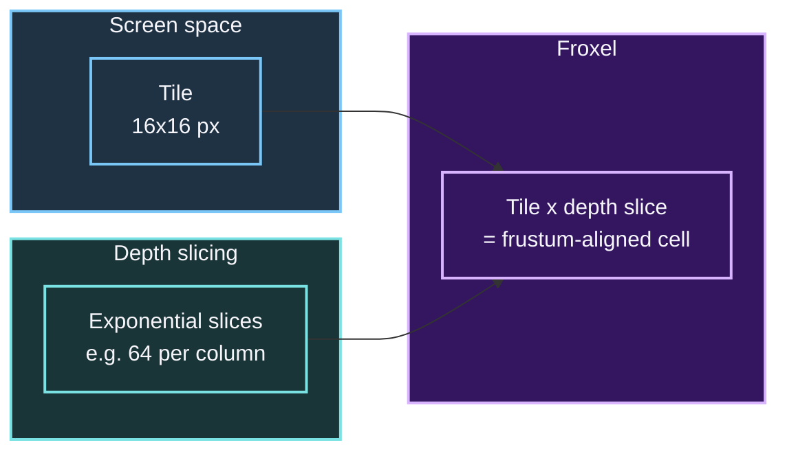
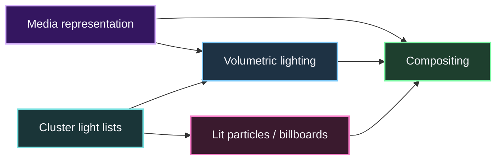
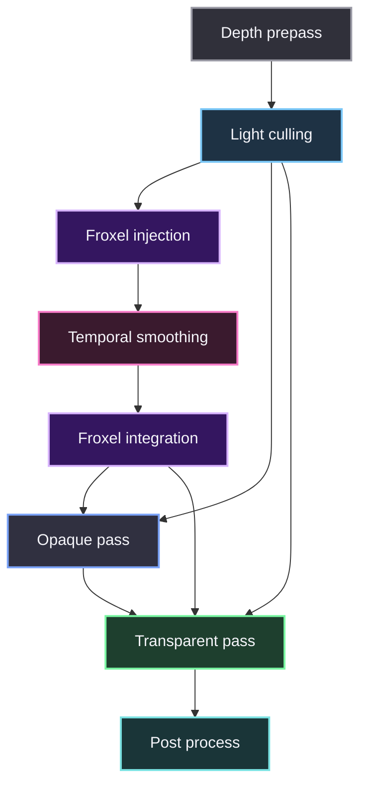
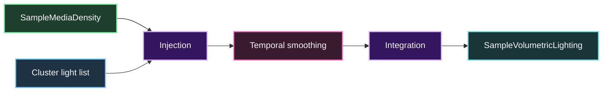
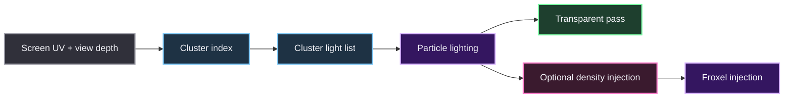
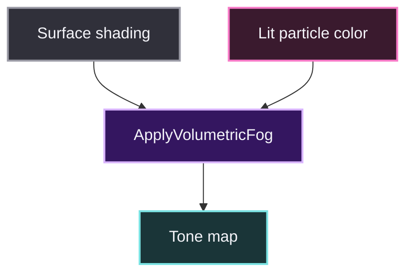

# Volumetrics in a Forward+ renderer

Volumetric fog, smoke, and light shafts in a Forward+ renderer. Assumes an existing depth prepass, clustered light culling, per-cluster light lists, and a transparent pass. Reuses those light lists instead of adding a separate lighting path.

## What a froxel is

A **froxel** is a *frustum-aligned voxel*: one cell in a 3D grid that subdivides the camera's view frustum. It is the volumetric cousin of the 2D screen tile used by tiled forward rendering.

- A **tile** is a 2D rectangle of screen pixels (e.g. 16x16 px).
- A **voxel** is a 3D cube in world space.
- A **froxel** is a 2D tile extruded along the view ray in *depth slices*, with slice boundaries chosen in view space (usually exponentially so near-camera slices are thinner).

Every pixel of the screen maps to exactly one froxel column per depth slice. Froxels let you compute lighting, density, and scattering **once per cell** instead of once per pixel, then sample the result per pixel. That is the performance trick that makes real-time volumetric fog feasible.



A froxel volume is stored as a 3D texture, typically `RGBA16F`, where RGB holds accumulated in-scattered light and A holds extinction (or transmittance). Because froxel grids align with cluster grids in most Forward+ engines, the same light culling data can drive both.

## Scope

Every volumetric system answers one question per fragment or froxel:

> How much light is scattered toward the camera along the view ray through media, and how much is extinguished?

That splits into three modules that can ship independently.

<table>
  <thead>
    <tr>
      <th>Module</th>
      <th>Responsibility</th>
      <th>Depends on</th>
    </tr>
  </thead>
  <tbody>
    <tr><td>A. Media representation</td><td>Where fog/smoke/dust exists and its density</td><td>Nothing</td></tr>
    <tr><td>B. Volumetric lighting</td><td>In-scattering and extinction inside media</td><td>Cluster light lists, shadow maps</td></tr>
    <tr><td>C. Compositing</td><td>Applying fog color and transmittance to surfaces</td><td>Opaque and transparent passes</td></tr>
  </tbody>
</table>



## Contracts

Define and freeze these before writing passes. Everything downstream uses them.

```text
ClusterIndexFromScreenUVAndDepth(uv, viewDepth) -> clusterIndex
GetClusterLightList(clusterIndex) -> lightList
SampleMediaDensity(worldPos) -> density
SampleVolumetricLighting(worldPos) -> {inscatter, transmittance}
ApplyVolumetricFog(surfaceColor, worldPos) -> color
```

Rules:

- `SampleMediaDensity` is the only place density is defined.
- `ApplyVolumetricFog` is the only place fog is composited.
- Particles and froxels use the same cluster lookup function.
- Transparent fragments use depth-prepass depth for cluster lookup when needed.

## Render graph placement



## Phase 0: Audit

Goal: identify insertion points and lock the contracts.

Tasks:

- Map render graph: depth prepass, culling, opaque, transparent, post, debug views.
- Document light list format: SSBO/texture layout, max lights per cluster.
- Document transparent sorting and blending rules.
- Add test scenes:
  - height fog with a moving spotlight
  - local smoke volume with a flashlight
  - dust particles lit by emergency lights
  - transparent particles inside fog

Deliverables: integration map, shared shader header with contracts, baseline GPU timings.

Done when: opaque rendering is unchanged and every future pass has a named insertion point.

## Phase 1: Media representation

Goal: define where media exists, independent of lighting.

Tasks:

- Analytic media: height fog, optional distance fog, local sphere/box volumes with soft falloff.
- Volume-texture media: 3D density texture with tiling, scrolling, noise modulation, fixed world-to-UV mapping.
- Particle-derived density: written into the same representation, behind a flag.
- Implement `SampleMediaDensity` combining all three.

Deliverables: media authoring components, density function, density debug view.

Done when: density can be inspected in isolation and does not change when lights change.

## Phase 2: Volumetric lighting

Goal: compute in-scattering and extinction using the existing cluster light data. Two options, can coexist.

### B1: Froxel fog (default)



- Froxel grid matches or derives from cluster grid.
- Exponential depth slicing aligned with cluster slicing.
- 3D texture stores scattering (RGB) and extinction (A), e.g. `RGBA16F`.
- Injection: sample density, read cluster light list, accumulate in-scattering per light.
- Integration: march each froxel column, output fog color and transmittance.
- Temporal smoothing: reproject previous volume, clamp blend.

### B2: Ray march (fallback or high quality)

- March from camera to depth-prepass depth.
- Sample density and cluster light list at each step.
- Accumulate scattering and transmittance.
- Jitter with blue noise and temporally reproject.
- Optional half-resolution march with bilateral upsample.

Shared lighting rules:

- Use only the cluster light list for the fragment or froxel.
- Shadow sampling is optional per light; document which light types support shadows in media.
- Phase function: isotropic by default; Henyey-Greenstein optional per light.

Deliverables: froxel pipeline and/or ray-march pipeline, `SampleVolumetricLighting`.

Done when: a moving spotlight produces stable light shafts, and cost scales with froxel resolution or step count rather than total light count.

## Phase 3: Lit particles and billboard media

Goal: render transparent particles and large smoke volumes lit by the same cluster light lists, and optionally let them contribute density.



Tasks:

- Particle pixel shader computes screen UV and view depth, calls `ClusterIndexFromScreenUVAndDepth`, fetches `GetClusterLightList`, loops over only those lights.
- Render as transparent, depth-tested, depth-write-off.
- Billboard/impostor smoke volumes use the same lighting path; optional proximity fade when the camera enters the volume.
- Optional particle-to-media bridge: particles inject density into the froxel media behind a flag.

Deliverables: lit transparent shader path, optional particle density injection pass.

Done when: particles and billboards respond to dynamic lights, are fogged exactly once, and do not depend on a deferred G-buffer for transparent lighting.

## Phase 4: Compositing

Goal: apply volumetric lighting to opaque and transparent surfaces without double-fogging.



Tasks:

- Opaque pass: after shading, call `ApplyVolumetricFog(surfaceColor, worldPos)`.
- Transparent pass: particles and billboards compute their own lit color, then apply the same fog function once.
- Do not apply fog to already-fogged post-process effects.
- Fog is applied after surface lighting and before tone mapping.

Deliverables: updated opaque/transparent shader includes, render graph wiring.

Done when: opaque and transparent objects are fogged consistently and there are no double-fog artifacts on particles inside smoke.

## Phase 5: Fallbacks

Ship only what your targets need. Each fallback preserves the `ApplyVolumetricFog` contract so opaque and transparent passes do not change.

<table>
  <thead>
    <tr>
      <th>Technique</th>
      <th>When to use</th>
      <th>Notes</th>
    </tr>
  </thead>
  <tbody>
    <tr><td>Analytic fog only</td><td>Minimum spec / mobile</td><td>No froxel or ray march; <code>SampleVolumetricLighting</code> returns analytic result</td></tr>
    <tr><td>Half-res froxel + bilateral upsample</td><td>Mid-range GPUs</td><td>Cheaper injection and integration</td></tr>
    <tr><td>Ray march low step count</td><td>GPU without froxel support</td><td>Fewer steps, temporal accumulation</td></tr>
    <tr><td>Screen-space light shafts</td><td>Stylized look or very low end</td><td>Post-process radial blur from bright pixels; not physically grounded</td></tr>
  </tbody>
</table>

Done when: switching quality mode requires no shader rewrites in opaque or transparent passes.

## Phase 6: Quality scaling, profiling, rollout

Tasks:

- Quality presets: froxel resolution, ray-march step count, temporal on/off, shadow sampling in media, particle density injection.
- Fallback chain: froxel -> half-res froxel -> ray march low -> analytic fog.
- Profiling: GPU timings for injection, integration, temporal, ray march, transparent pass; light-list occupancy per cluster; froxel bandwidth.
- Feature flags, validated independently on target hardware:
  - Flag 1: lit transparent particles
  - Flag 2: froxel volumetric fog
  - Flag 3: particle density injection
  - Flag 4: temporal smoothing

Done when: every module can be disabled without breaking rendering, the low-end path meets frame budget, and the Phase 0 test scenes pass visual validation.

## Risks and mitigations

<table>
  <thead>
    <tr>
      <th>Risk</th>
      <th>Mitigation</th>
    </tr>
  </thead>
  <tbody>
    <tr><td>Transparent fragments lack reliable cluster depth</td><td>Use depth-prepass depth for cluster lookup; validate with debug view</td></tr>
    <tr><td>Froxel flicker with moving lights</td><td>Temporal reprojection with clamping; reduce injection noise</td></tr>
    <tr><td>Double fog on transparents</td><td>Single <code>ApplyVolumetricFog</code> function, applied once per fragment</td></tr>
    <tr><td>Light-list format too limited</td><td>Extend SSBO layout minimally; avoid rewriting culling</td></tr>
    <tr><td>Cost blowup on high light counts</td><td>Rely on cluster culling; cap max lights per cluster</td></tr>
    <tr><td>Particle density injection causes feedback</td><td>Inject only from a subset of particles; clamp density</td></tr>
  </tbody>
</table>

## Summary

Three decoupled modules: media representation, volumetric lighting via existing cluster light lists, and single-path compositing. Froxel fog is the default lighting method, ray marching is an optional high-quality path, and analytic and screen-space fallbacks are available. No technique is tied to any specific game or engine feature beyond the Forward+ cluster light data already present.