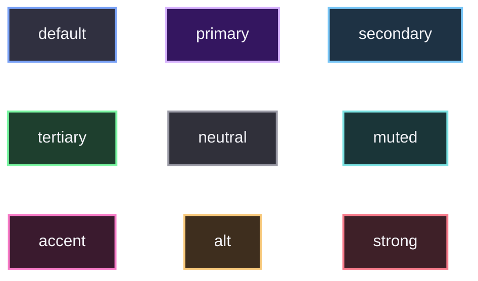
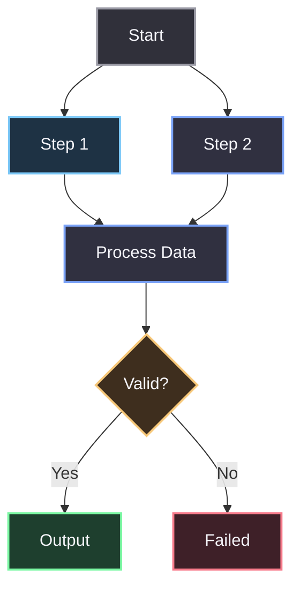
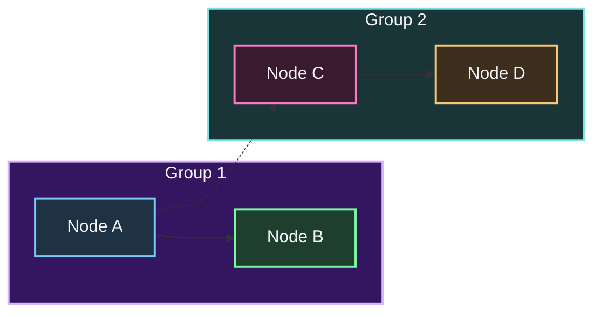
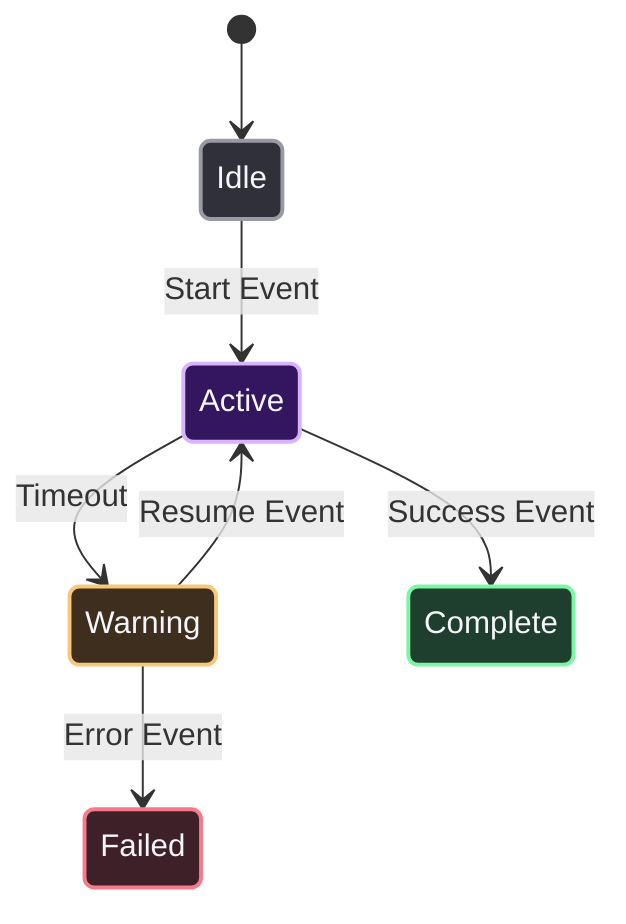
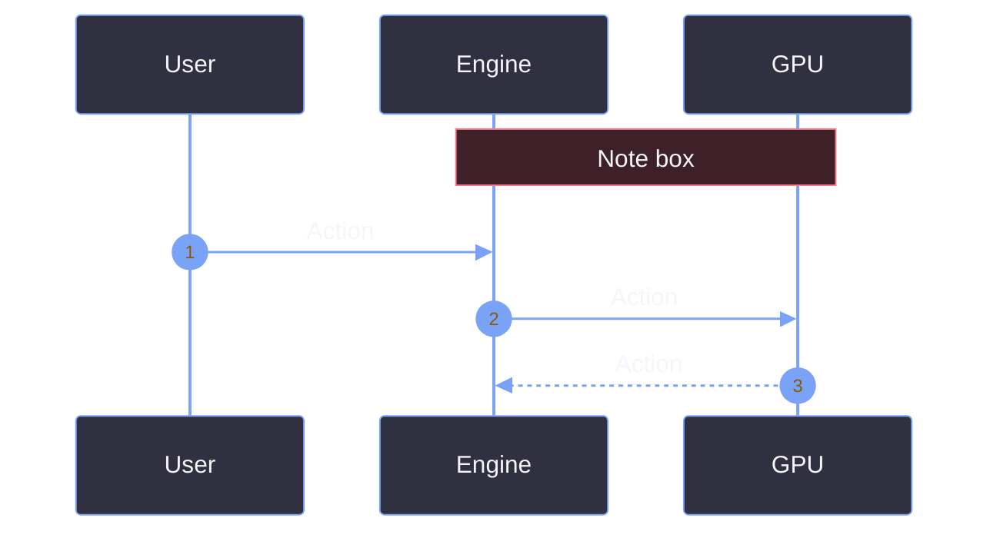

# Mermaid Palette (Quartz Fix)

Quartz themes mess up Mermaid's default diagram colors. I use these specific classes to force dark backgrounds and soft off-white text (`#f5f5fa`) so they look good and stay visible.

## 1. The Palette

Paste these `classDef` lines at the bottom of the flowchart code block. Don't use `%%{init}%%` headers for flowcharts.

```css
classDef default fill:#303040,stroke:#7aa2f7,stroke-width:2px,color:#f5f5fa;
classDef primary fill:#341660,stroke:#d8b4fe,stroke-width:2px,color:#f5f5fa;
classDef secondary fill:#1e3244,stroke:#7ac7f7,stroke-width:2px,color:#f5f5fa;
classDef tertiary fill:#1e3f2e,stroke:#7af7a2,stroke-width:2px,color:#f5f5fa;
classDef neutral fill:#30303a,stroke:#9a9aa5,stroke-width:2px,color:#f5f5fa;
classDef muted fill:#1a3538,stroke:#7ae2e2,stroke-width:2px,color:#f5f5fa;
classDef accent fill:#3a1a2e,stroke:#f77ac7,stroke-width:2px,color:#f5f5fa;
classDef alt fill:#3e2e1e,stroke:#f7c87a,stroke-width:2px,color:#f5f5fa;
classDef strong fill:#3e2028,stroke:#f77a8a,stroke-width:2px,color:#f5f5fa;
```

<table>
  <thead>
    <tr>
      <th>Class</th>
      <th>Background</th>
      <th>Stroke</th>
    </tr>
  </thead>
  <tbody>
    <tr><td><strong>default</strong></td><td><code>#303040</code></td><td><code>#7aa2f7</code></td></tr>
    <tr><td><strong>primary</strong></td><td><code>#341660</code></td><td><code>#d8b4fe</code></td></tr>
    <tr><td><strong>secondary</strong></td><td><code>#1e3244</code></td><td><code>#7ac7f7</code></td></tr>
    <tr><td><strong>tertiary</strong></td><td><code>#1e3f2e</code></td><td><code>#7af7a2</code></td></tr>
    <tr><td><strong>neutral</strong></td><td><code>#30303a</code></td><td><code>#9a9aa5</code></td></tr>
    <tr><td><strong>muted</strong></td><td><code>#1a3538</code></td><td><code>#7ae2e2</code></td></tr>
    <tr><td><strong>accent</strong></td><td><code>#3a1a2e</code></td><td><code>#f77ac7</code></td></tr>
    <tr><td><strong>alt</strong></td><td><code>#3e2e1e</code></td><td><code>#f7c87a</code></td></tr>
    <tr><td><strong>strong</strong></td><td><code>#3e2028</code></td><td><code>#f77a8a</code></td></tr>
  </tbody>
</table>

### Visual Reference


---

## 2. Flowcharts

Build the graph, paste the palette at the bottom, and assign classes using `class NodeID className;`.



---

## 3. Styling Subgraphs

Subgraphs ignore `classDef`. I have to give them an ID and use the `style` keyword after the `end` statement. I can still color the nodes inside them differently.



---

## 4. State Diagrams

State diagrams apply classes inline using `:::className` appended directly to the state name. 
*(Note: `default` is a reserved keyword in state diagrams and causes a parser error, so I use `base` for the first class here).*



---

## 5. The Sequence Diagram Exception

Sequence diagrams don't support `classDef`. I must use the `%%{init}%%` block at the top to map the colors.



---

## 6. Tips

*   **Line Breaks:** Use `<br/>` inside nodes.
*   **Formatting:** Use `<b>` / `<i>` or standard markdown `**bold**` inside nodes.
*   **Grouping:** `class A,B,C default;` to apply the same class to multiple nodes at once.